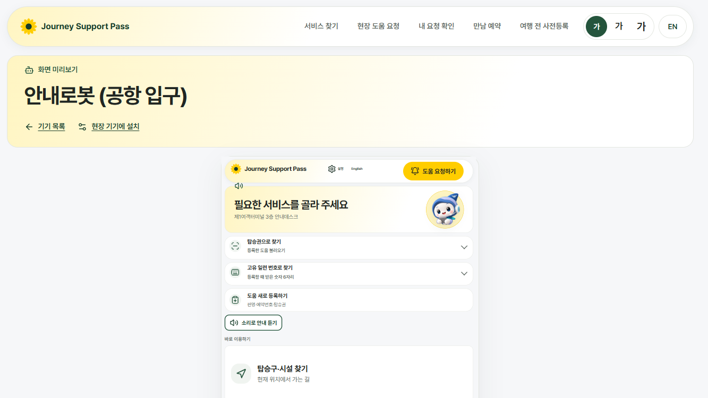
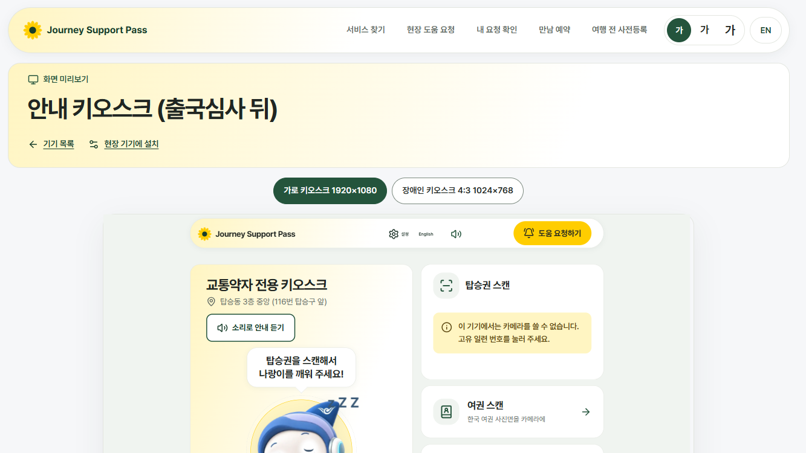
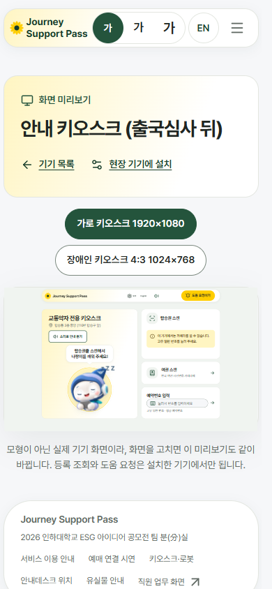

# 기기 화면 미리보기 — 실제 키오스크 화면 연동

`/devices` 의 「화면 미리보기」(`/devices/robot`, `/devices/kiosk`)는 실제 키오스크 화면이 아니라 따로 만든 **모형 화면**(`DevicePreview.tsx`)이었다. 키오스크를 고칠 때마다 모형을 따로 고쳐야 해서 서로 어긋났다.

## 바뀐 점
- 모형 화면을 없애고 **실제 키오스크 화면**(`/kiosk/entry` = 안내로봇, `/kiosk/guide` = 안내 키오스크)을 같은 사이트 안의 틀(iframe)에 기기 크기 그대로 띄운다. 키오스크 화면을 고치면 미리보기도 **자동으로 같이 바뀐다.**
- 키오스크 페이지에 `?preview=1` 을 더했다. 설치 쿠키가 없어도 시연 자리(`t1-info`, `cc-center`)로 열린다. 설치한 기기에서는 설치된 자리가 우선이다.
- `X-Frame-Options: SAMEORIGIN` 을 `/kiosk/guide`, `/kiosk/entry` 에만 걸었다(그 밖의 화면은 그대로 `DENY`). 다른 사이트는 여전히 이 화면을 틀에 넣을 수 없다.
- 안내로봇은 세로 1080×1920, 키오스크는 가로 1920×1080 과 4:3 1024×768 을 전환해 볼 수 있다.
- 카메라·마이크는 켜지 않는다(`allow="camera 'none'; microphone 'none'"`). 그래서 카메라 칸에는 「카메라를 쓸 수 없습니다」 안내가 나오고, 브라우저 콘솔에 권한 안내 메시지가 남는다.
- 서버와 통신하는 기능(등록 조회, 도움 요청)은 설치 쿠키가 있는 기기에서만 동작한다. 미리보기에서는 눌러 보는 데까지만 된다.

## 그림
| 안내로봇 1333×750 | 안내 키오스크 1333×750 | 안내 키오스크 390×844 |
|---|---|---|
|  |  |  |

안내 키오스크 미리보기가 옛 모양으로 보이는 것은 이 그림을 찍은 브랜치에 키오스크 첫 화면 개편(#126)이 아직 없어서다. #126 이 병합되면 미리보기도 따로 고치지 않고 새 모양으로 바뀐다.
