# G1 스탬프북 영어 화면

기준: `main`의 `f2e2217`. 세 수첩의 문구·테마·도장·장소 이름을 번역했다. 기존 라이브러리 내용은 그대로 유지하고 표시용 영어 자료만 추가했다. 저장 키 `jsp:stamp-book`, 저장 필드, 체크포인트·테마·역할 ID와 수집 판정은 바꾸지 않았다.

## 전후 실측

390×844·1366×657 × 글자 1·1.5 × 한국어·영어 × 세 테마 × 8화면 = 전후 각각 192조건. Chrome에서 글꼴과 움직임이 끝난 뒤 쟀다. 코스와 수집 시각은 같은 가짜 수첩으로 맞췄다. 사진 화면은 권한 거절과 외부 얼굴 인식 미지원 조건이다.

- 이후 192조건 모두 가로 넘침 0·페이지 오류 0. 영어 본문 안내에 남은 한글 0. 브라우저 자체 날짜 입력 표시는 브라우저 언어를 따른다.
- 한국어 96조건은 공백을 정리한 본문과 문서 높이가 모두 이전과 같다. 실제 입력한 이름과 기존 사진 속 글자는 번역하거나 다시 만들지 않는다.
- 이전 스캔 화면의 가로 넘침은 24조건, 최대 437px였다. 파일 입력칸에도 적용되던 스탬프북의 넓은 입력칸 규칙을 제외하고 스캔 칸에 위치 기준을 두어, 내용을 숨기지 않고 해결했다.
- 아래 표는 영어 주소의 문서 높이이며, 범위는 세 테마의 최솟값–최댓값이다. 세로 스크롤은 허용하고 숨기지 않았다.

| 크기 | 글자 | 화면 | 문서 높이 전 → 후 | 옆 넘침 최댓값 전 → 후 |
|---|---|---|---|---|
| 390×844 | 1 | 수첩 고르기 | 1089 → 1145 | 0 → 0 |
| 390×844 | 1 | 표지 | 844 → 844 | 0 → 0 |
| 390×844 | 1 | 수집 홈 | 1324 → 1314–1351 | 0 → 0 |
| 390×844 | 1 | 스캔 | 844 → 844 | 1 → 0 |
| 390×844 | 1 | 도장 확인 | 844 → 844 | 0 → 0 |
| 390×844 | 1 | 완료 보상 | 844 → 844 | 0 → 0 |
| 390×844 | 1 | 사진 | 844 → 844 | 0 → 0 |
| 390×844 | 1 | 경로 지도 | 1778 → 1862–1898 | 0 → 0 |
| 390×844 | 1.5 | 수첩 고르기 | 1865 → 2114 | 0 → 0 |
| 390×844 | 1.5 | 표지 | 1130–1190 → 1167–1347 | 0 → 0 |
| 390×844 | 1.5 | 수집 홈 | 2143 → 2327–2436 | 0 → 0 |
| 390×844 | 1.5 | 스캔 | 844 → 874 | 9 → 0 |
| 390×844 | 1.5 | 도장 확인 | 963–1037 → 1050–1124 | 0 → 0 |
| 390×844 | 1.5 | 완료 보상 | 947–1043 → 1110–1165 | 0 → 0 |
| 390×844 | 1.5 | 사진 | 899 → 899–953 | 0 → 0 |
| 390×844 | 1.5 | 경로 지도 | 2772 → 3003–3113 | 0 → 0 |
| 1366×657 | 1 | 수첩 고르기 | 853 → 788 | 0 → 0 |
| 1366×657 | 1 | 표지 | 772–795 → 772–795 | 0 → 0 |
| 1366×657 | 1 | 수집 홈 | 1302 → 1302 | 0 → 0 |
| 1366×657 | 1 | 스캔 | 657 → 657 | 437 → 0 |
| 1366×657 | 1 | 도장 확인 | 669–727 → 669–727 | 0 → 0 |
| 1366×657 | 1 | 완료 보상 | 682–746 → 682–746 | 0 → 0 |
| 1366×657 | 1 | 사진 | 716 → 716 | 0 → 0 |
| 1366×657 | 1 | 경로 지도 | 1818 → 1818 | 0 → 0 |
| 1366×657 | 1.5 | 수첩 고르기 | 1225 → 1127 | 0 → 0 |
| 1366×657 | 1.5 | 표지 | 1097–1125 → 1097–1125 | 0 → 0 |
| 1366×657 | 1.5 | 수집 홈 | 1941 → 1941 | 0 → 0 |
| 1366×657 | 1.5 | 스캔 | 734 → 734 | 325 → 0 |
| 1366×657 | 1.5 | 도장 확인 | 930–1004 → 930–1004 | 0 → 0 |
| 1366×657 | 1.5 | 완료 보상 | 852–948 → 852–948 | 0 → 0 |
| 1366×657 | 1.5 | 사진 | 870 → 870 | 0 → 0 |
| 1366×657 | 1.5 | 경로 지도 | 2517 → 2517 | 0 → 0 |

## 실제 화면

### flight-390-1-en-themes

| 전 | 후 |
|---|---|
| 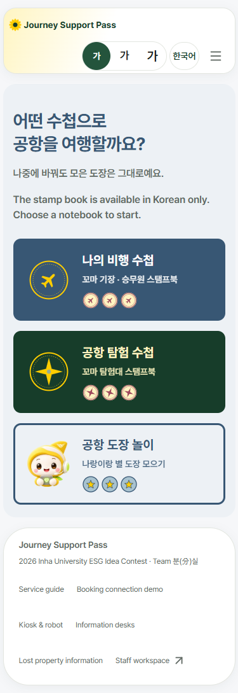 | 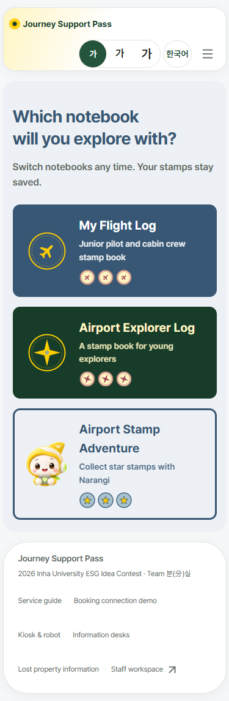 |

### flight-390-1-en-cover

| 전 | 후 |
|---|---|
| 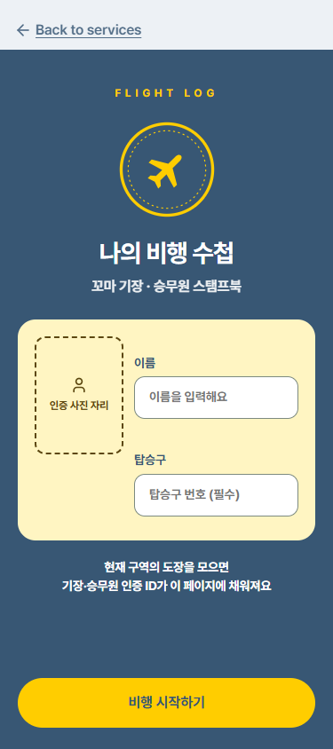 | 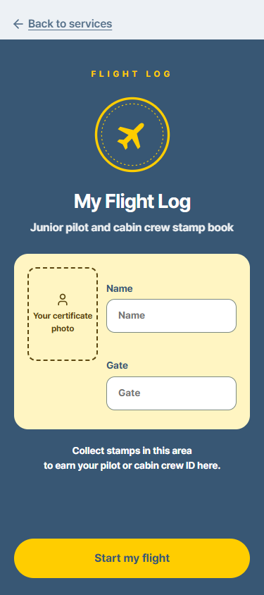 |

### flight-390-1-en-got

| 전 | 후 |
|---|---|
| 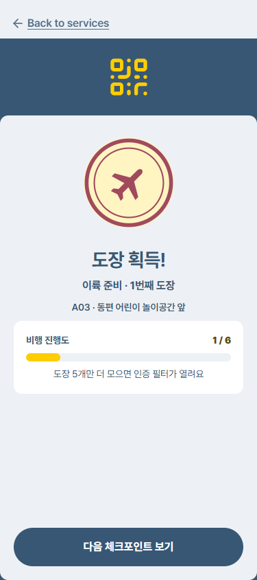 | 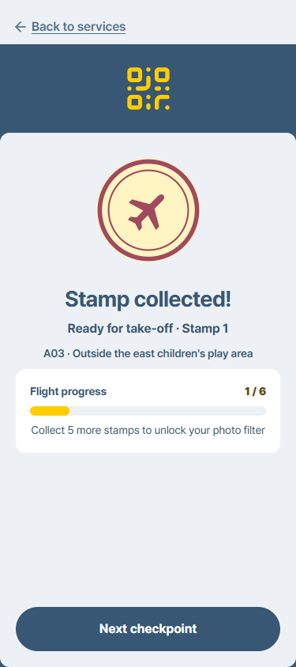 |

### flight-390-1-en-done

| 전 | 후 |
|---|---|
| 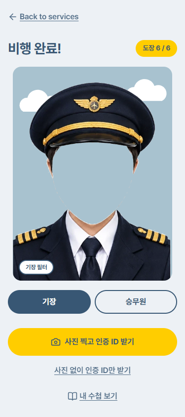 | 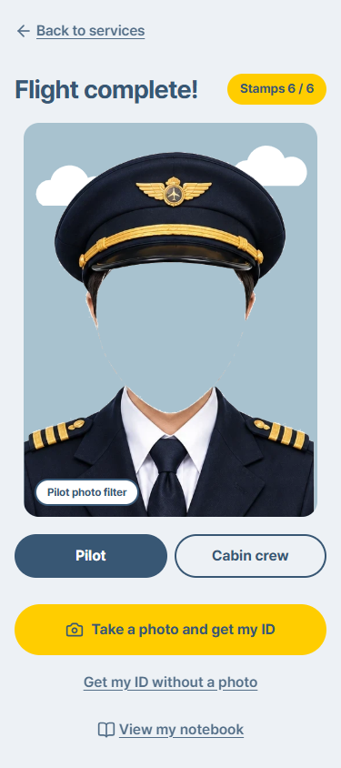 |

### flight-390-1.5-en-home

| 전 | 후 |
|---|---|
| 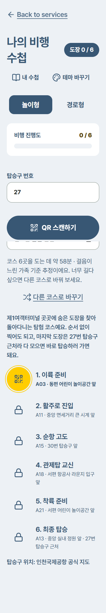 | 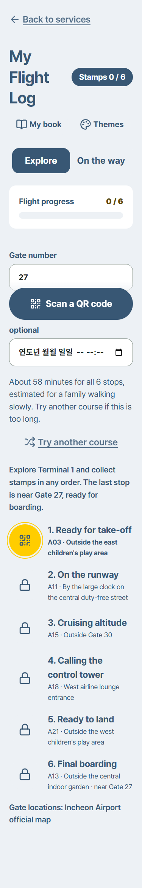 |

### flight-390-1.5-en-scan

| 전 | 후 |
|---|---|
| 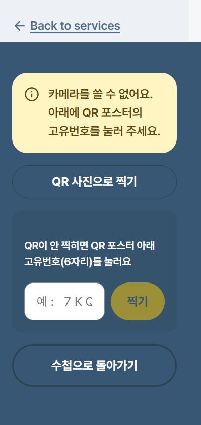 | 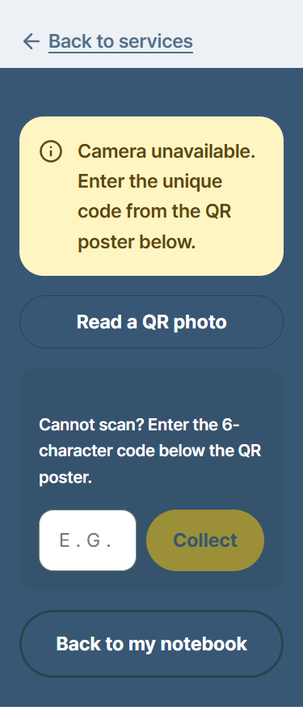 |

### flight-390-1.5-en-camera

| 전 | 후 |
|---|---|
| 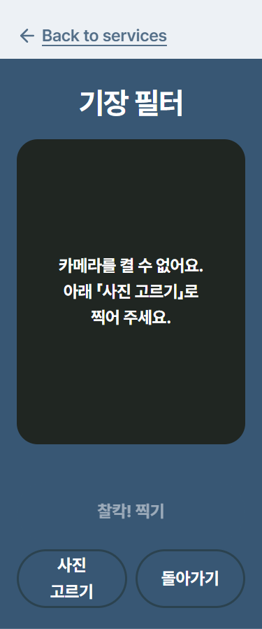 | 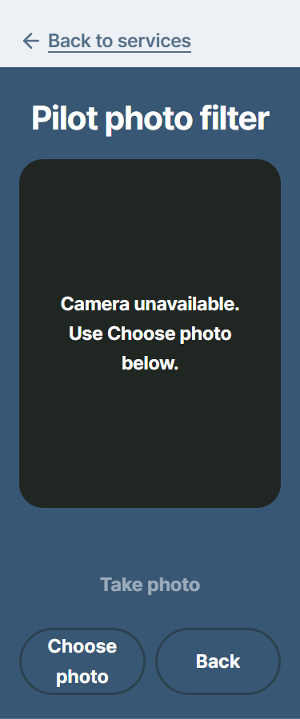 |

### flight-1366-1-en-home

| 전 | 후 |
|---|---|
| 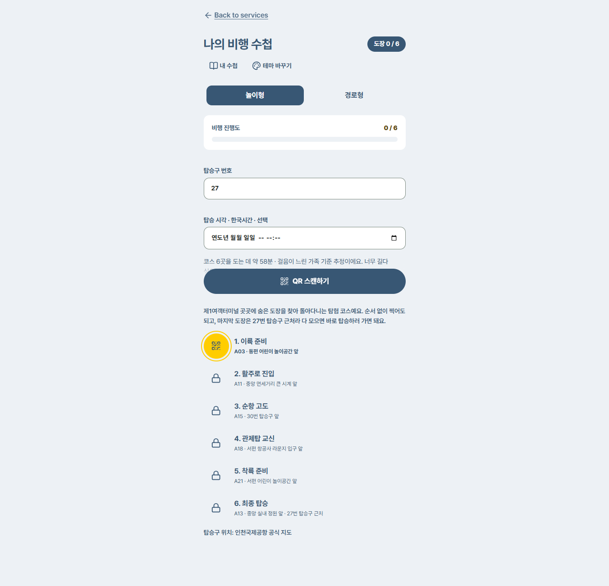 | 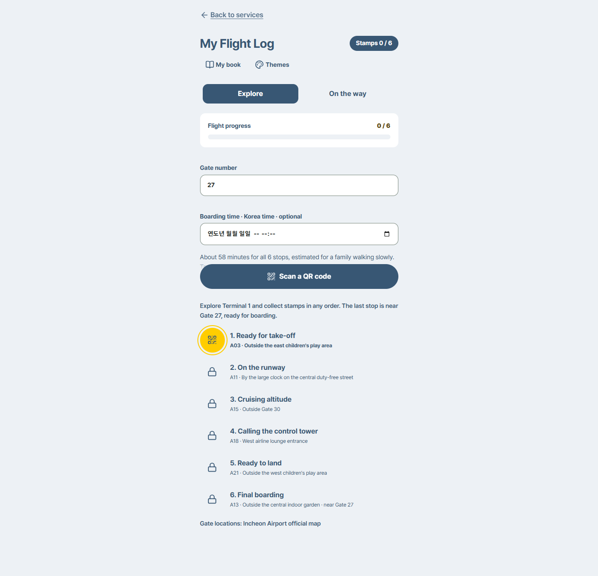 |

### flight-1366-1.5-en-camera

| 전 | 후 |
|---|---|
| 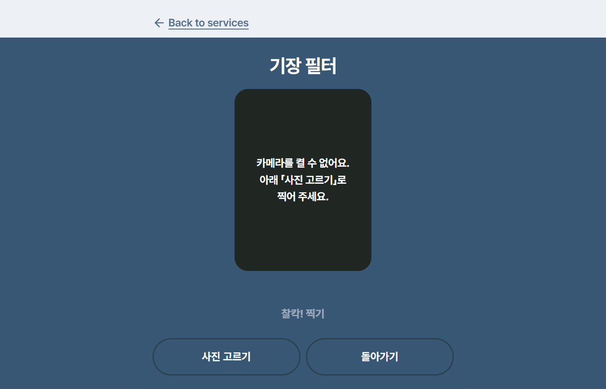 | 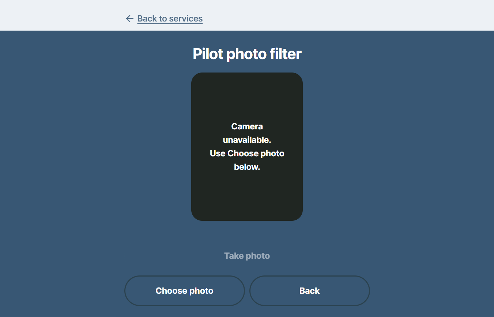 |

### explorer-390-1-en-cover

| 전 | 후 |
|---|---|
| 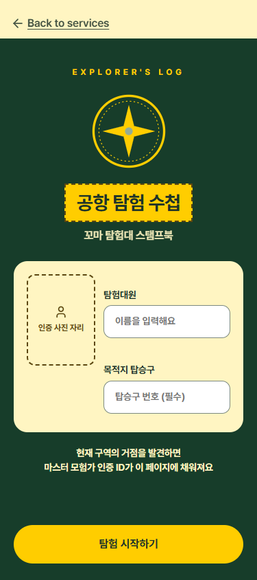 | 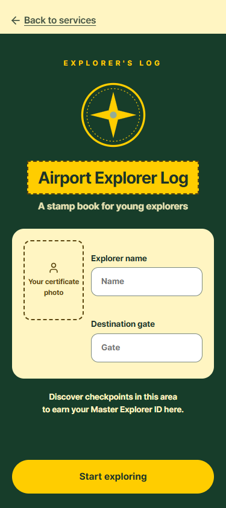 |

### friend-390-1-en-cover

| 전 | 후 |
|---|---|
| 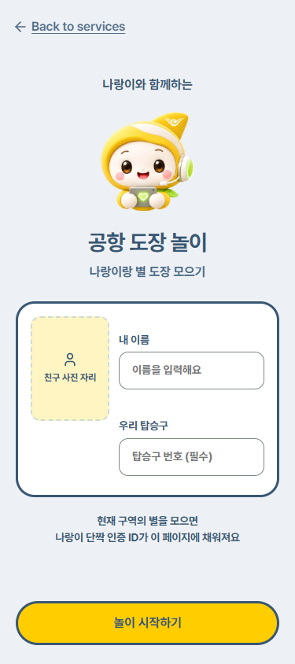 | 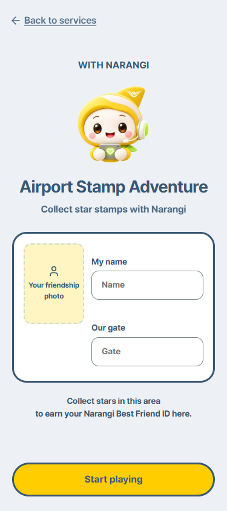 |

### flight-390-1-ko-home

| 전 | 후 |
|---|---|
| 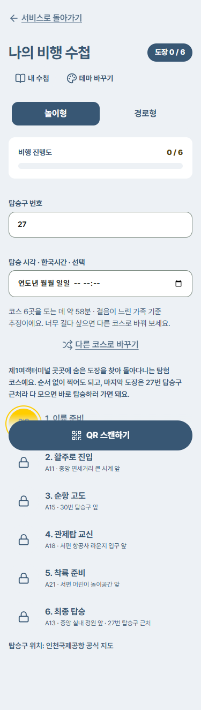 |  |

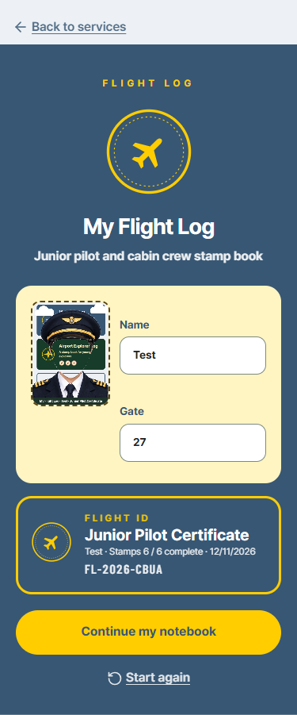

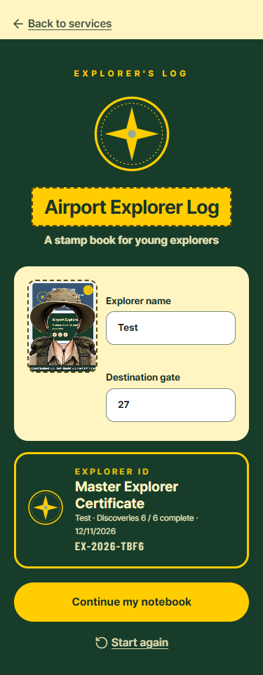

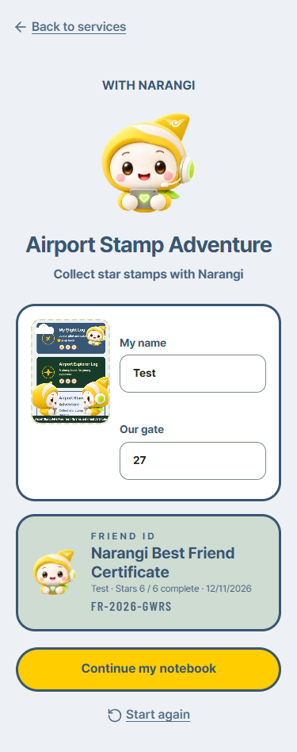

## 수집·저장 확인

- 한국어·영어 × 세 테마, 6경우에서 실제 단추와 번호 입력으로 도장 6개를 모았다. 없는 탑승구·코스 밖 체크포인트 오류 안내도 확인했다.
- 사진 고르기로 시험 그림을 올려 사진·인증을 저장하고, 새로고침·서비스 화면 왕복·언어 전환 뒤 저장 내용 전체가 같은지 비교했다. 6경우 모두 통과, 페이지 오류 0.
- 영어 장소 이름 73개와 세 테마의 표시 자료에 번역되지 않은 한글이 없는지 확인했다.
- 실제 카메라·조명·스피커·실제 얼굴 인식 하드웨어는 확인하지 않았다. 사진은 시험 그림 업로드로 확인했다.
- 임시 스크립트의 잘못된 입력 선택으로 멈춘 회차는 통과 근거에서 제외했다. 앱 수집 규칙은 수정하지 않았다.
- 큰 측정 JSON·임시 확인 스크립트는 저장소 밖에 두었다. 전체 검사 결과는 PR 설명에 별도 기록한다.
