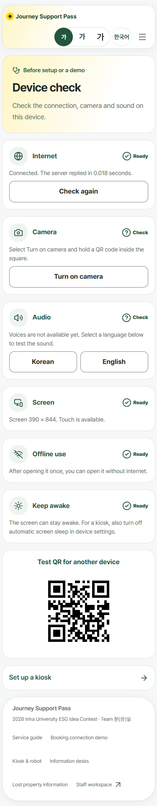
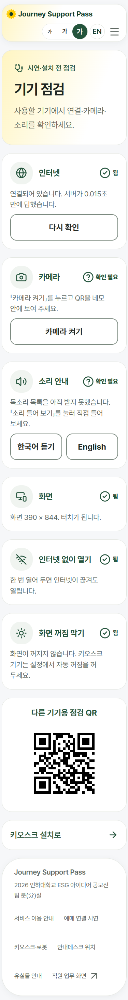
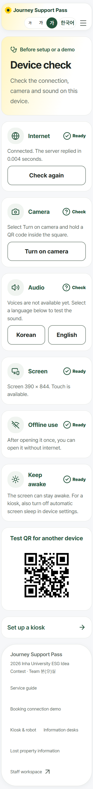
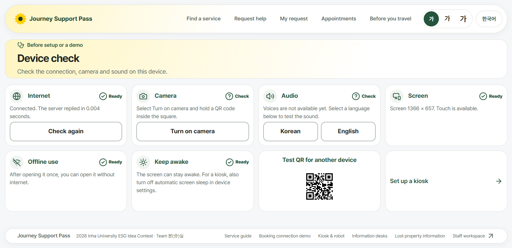
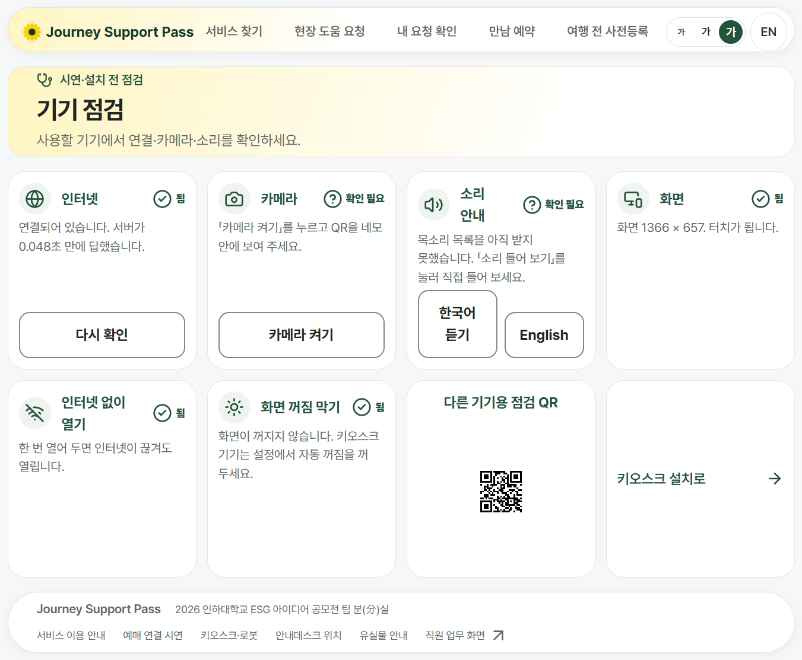
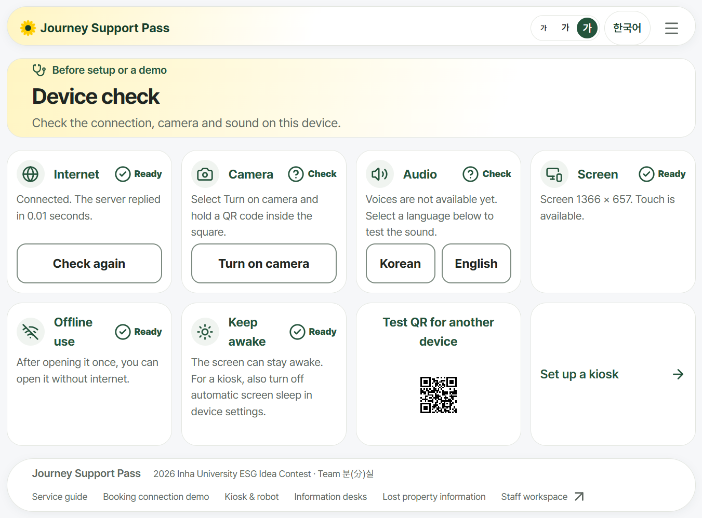
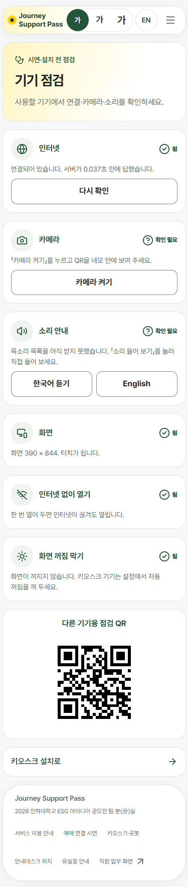
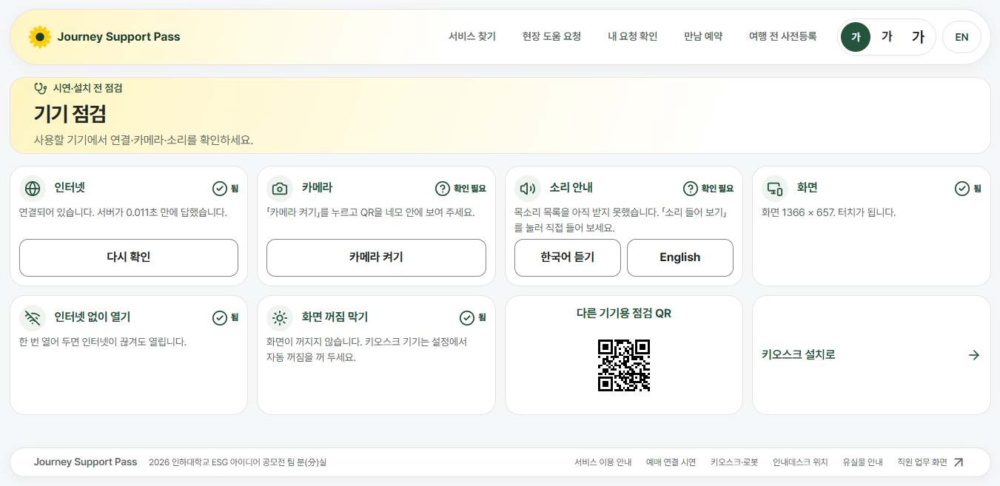

# G2 기기 점검 영어 화면

기준: `main`의 `f2e2217`. `/check?lang=en`의 본문과 상태·QR·카메라 안내를 영어로 표시한다. 한국어 문구, 점검 방식, 공통 스타일, 페이지 metadata는 바꾸지 않았다.

## 전후 실측

Chrome에서 글꼴·화면 전환이 끝나고 연결 확인과 점검 QR 표시가 완료된 뒤 측정했다. 비교 조건을 같게 하기 위해 연결 확인에는 200 응답, 소리 안내에는 빈 목소리 목록을 사용했다. 높이는 문서 전체 높이이며 세로 스크롤을 숨기지 않았다.

| 화면 크기 | 글자 | 언어 | 문서 높이 전 → 후 | 화면 높이 | 옆 넘침 전 → 후 |
|---|---|---|---|---|---|
| 390×844 | 1 | 한국어 | 1768 → 1768 | 844 | 0 → 0 |
| 390×844 | 1 | 영어 | 1768 → 1920 | 844 | 0 → 0 |
| 390×844 | 1.5 | 한국어 | 2918 → 2918 | 844 | 0 → 0 |
| 390×844 | 1.5 | 영어 | 2918 → 3166 | 844 | 0 → 0 |
| 1366×657 | 1 | 한국어 | 657 → 657 | 657 | 0 → 0 |
| 1366×657 | 1 | 영어 | 657 → 657 | 657 | 0 → 0 |
| 1366×657 | 1.5 | 한국어 | 1113 → 1113 | 657 | 0 → 0 |
| 1366×657 | 1.5 | 영어 | 1113 → 998 | 657 | 0 → 0 |

영어를 선택해도 이전에는 본문이 한국어였다. 한국어 본문은 매번 달라지는 서버 응답 시간 숫자를 제외하고 전후가 같았다. 영어 본문에는 한글이 남지 않았으며, 위 8조건에서 페이지 오류는 0건이었다. 휴대전화와 글자 1.5배의 긴 본문은 페이지 전체를 내려 읽는다.

## 실제 화면

| 조건 | 전 | 후 |
|---|---|---|
| 휴대전화 영어 1배 |  |  |
| 휴대전화 영어 1.5배 |  |  |
| 노트북 영어 1배 |  |  |
| 노트북 영어 1.5배 |  |  |
| 휴대전화 한국어 1배 |  |  |
| 노트북 한국어 1배 |  |  |

## 안내 분기 확인

- 목소리 없음·한국어와 영어 모두 있음·한국어만 있음·영어만 있음·그 밖의 언어만 있음·소리 안내 미지원: 영어 상태 문구 확인.
- 연결 실패·느린 연결·앱 안 브라우저·오프라인 저장 및 화면 꺼짐 방지 미지원: 영어 안내 확인.
- 카메라 권한 거절 안내, 사진 파일로 점검 QR·형식에 맞춘 가짜 여객 QR·다른 QR 읽기: 영어 결과 확인. 발급된 여객 정보는 사용하지 않았다.
- 한국어·영어 듣기 단추는 각각 `ko-KR`, `en-US`로 읽기를 요청했다. 실제 스피커 소리, 물리 카메라와 조명, 실제 오프라인 재접속과 화면 꺼짐 방지는 재지 않음.
- 위 분기는 브라우저 기능 응답을 통제한 9조건에서 확인했으며, 모두 옆 넘침 0·페이지 오류 0이었다.

큰 측정 JSON과 임시 확인 스크립트는 저장소에 넣지 않았다.
