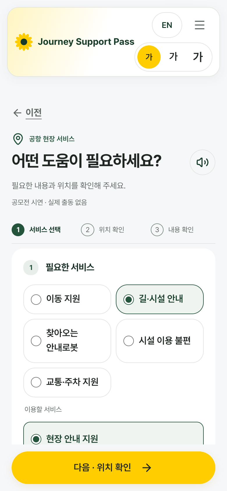
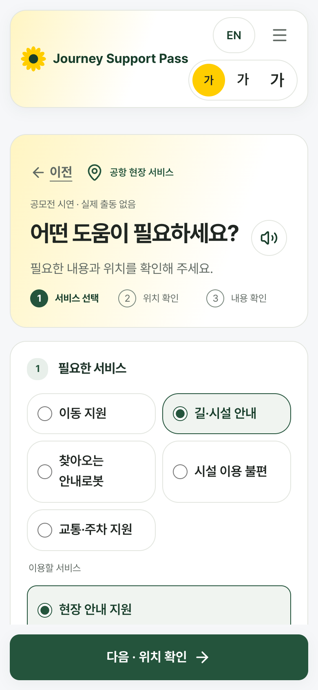
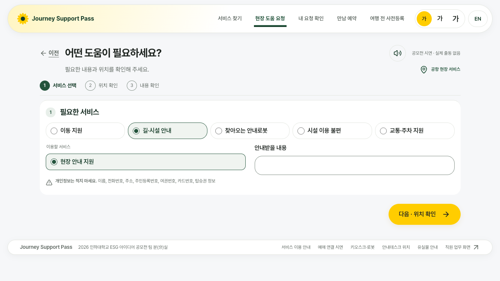
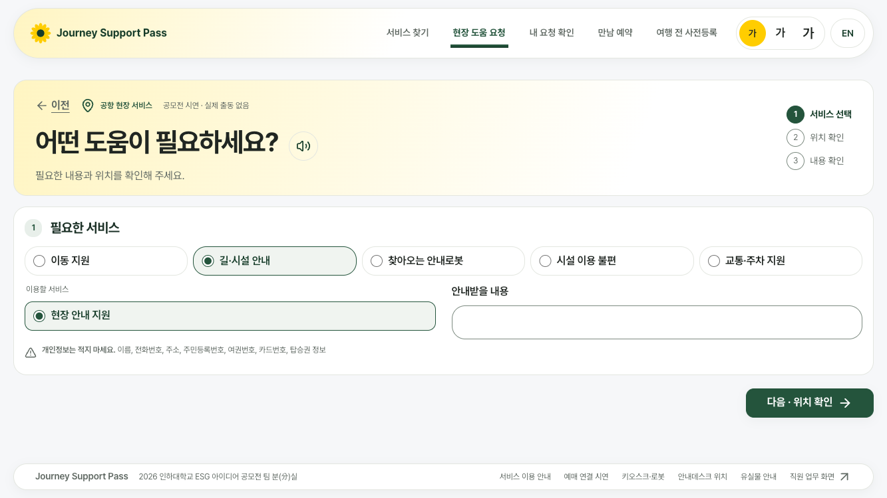
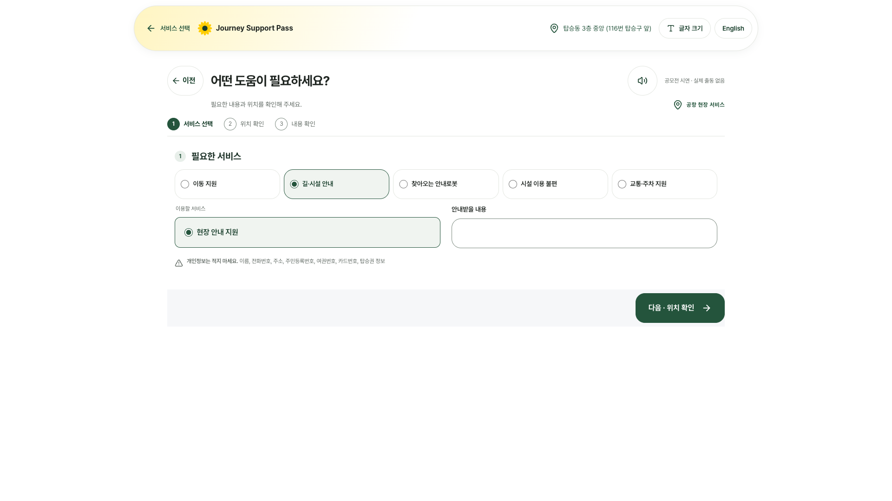
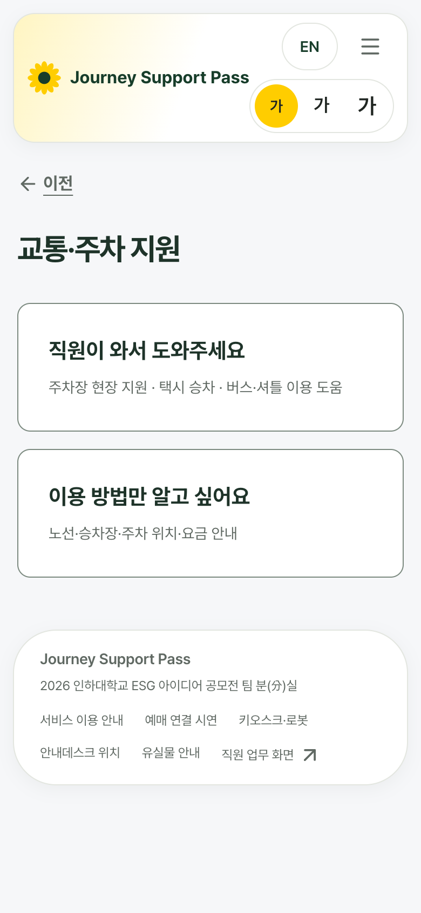
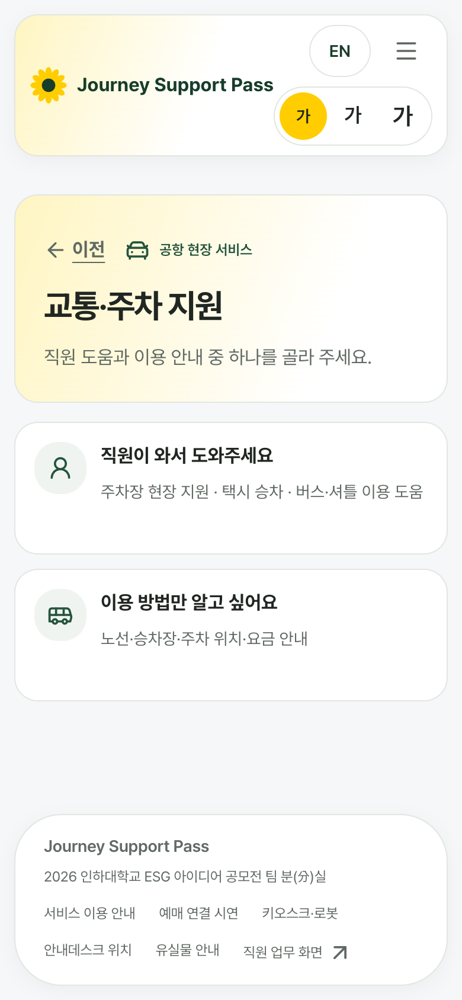
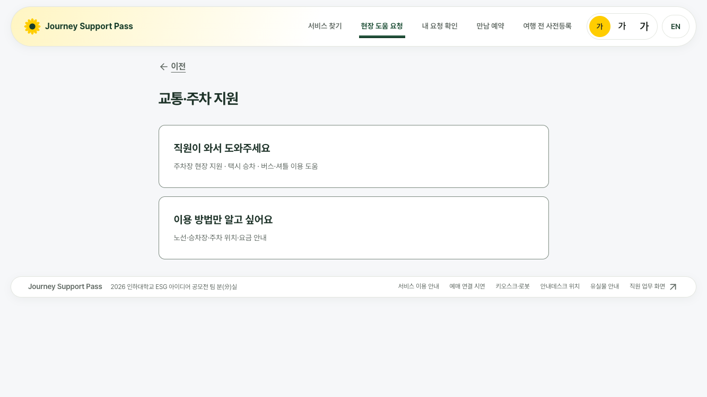
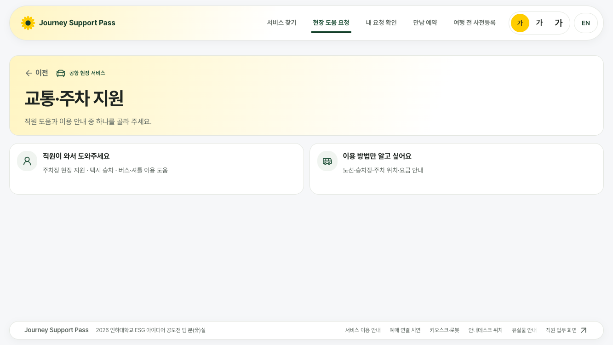

# 현장 도움 요청(/help) 화면 틀 통일

첫 화면(`/`)과 같은 틀로 맞췄습니다: 둥근 위쪽 바와 같은 끝선, 노란 그라데이션 소개 박스, 흰 카드, 딥그린 주요 버튼.

## 바꾼 화면
- /help (서비스 선택·위치·내용 확인 단계, 시설 불편 신고 포함)
  - 글 제목을 `.ph-hero` 소개 박스로 바꿨습니다. 왼쪽에 「이전」·공항 현장 서비스·시연 표시, 제목, 한 줄 설명을 두고, 오른쪽에 단계 표시를 세로로 넣었습니다.
  - 본문 끝선을 위쪽 바와 같게 맞췄습니다(가이드 2절 공식).
  - 「다음 · 위치 확인」, 「요청 내용 확인」, 「이 내용으로 요청 접수」를 노랑에서 딥그린 `.btn-primary`로 바꿨습니다. 노랑은 위쪽 바 글자 크기 선택 한 곳에만 남습니다.
  - 입력 칸 묶음을 1px 선의 흰 카드(중간 모서리)로 바꿨습니다. 요약 카드도 같은 모서리를 씁니다.
  - 761~1100px(태블릿·가로 키오스크 1024)에서도 첫 단계를 「서비스 한 줄 + 세부 선택·적는 칸 두 칸」으로 배치했습니다.
  - 노트북에서 아래쪽 바가 화면 맨 아래에 붙습니다(`.public-site:has(...)` 기존 규칙 확장).
- /help?topic=traffic (교통·주차)
  - 같은 소개 박스와, 아이콘 칩이 있는 같은 높이 카드 두 칸으로 바꿨습니다. 안내 보기의 링크는 두 칸으로 묶었고, 주요 버튼은 딥그린입니다.
- 새 CSS 파일·`!important`·색 코드·고정 px 크기·내용 숨김은 더하지 않았습니다. 「도움 요청하기」·소리 안내·글자 크기 설정은 건드리지 않았습니다.
- 키오스크 `/help`에는 `html[data-kiosk]`가 붙지 않습니다. 그래서 키오스크 여백은 `devices.css`의 `.field-task-shell` 규칙에서 줄였습니다.

## 크기별 실측 (바꾸기 전 → 뒤)
px 단위. 세로는 문서 높이/화면 높이입니다. 키오스크는 공개 시연 설치 코드로 연 키오스크 세션입니다. 교통 화면의 「전」 본문 끝선은 첫 요소(「이전」 단추)를 잰 값입니다.

| 화면 | 크기 | 글자 | 세로 doc/vh (전 → 후) | 옆 넘침 | 바 끝선 | 본문 끝선 (전 → 후) | 진행 버튼 색 (후) |
|---|---|---|---|---|---|---|---|
| /help | 390x844 | ×1 | 1248/844 → **1232/844** | 0 | [12, 378] | [20, 370] → [12, 378] | 노랑 → 딥그린 |
| /help?topic=traffic | 390x844 | ×1 | 844/844 → **844/844** | 0 | [12, 378] | [16, 68] → [12, 378] | 흰 카드 → 흰 카드 |
| /help?topic=facility | 390x844 | ×1 | 1283/844 → **1267/844** | 0 | [12, 378] | [20, 370] → [12, 378] | 노랑 → 딥그린 |
| /help | 390x844 | ×1.5 | 2231/844 → **2312/844** | 0 | [12, 378] | [30, 360] → [12, 378] | 노랑 → 딥그린 |
| /help?topic=traffic | 390x844 | ×1.5 | 1297/844 → **1245/844** | 0 | [12, 378] | [24, 101] → [12, 378] | 흰 카드 → 흰 카드 |
| /help?topic=facility | 390x844 | ×1.5 | 2034/844 → **2128/844** | 0 | [12, 378] | [30, 360] → [12, 378] | 노랑 → 딥그린 |
| /help | 1280x633 | ×1 | 688/633 → **633/633** | 0 | [20, 1260] | [79, 1201] → [20, 1260] | 노랑 → 딥그린 |
| /help?topic=traffic | 1280x633 | ×1 | 633/633 → **633/633** | 0 | [20, 1260] | [272, 324] → [20, 1260] | 흰 카드 → 흰 카드 |
| /help?topic=facility | 1280x633 | ×1 | 716/633 → **633/633** | 0 | [20, 1260] | [79, 1201] → [20, 1260] | 노랑 → 딥그린 |
| /help | 1280x633 | ×1.5 | 1084/633 → **955/633** | 0 | [20, 1260] | [36, 1244] → [20, 1260] | 노랑 → 딥그린 |
| /help?topic=traffic | 1280x633 | ×1.5 | 852/633 → **647/633** | 0 | [20, 1260] | [88, 165] → [20, 1260] | 흰 카드 → 흰 카드 |
| /help?topic=facility | 1280x633 | ×1.5 | 1066/633 → **937/633** | 0 | [20, 1260] | [36, 1244] → [20, 1260] | 노랑 → 딥그린 |
| /help | 1333x750 | ×1 | 750/750 → **750/750** | 0 | [20, 1313] | [106, 1228] → [20, 1313] | 노랑 → 딥그린 |
| /help?topic=traffic | 1333x750 | ×1 | 750/750 → **750/750** | 0 | [20, 1313] | [299, 350] → [20, 1313] | 흰 카드 → 흰 카드 |
| /help?topic=facility | 1333x750 | ×1 | 750/750 → **750/750** | 0 | [20, 1313] | [106, 1228] → [20, 1313] | 노랑 → 딥그린 |
| /help | 1333x750 | ×1.5 | 1090/750 → **1126/750** | 0 | [20, 1313] | [36, 1297] → [20, 1313] | 노랑 → 딥그린 |
| /help?topic=traffic | 1333x750 | ×1.5 | 852/750 → **753/750** | 0 | [20, 1313] | [115, 192] → [20, 1313] | 흰 카드 → 흰 카드 |
| /help?topic=facility | 1333x750 | ×1.5 | 1072/750 → **1108/750** | 0 | [20, 1313] | [36, 1297] → [20, 1313] | 노랑 → 딥그린 |
| /help | 1366x657 | ×1 | 688/657 → **657/657** | 0 | [20, 1346] | [122, 1244] → [20, 1346] | 노랑 → 딥그린 |
| /help?topic=traffic | 1366x657 | ×1 | 657/657 → **657/657** | 0 | [20, 1346] | [315, 367] → [20, 1346] | 흰 카드 → 흰 카드 |
| /help?topic=facility | 1366x657 | ×1 | 716/657 → **657/657** | 0 | [20, 1346] | [122, 1244] → [20, 1346] | 노랑 → 딥그린 |
| /help | 1366x657 | ×1.5 | 1084/657 → **955/657** | 0 | [20, 1346] | [36, 1330] → [20, 1346] | 노랑 → 딥그린 |
| /help?topic=traffic | 1366x657 | ×1.5 | 852/657 → **657/657** | 0 | [20, 1346] | [131, 208] → [20, 1346] | 흰 카드 → 흰 카드 |
| /help?topic=facility | 1366x657 | ×1.5 | 1066/657 → **937/657** | 0 | [20, 1346] | [36, 1330] → [20, 1346] | 노랑 → 딥그린 |
| /help | 1920x937 | ×1 | 937/937 → **937/937** | 0 | [288, 1632] | [399, 1521] → [288, 1632] | 노랑 → 딥그린 |
| /help?topic=traffic | 1920x937 | ×1 | 937/937 → **937/937** | 0 | [288, 1632] | [592, 644] → [288, 1632] | 흰 카드 → 흰 카드 |
| /help?topic=facility | 1920x937 | ×1 | 937/937 → **937/937** | 0 | [288, 1632] | [399, 1521] → [288, 1632] | 노랑 → 딥그린 |
| /help | 1920x937 | ×1.5 | 1048/937 → **1109/937** | 0 | [288, 1632] | [119, 1802] → [288, 1632] | 노랑 → 딥그린 |
| /help?topic=traffic | 1920x937 | ×1.5 | 937/937 → **937/937** | 0 | [288, 1632] | [408, 485] → [288, 1632] | 흰 카드 → 흰 카드 |
| /help?topic=facility | 1920x937 | ×1.5 | 1090/937 → **1126/937** | 0 | [288, 1632] | [119, 1802] → [288, 1632] | 노랑 → 딥그린 |
| /help | 키오스크 1920x1080 | ×1 | 1080/1080 → **1080/1080** | 0 | [288, 1632] | [360, 1560] → [288, 1632] | 딥그린 → 딥그린 |
| /help?topic=traffic | 키오스크 1920x1080 | ×1 | 1080/1080 → **1080/1080** | 0 | [288, 1632] | [360, 438] → [288, 1632] | 흰 카드 → 흰 카드 |
| /help?topic=facility | 키오스크 1920x1080 | ×1 | 1080/1080 → **1080/1080** | 0 | [288, 1632] | [360, 1560] → [288, 1632] | 딥그린 → 딥그린 |
| /help | 키오스크 1920x1080 | ×1.5 | 1080/1080 → **1080/1080** | 0 | [288, 1632] | [60, 1860] → [288, 1632] | 딥그린 → 딥그린 |
| /help?topic=traffic | 키오스크 1920x1080 | ×1.5 | 1080/1080 → **1080/1080** | 0 | [288, 1632] | [60, 175] → [288, 1632] | 흰 카드 → 흰 카드 |
| /help?topic=facility | 키오스크 1920x1080 | ×1.5 | 1080/1080 → **1080/1080** | 0 | [288, 1632] | [60, 1860] → [288, 1632] | 딥그린 → 딥그린 |
| /help | 키오스크 1024x768 | ×1 | 953/768 → **768/768** | 0 | [20, 1004] | [40, 984] → [20, 1004] | 딥그린 → 딥그린 |
| /help?topic=traffic | 키오스크 1024x768 | ×1 | 768/768 → **768/768** | 0 | [20, 1004] | [40, 118] → [20, 1004] | 흰 카드 → 흰 카드 |
| /help?topic=facility | 키오스크 1024x768 | ×1 | 768/768 → **768/768** | 0 | [20, 1004] | [40, 984] → [20, 1004] | 딥그린 → 딥그린 |
| /help | 키오스크 1024x768 | ×1.5 | 1203/768 → **1031/768** | 0 | [20, 1004] | [60, 964] → [20, 1004] | 딥그린 → 딥그린 |
| /help?topic=traffic | 키오스크 1024x768 | ×1.5 | 785/768 → **768/768** | 0 | [20, 1004] | [60, 175] → [20, 1004] | 흰 카드 → 흰 카드 |
| /help?topic=facility | 키오스크 1024x768 | ×1.5 | 1007/768 → **893/768** | 0 | [20, 1004] | [60, 964] → [20, 1004] | 딥그린 → 딥그린 |
| /help | 키오스크 1080x1920 | ×1 | 1920/1920 → **1920/1920** | 0 | [20, 1060] | [40, 1040] → [20, 1060] | 딥그린 → 딥그린 |
| /help?topic=traffic | 키오스크 1080x1920 | ×1 | 1920/1920 → **1920/1920** | 0 | [20, 1060] | [40, 118] → [20, 1060] | 흰 카드 → 흰 카드 |
| /help?topic=facility | 키오스크 1080x1920 | ×1 | 1920/1920 → **1920/1920** | 0 | [20, 1060] | [40, 1040] → [20, 1060] | 딥그린 → 딥그린 |
| /help | 키오스크 1080x1920 | ×1.5 | 1920/1920 → **1920/1920** | 0 | [20, 1060] | [60, 1020] → [20, 1060] | 딥그린 → 딥그린 |
| /help?topic=traffic | 키오스크 1080x1920 | ×1.5 | 1920/1920 → **1920/1920** | 0 | [20, 1060] | [60, 175] → [20, 1060] | 흰 카드 → 흰 카드 |
| /help?topic=facility | 키오스크 1080x1920 | ×1.5 | 1920/1920 → **1920/1920** | 0 | [20, 1060] | [60, 1020] → [20, 1060] | 딥그린 → 딥그린 |

## 점검
- tsc 통과, eslint src 오류 0(기존 경고 3), vitest 1006 통과·5 건너뜀.
- layout-check: 132개 화면 문제 0개. 첫 실행에서 320px·글자 1.5배일 때 소리 단추가 13px 넘쳐서, 제목 줄이 접히게 고친 뒤 다시 돌렸습니다.
- e2e: 289개 중 288개 통과, 1개 실패. 실패 항목은 「모의 체크인이 정확히 2건」인지 보는 통계(`checkins === 2`)이며 4건으로 나왔습니다. 같은 날 같은 로컬 DB에서 점검을 두 번 돌려 기록이 쌓인 결과입니다(첫 실행은 자정을 넘겨 오늘 현황 통계 2개가 실패). 화면 흐름과 문구 점검은 모두 통과했습니다.

## 화면 그림
| 화면·크기 | 전 | 후 |
|---|---|---|
| /help · 390 |  |  |
| /help · 1333 |  |  |
| /help · 키오스크 1920 |  |  |
| 교통·주차 · 390 |  |  |
| 교통·주차 · 1333 |  |  |

## 확인 못 한 것 / 남은 문제
- 키오스크 1024×768에서 글자 1.5배일 때는 아직 세로 스크롤이 남습니다(/help 1031, 시설 불편 893). 글자 1배는 768로 맞습니다.
- 이동 지원(`/help?topic=mobility`)의 지도 화면은 `/navigate`와 같은 지도 부품이라 다음 PR(`/navigate`)에서 함께 다룹니다. 끝선은 이번에 바와 같아졌지만 왼쪽 칸 안 스크롤은 그대로입니다.
- 접수 뒤 진행 상태 화면(`RequestStatusPanel`)과 확인 화면은 끝선만 바뀌었고 크기별 실측은 재지 않았습니다.
- 휴대전화는 글자 1배에서도 첫 단계가 길어 스크롤됩니다(1232/844). 휴대전화는 스크롤을 허용하는 크기입니다.
