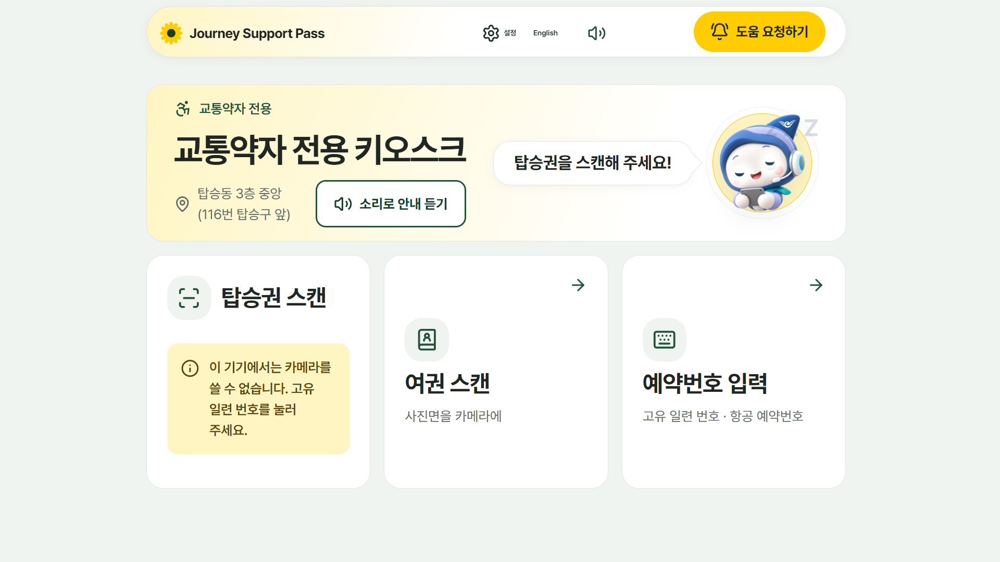
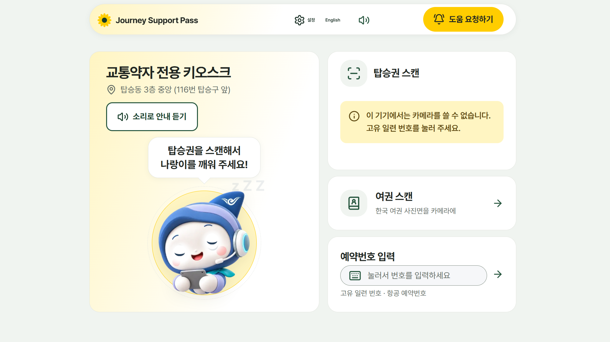
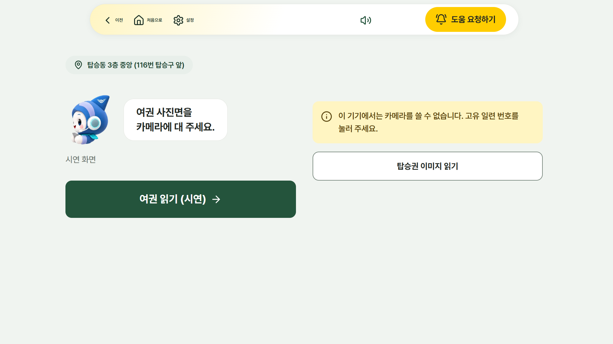
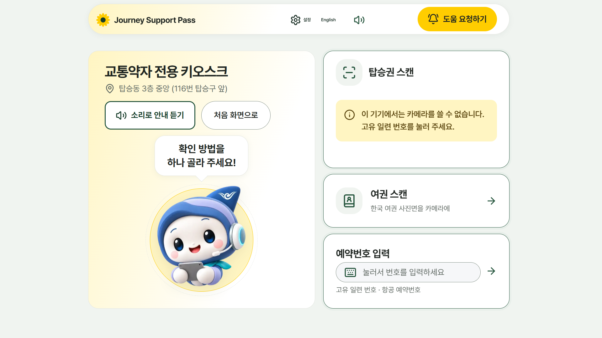
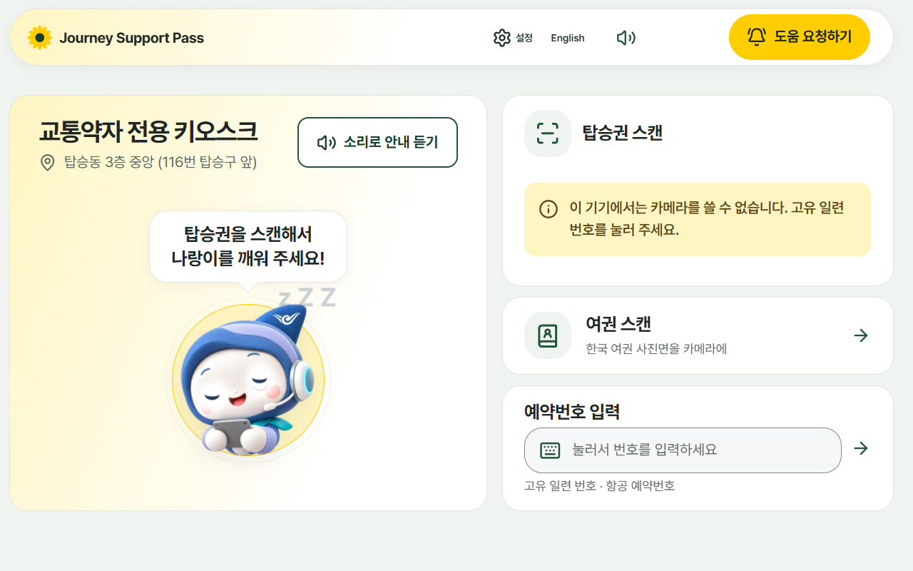
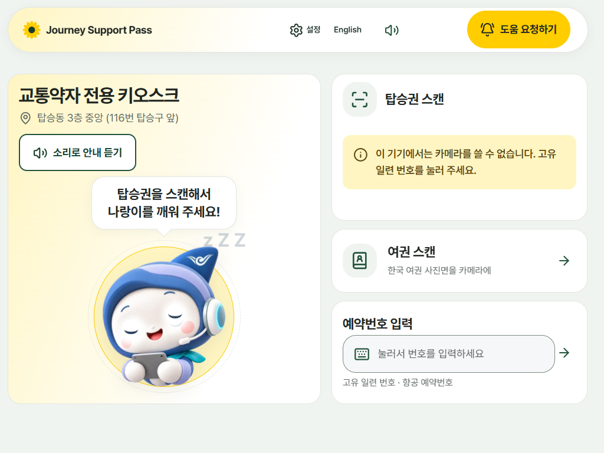
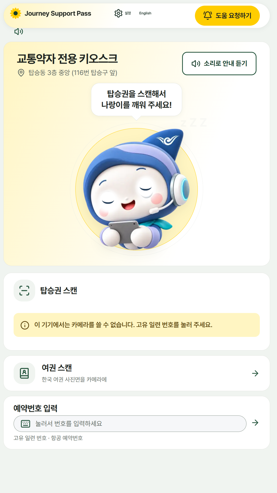

# 키오스크 첫 화면 개편 (스케치 반영)

화면: `/kiosk/guide` 첫 화면(안내 키오스크, 나랑이 화면). 바꾸기 전은 소개 박스 안에 작은 캐릭터가 있고 카드 세 개가 같은 크기로 늘어선 모양이었다.

## 바뀐 점
- 왼쪽 상자: 큰 나랑이와 말풍선(「탑승권을 스캔해서 나랑이를 깨워 주세요!」). 건드리지 않으면 자고, 탑승권을 비추거나 화면을 누르면 깨어난다(원래 동작 그대로).
- 오른쪽: 탑승권 스캔(카메라) · 여권 스캔 · 예약번호 입력(입력 칸 모양, 누르면 숫자판). 카드 셋이 쌓인다.
- 세로 키오스크: 위에 나랑이 상자, 아래에 카드를 한 줄로.
- 나랑이 크기는 「화면 높이 − 위쪽 바 − 24rem」으로 정한다. 글자(rem)가 큰 기기에서는 그만큼 줄어 스크롤이 생기지 않는다.
- 화면에 보이는 캐릭터 이름을 「나랑이」로 바꿨다(영어 Narangi). 코드·파일 이름(`haneuli-*`)은 점검 스크립트가 써서 그대로 둔다.

## 건드리지 않은 것
- 기기 화면 크기, 위쪽 바와 「도움 요청하기」(`.call-btn`)의 크기·자리(모든 키오스크 화면 공통 규칙).
- 확인 방법의 동작(탑승권 카메라, 숫자판, 여권 시연 화면), 소리 안내, 깨우기·재우기, 영어 화면.
- 스케치 2쪽의 확인 이후 흐름은 바꾸지 않았다 → `docs/kiosk-flow-redesign.md`.

## 세로 스크롤 실측 (글자 1배, 대기·깨운 뒤)
| 화면 | 바꾼 뒤 |
|---|---|
| 가로 키오스크 1920×1080 | 0 / 0 |
| 가로 키오스크 1280×800 | 0 / 0 |
| 장애인 키오스크 1024×768 | 0 / 0 |
| 안내로봇·세로 키오스크 1080×1920 | 0 / 0 |
| 참고: 1366×768, 1440×900 | 0 / 0 |
| 참고: 1024×600(가이드에 없는 아주 낮은 화면) | 18px 남음 |

가로 넘침은 모든 크기에서 0이다.

## 화면 그림
| 크기 | 전 | 후 |
|---|---|---|
| 1920×1080 대기 |  |  |
| 1920×1080 깨운 뒤 |  |  |
| 1280×800 | |  |
| 1024×768 | |  |
| 1080×1920 | |  |

운영 기기 카메라는 없는 환경이라 카메라 칸에는 「카메라를 쓸 수 없습니다」 안내가 나온다.
