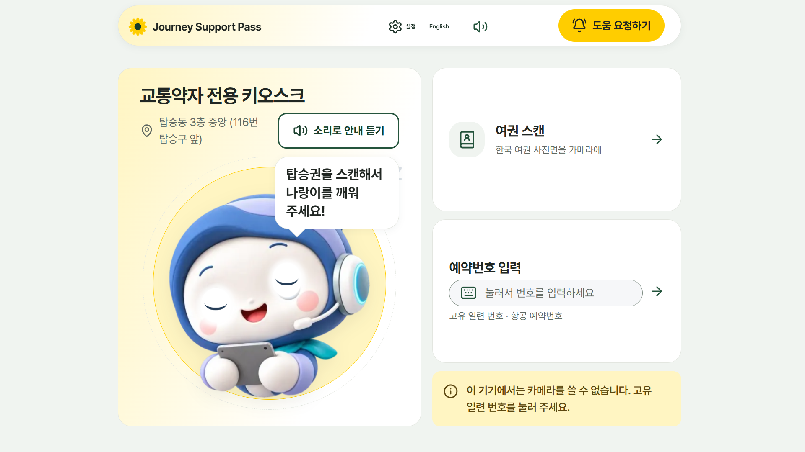
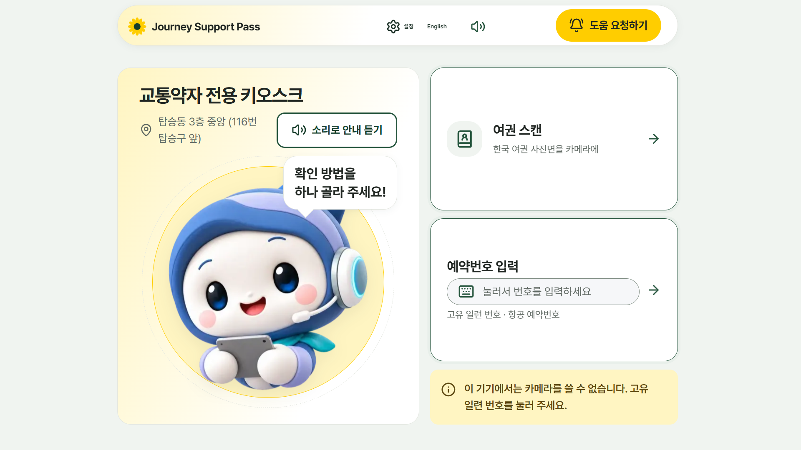
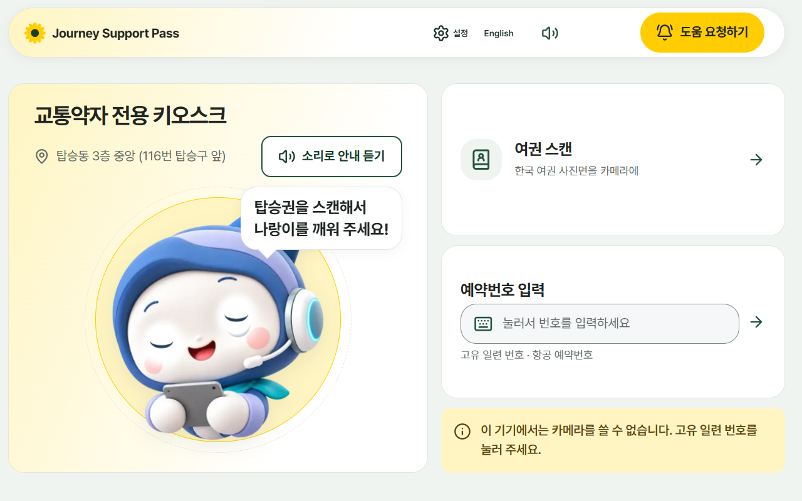
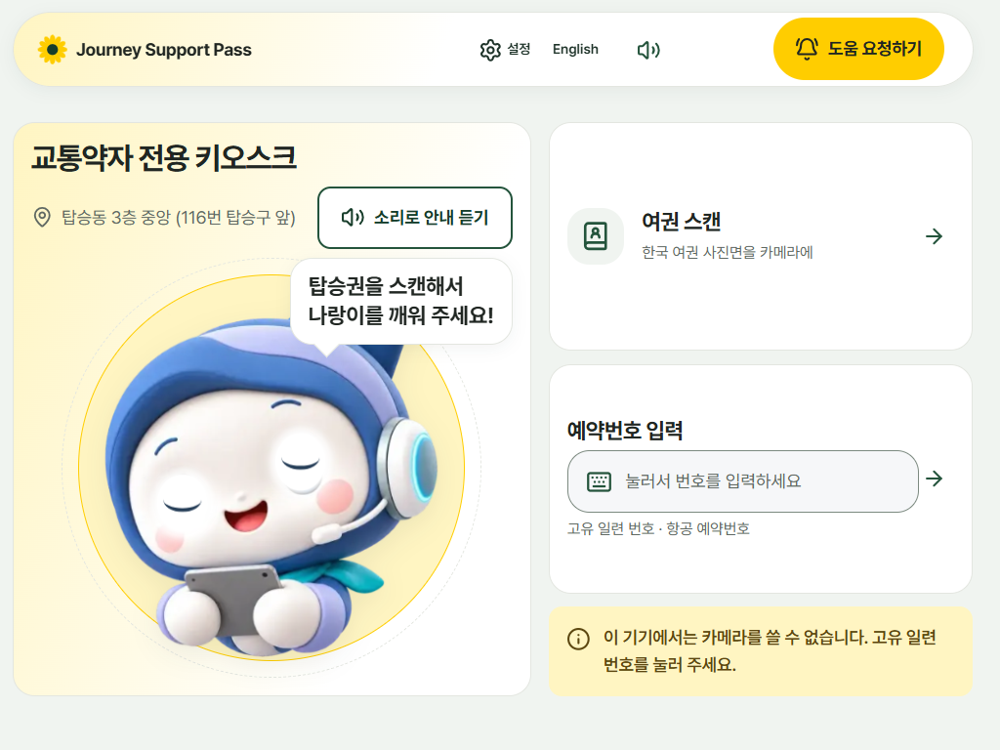
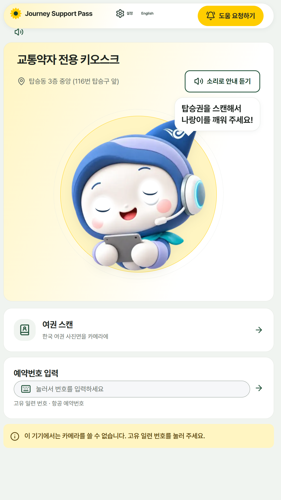
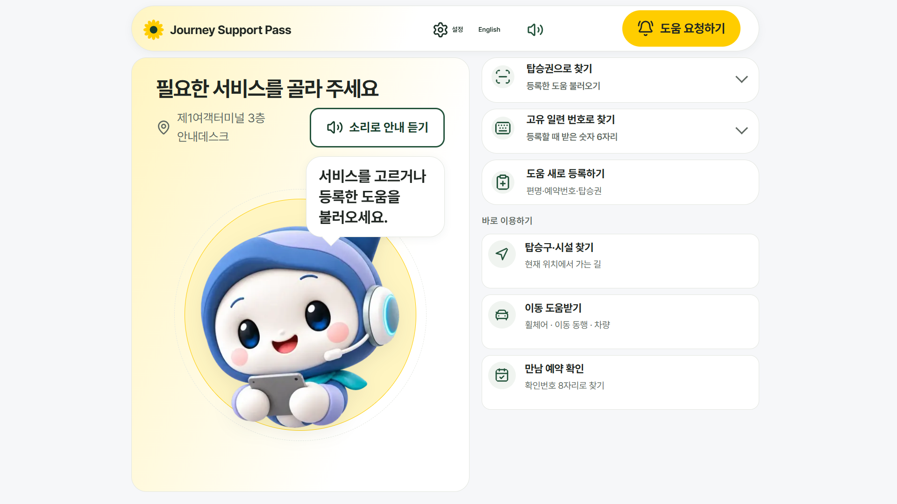
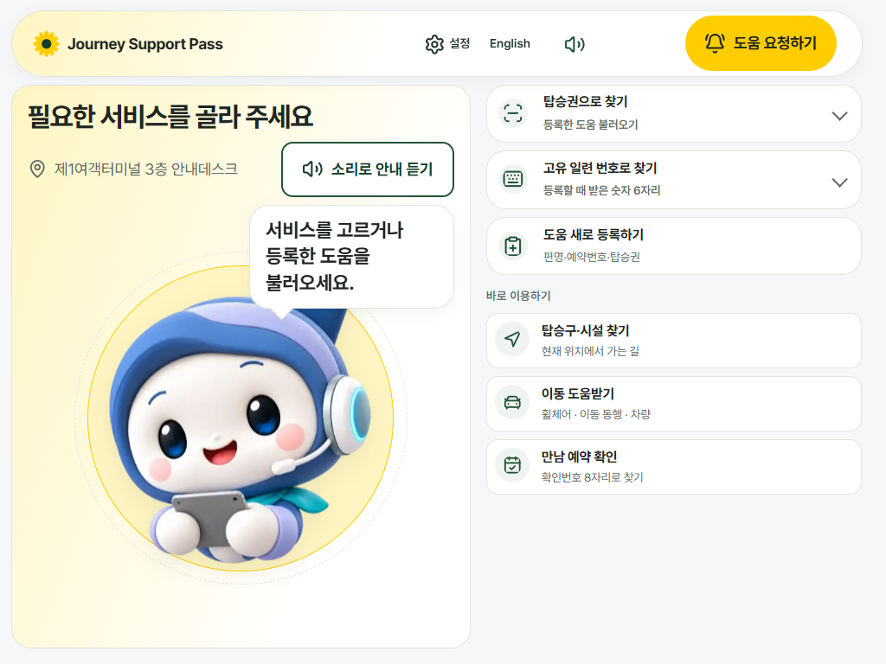
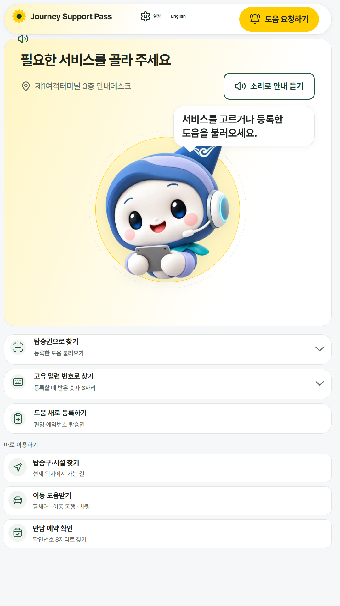

# 키오스크 첫 화면 v2 — 스케치대로 다시, 입구·안내로봇도 같은 모양

#123 에서 첫 화면을 바꿨지만 스케치와 달랐다(탑승권 스캔 카드를 더했고, 캐릭터가 작았다). 스케치에 맞춰 다시 짰고, 같은 키오스크 계열인 입구·안내로봇 화면도 같은 모양으로 맞췄다.

## 바뀐 점
- **탑승권 스캔 칸을 화면에서 없앴다.** 탑승권 읽기(카메라)는 그대로 켜 둔다. 카메라를 못 쓰는 기기에서만 「고유 일련 번호를 눌러 주세요」 안내가 보인다.
- **나랑이가 왼쪽 상자의 주인공.** 제목·위치·소리 안내를 위쪽 두 줄로 줄이고, 말풍선은 나랑이 오른쪽 위에 걸쳤다. 나랑이 크기는 「화면 높이 − 위쪽 바 − 14.5rem」으로 정한다.
- 오른쪽 카드는 스케치대로 **여권 스캔 · 예약번호 입력** 두 개.
- 위쪽 바의 「처음으로」와 같은 일을 하는 「처음 화면으로」 단추는 뺐다.
- **입구·안내로봇(`/kiosk/entry`)**: 옛 소개 띠 대신 같은 나랑이 상자(`HaneuliStage`)를 왼쪽(세로에서는 위)에 두고, 불러오기 카드와 서비스 카드를 오른쪽(아래)에 쌓는다.

## 세로 스크롤 실측 (글자 1배)
안내 키오스크 첫 화면과 입구·안내로봇 화면 모두 아래 크기에서 **0**(가로 넘침도 0).
1920×1080 · 1280×800 · 1024×768 · 1080×1920, 참고로 1366×768 · 1440×900 · 1024×600.

## 그림
| 안내 키오스크 | 그림 |
|---|---|
| 1920×1080 대기 |  |
| 1920×1080 깨운 뒤 |  |
| 1280×800 |  |
| 1024×768 |  |
| 1080×1920 |  |

| 입구·안내로봇 | 그림 |
|---|---|
| 1920×1080 |  |
| 1024×768 |  |
| 1080×1920 |  |

바꾸기 전(#123 직후) 안내 키오스크 그림은 `../kiosk-home-redesign/` 에 있다. 카메라가 없는 환경에서 찍어서 카메라 안내가 함께 보인다. 입구 화면의 서비스 카드는 #125(카드 크기)가 병합되면 더 커진다.
