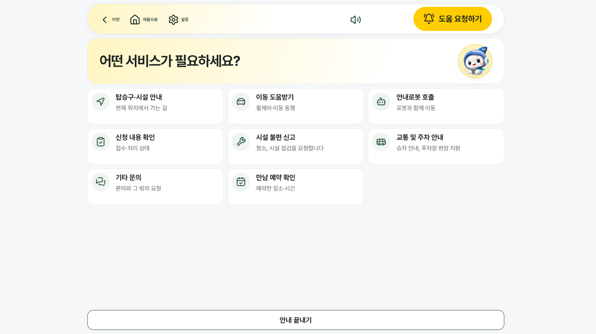
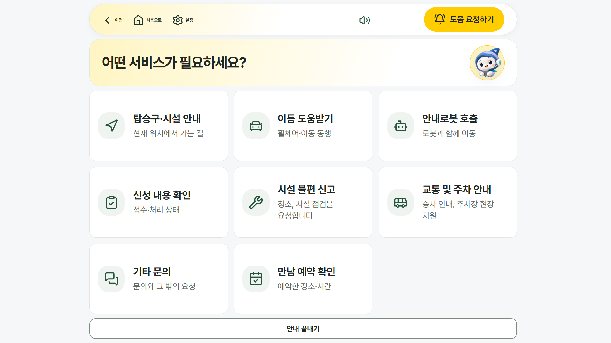
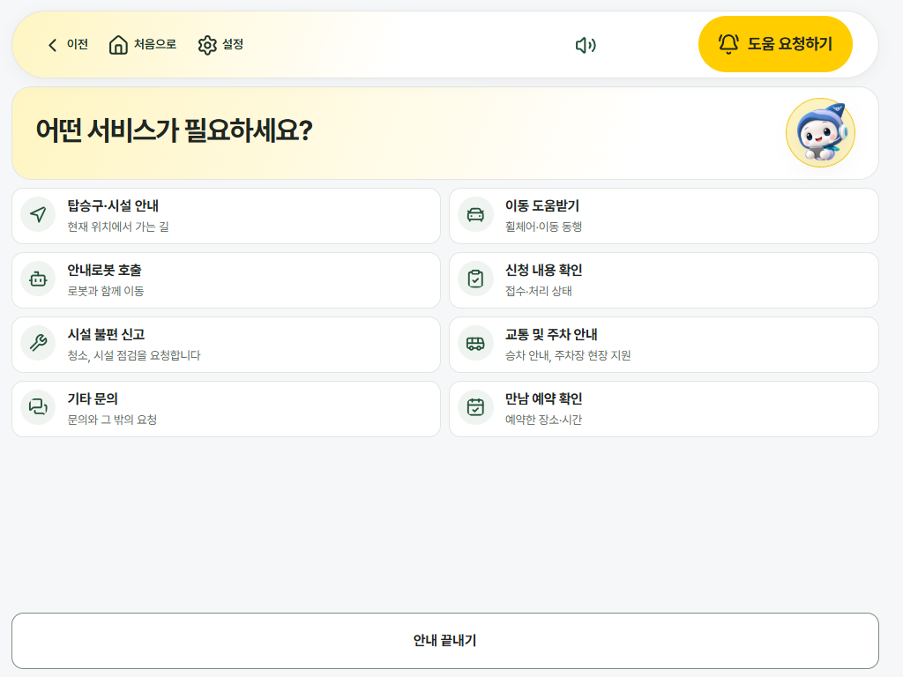
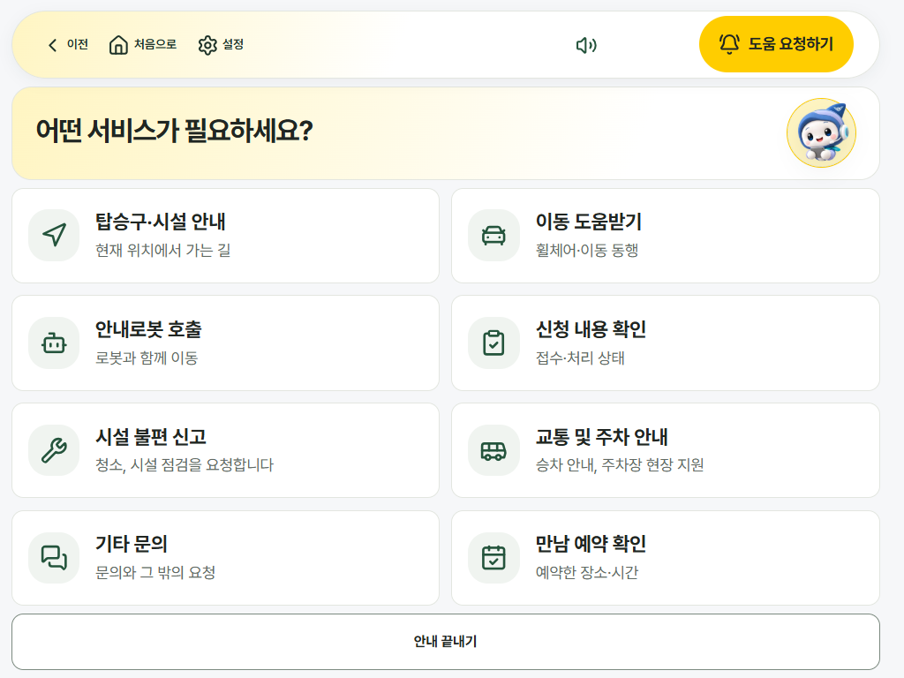
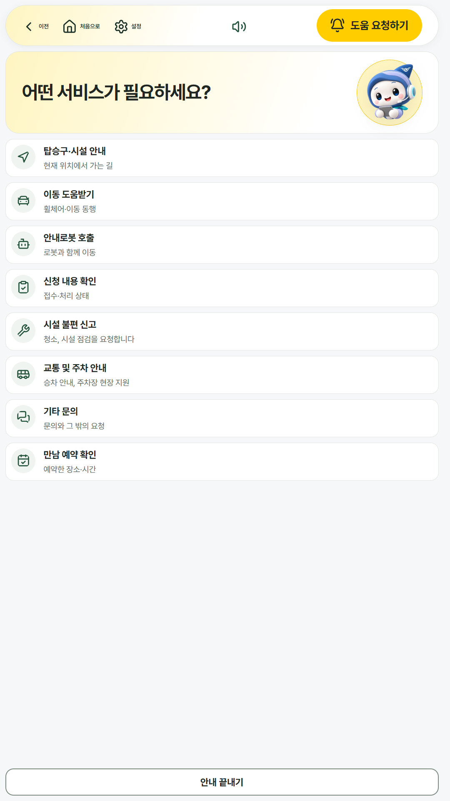
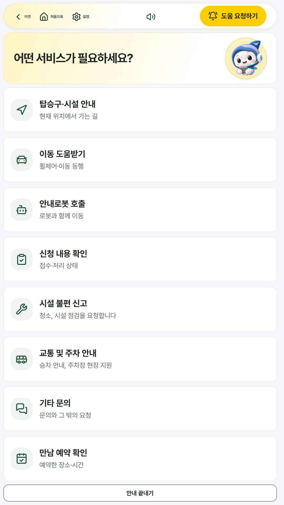

# 키오스크 서비스 카드 크기 (#122 후속)

#122 가 카드를 높이 고정(3.5rem·4.5rem)으로 통일하면서 카드가 너무 작아졌다(1024×768 에서 64px = 누르는 높이 하한 그대로). 높이를 못 박지 않고 최소 높이로 바꾸고, 남는 높이를 나눠 쓰게 했다.

| 크기 | 카드 높이 전 → 후 | 세로 스크롤 |
|---|---|---|
| 1920×1080 | 117 → 222px | 0 |
| 1280×800 | 91 → 153px | 0 |
| 1024×768 | 64 → 108px (누르는 높이 64px 의 1.7배) | 0 |
| 1080×1920 | 91 → 170px | 0 |

서비스 고르기 화면(카드 8개) 기준. 입구 키오스크의 서비스 카드도 같은 규격을 쓴다.

| 크기 | 전 | 후 |
|---|---|---|
| 1920×1080 |  |  |
| 1024×768 |  |  |
| 1080×1920 |  |  |
