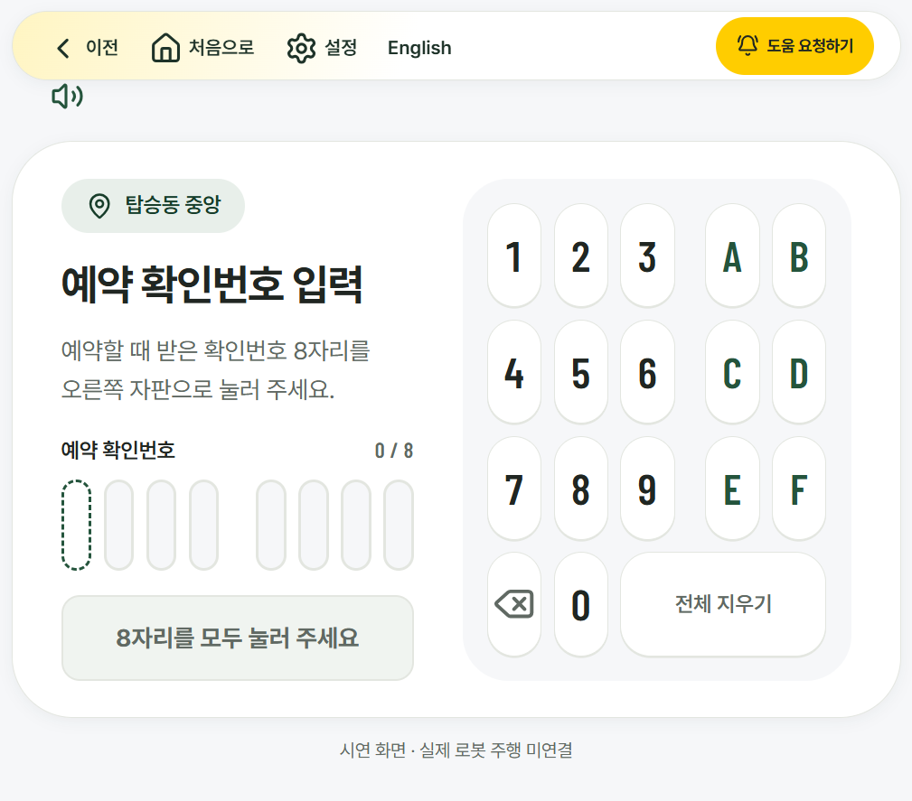
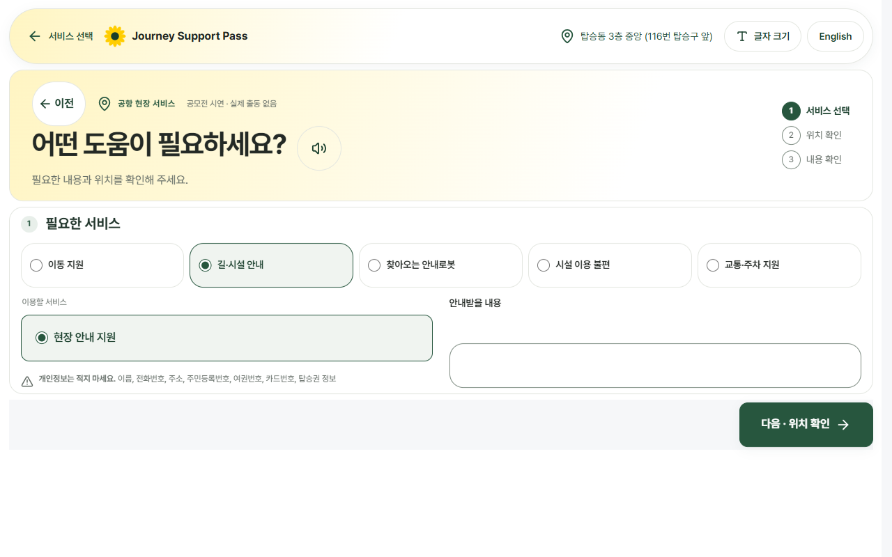

# 키오스크 방문 기록의 도움 요청 — 미완료 초안

## 변경

- 기존 StaffCall과 call-dock을 재사용했다. 방문 기록의 선택 정보가 있으면 안내 설정을 이어받고, 복귀 장소는 기존 안내·입구 기기 구분을 따른다.
- E2E에 도움 버튼 한 개 확인, 공용 접수 화면 진입, 접근성 점검, 서비스 화면 복귀를 추가했다.

## 실측

| 크기 | 세로 doc/vh 전 → 후 | 가로 넘침 | 전 | 후 |
|---|---|---|---|---|
| 390×844 | 1027/844 → 1100/844 | 0 → 0 |  |  |
| 1333×750 | 750/750 → 750/750 | 0 → 0 |  |  |
| 1920×1080 | 1080/1080 → 1080/1080 | 0 → 0 |  |  |
| 1024×768 | 768/768 → 768/768 | 0 → 0 |  |  |
| 1080×1920 | 1920/1920 → 1920/1920 | 0 → 0 |  |  |

## 점검과 미해결

- tsc 오류 0개, eslint 오류 0개·기존 경고 3개.
- Vitest 1,015개 통과·5개 건너뜀(파일 64개 통과·1개 건너뜀).
- E2E 293/293 통과. 새 진입·복귀 검사 4개 포함.
- 전체 배치 검사: 216개 화면, 신규 문제 4개. 1024×768의 설정, 1080×1920의 English가 도움 버튼과 겹친다고 글자 1·1.5배에서 각각 검출됐다.
- 동일한 터치 모드·배율의 별도 재측정 6개 조합에서는 가림이 재현되지 않았다. 이 차이의 원인은 아직 확정하지 못했다.
- 390px 키오스크 화면은 상단 메뉴 가림이 보인다. 공용 바 수정 범위는 #114와 겹칠 수 있어 관리자에게 확인을 요청했다. 임의로 바를 수정하지 않았다.
- 따라서 병합 가능한 완료본이 아니다. 미해결 문제를 숨기거나 검사 기준을 낮추지 않았다.

### 큰 글자 추가 그림

### 도움 요청 진입

