# 키오스크 방문 기록의 공용 도움 요청

기준 main은 a69f316(#115·#117·#118 포함)입니다. #114의 비키오스크 휴대전화 상단 바는 수정하지 않았습니다. 임시 스크립트와 큰 측정 JSON은 저장소 밖에 보관하며, 이 폴더에는 실제 화면 그림과 실측표만 남깁니다.

## 변경과 원인

- 방문 기록에도 기존 StaffCall을 연결해 도움 요청 접수·복귀를 제공합니다. 버튼 크기·위치는 안내·입구 기기와 같은 공용 규칙을 사용합니다.
- call-dock이 FlowShell의 형제인 구조는 안내·입구와 같고, body:has(.call-dock)도 정상 작동했습니다. 실제 원인은 FlowShell이 data-kiosk와 배율을 useEffect에서 늦게 붙이던 시점이었습니다. 초기 HTML에는 키오스크 표시가 없어 site-bar.css의 공용 오른쪽 공간 예약이 적용되지 않았습니다.
- 빈 설정의 새 페이지에서도 외부 JS를 늦추면 재현됩니다. 전체 배치 검사는 페이지를 새로 열며 설정을 주입합니다. 이전 세션의 wantsStaff·큰 단추 설정이 없어도 재현되므로 이전 페이지 설정이 원인이라고 단정하지 않습니다. 폰트 준비를 기다리고 전환 모션을 끝낸 별도 실측으로 로딩 시점 문제를 구분했습니다.
- FlowShell의 공용 초기 스크립트가 바를 그리기 전에 키오스크 표시·허용 목록으로 검증한 저장 배율을 적용합니다. 이후 기존 동기화는 useLayoutEffect에서 처리합니다. 접속 정보나 사용자 입력은 스크립트에 넣지 않습니다.
- 여러 줄 바에서도 도움 줄은 공용 site-bar-height 토큰의 첫 줄에 정렬합니다. 화면 전용 크기·위치나 선택자 우선순위 덮기를 추가하지 않았습니다.
- 초기 외부 JS를 늦추는 회귀 검사 1개·그 화면의 접근성 검사 1개와 기존 도움 버튼·접수·접근성·복귀 검사 4개를 전체 E2E에 포함했습니다. 기존 배치 검사 기준은 바꾸지 않았습니다.

## main 전 → 최종 뒤

Chrome에서 실제 문서 높이와 옆 넘침을 쟀습니다. 도움 단추는 main에서 없던 기능이므로 전은 0개, 뒤는 모든 조건에서 1개입니다.

| 크기 | 세로 doc/vh 전 → 뒤 | 옆 넘침 전 → 뒤 | 전 | 뒤 |
|---|---|---|---|---|
| 390×844 | 1027/844 → 1100/844 | 0 → 0 | 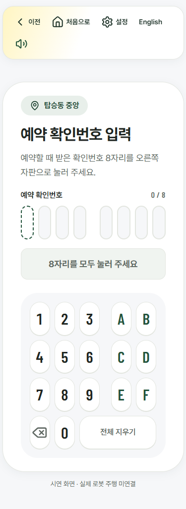 | 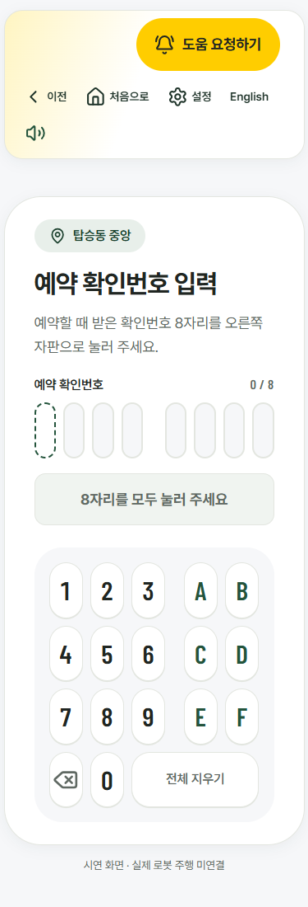 |
| 1333×750 | 750/750 → 750/750 | 0 → 0 | 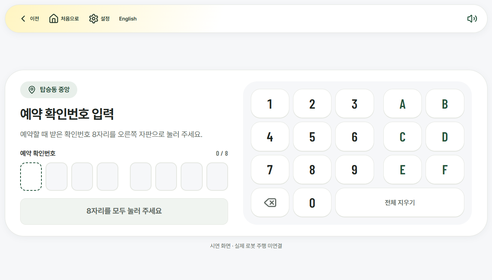 | 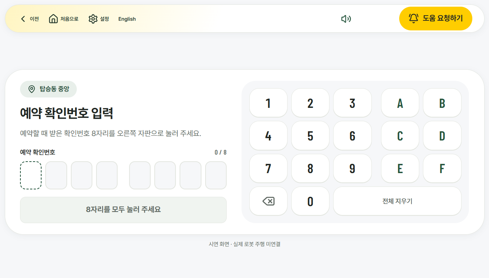 |
| 1920×1080 | 1080/1080 → 1080/1080 | 0 → 0 | 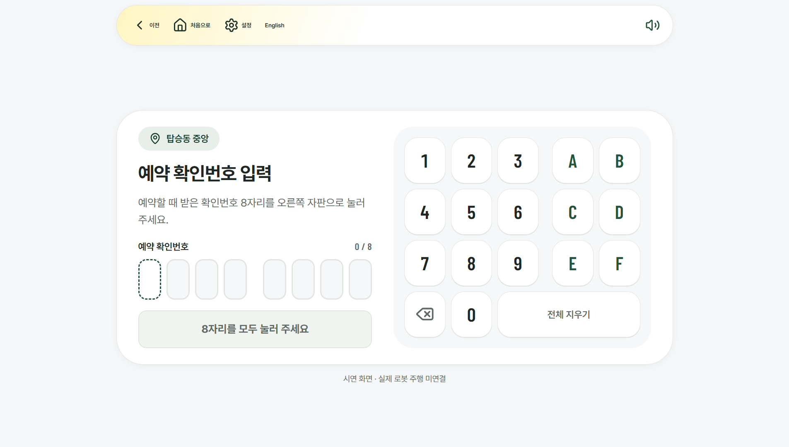 | 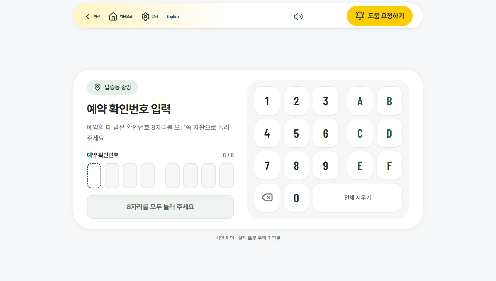 |
| 1024×768 | 768/768 → 768/768 | 0 → 0 | 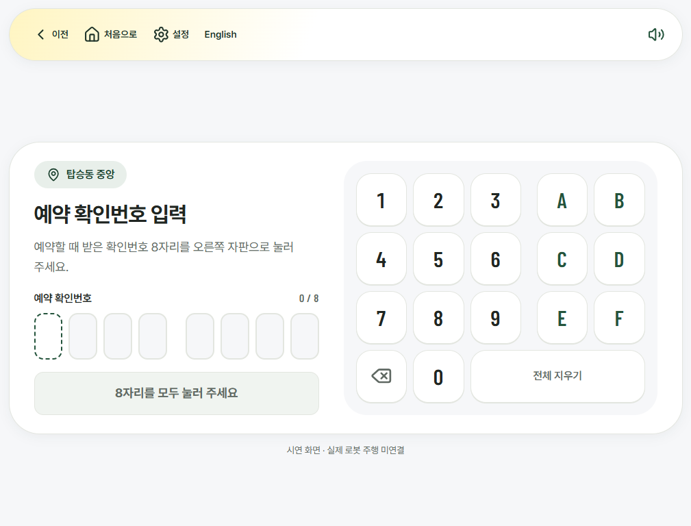 | 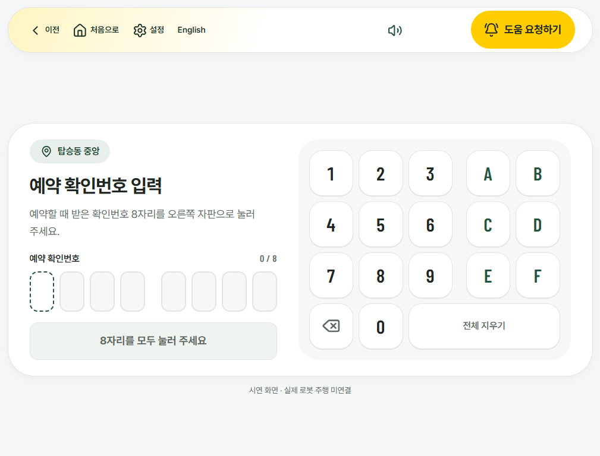 |
| 1080×1920 | 1920/1920 → 1920/1920 | 0 → 0 | 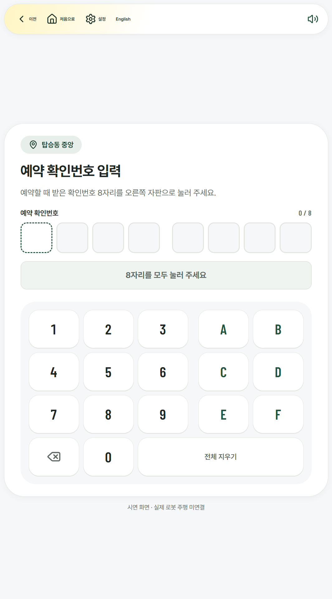 | 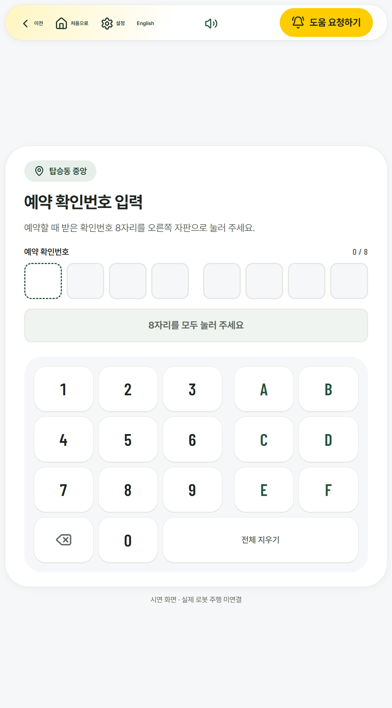 |

390px 키오스크는 큰 자판을 유지하므로 기존 세로 넘침이 있으며, 공용 바가 도움 자리를 확보하면서 높이 73px가 추가됩니다. 숨기거나 버튼을 빼서 맞추지 않았습니다. 실제 기기 3개 크기에서는 세로 넘침이 없습니다.

## 초안의 간헐적 가림을 재현한 전 → 수정 뒤

아래 전은 main이 아니라 도움 단추를 붙인 기존 PR 초안입니다. 양쪽 모두 외부 JS 6개를 보류한 초기 HTML에서 폰트 준비 후 측정했습니다. 요청 배율은 1·1.5배이며, 전은 실제 배율 자체가 아직 붙지 않은 상태였습니다.

| 크기 | 요청 배율 | 초기 공간 예약 전 → 뒤 | 가린 메뉴 전 → 뒤 |
|---|---|---|---|
| 1920×1080 | 1 | 없음 → 적용 | 없음 → 없음 |
| 1920×1080 | 1.5 | 없음 → 적용 | 없음 → 없음 |
| 1024×768 | 1 | 없음 → 적용 | 설정·English → 없음 |
| 1024×768 | 1.5 | 없음 → 적용 | 설정·English → 없음 |
| 1080×1920 | 1 | 없음 → 적용 | English → 없음 |
| 1080×1920 | 1.5 | 없음 → 적용 | English → 없음 |

재현 가림 4/6 → 0/6. 뒤는 6개 모두 data-kiosk·공간 예약·요청한 실제 배율을 확인했습니다.

| 조건 | 초안의 초기 HTML | 수정 뒤 초기 HTML |
|---|---|---|
| 1024×768, 글자1.5배 | 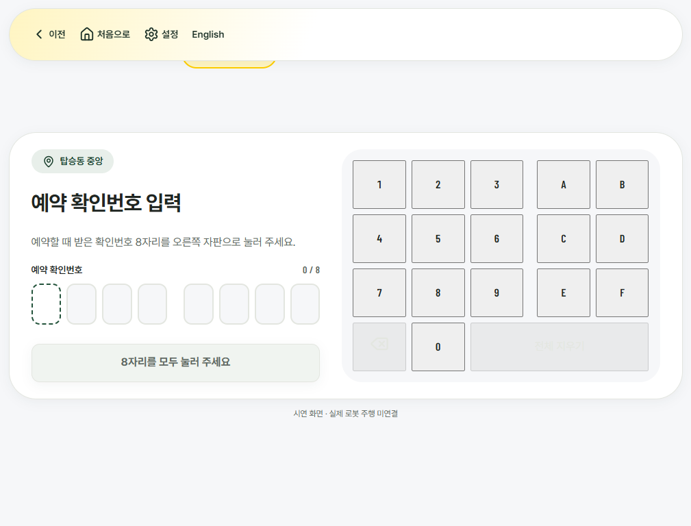 | 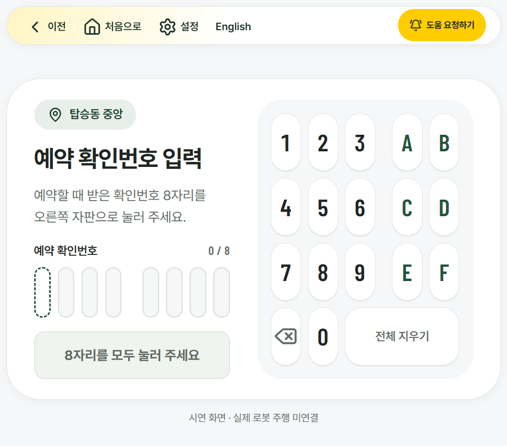 |
| 1080×1920, 글자1.5배 | 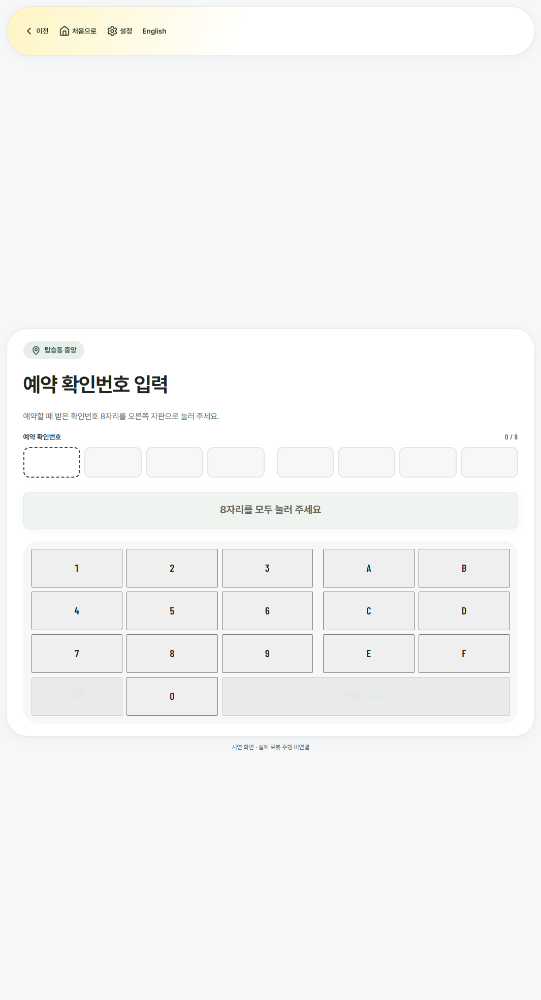 | 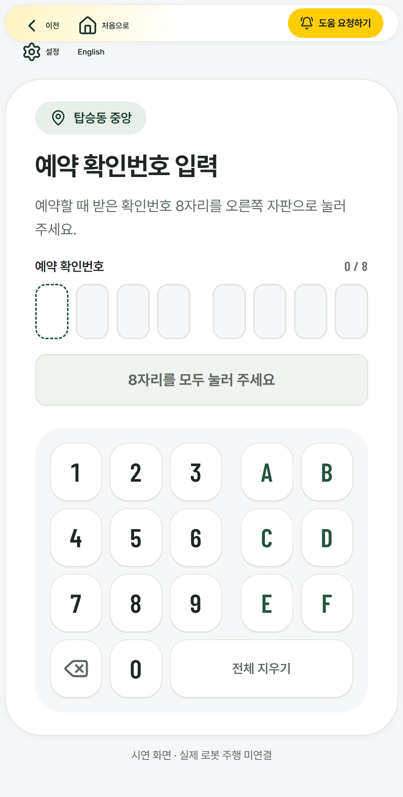 |

## 공용 크기·위치 비교

안내·입구·방문 기록 각각을 실제 설정 1·1.5배로 열었습니다. 3개 화면 × 3개 기기 크기 × 2개 배율의 18개 조건에서 메뉴 가림 0개이며, 같은 크기·배율에서 세 화면의 버튼 사각형이 모두 같습니다. 아래 값은 CSS px, 소수 셋째 자리 반올림입니다.

| 크기 | 배율 | x | y | 너비 | 높이 |
|---|---|---|---|---|---|
| 1920×1080 | 1 | 1331.734 | 22 | 252.766 | 78 |
| 1920×1080 | 1.5 | 1332.641 | 22 | 251.859 | 78 |
| 1024×768 | 1 | 791.5 | 18.391 | 175 | 64 |
| 1024×768 | 1.5 | 792.141 | 18.391 | 174.359 | 64 |
| 1080×1920 | 1 | 759.734 | 22 | 252.766 | 78 |
| 1080×1920 | 1.5 | 760.641 | 22 | 251.859 | 78 |

일반 로딩에서도 기기 6조건과 390px 2조건의 총 8개 조건에서 공용 공간 예약 적용·메뉴 가림 0개를 확인했습니다.

## 점검

- tsc 오류 0.
- eslint 오류 0, 기존 경고 3개.
- vitest 1015 통과, 5 건너뜀(파일 64 통과, 1 건너뜀).
- 최신 main을 합친 이 실행의 전체 배치 검사: 바꾸기 전 216개·문제 0개, 뒤 216개·문제 0개. 이전 초안 실행의 문제 4개는 간헐적이었으며, 위 초기 로딩 지연 재현으로 원인을 확인했습니다.
- 전체 E2E: 295/295 통과, 실패 0개, 실제 화면 그림 66장. 초기 로딩 지연 회귀 검사와 해당 화면의 접근성 검사를 포함합니다. 검사 중 파일을 수정하지 않았습니다.

## 확인 못 한 것

- 실제 기기의 카메라·마이크·진동·직원 실제 출동은 확인하지 않았습니다.
- 초기 JS 지연은 브라우저 요청 보류로 재현했습니다. 모든 실제 통신 환경을 재현한 것은 아닙니다.
- 병합·main push·직접 배포하지 않았습니다.
