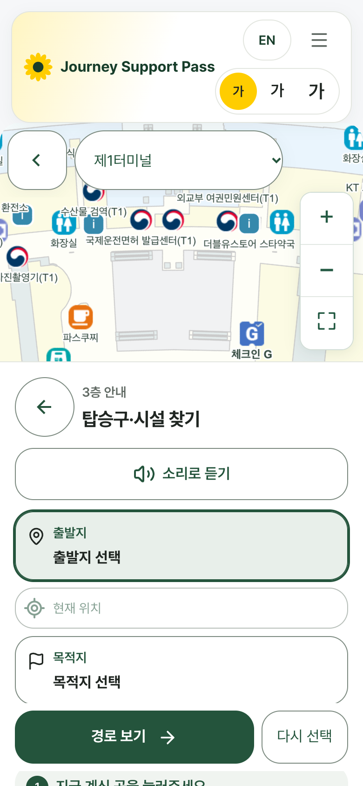
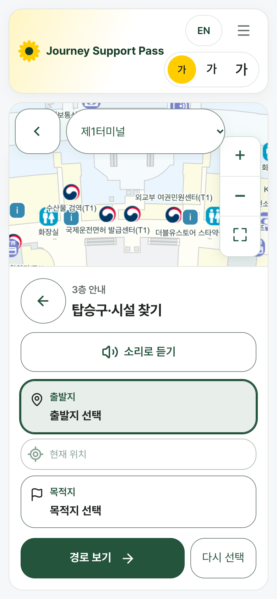
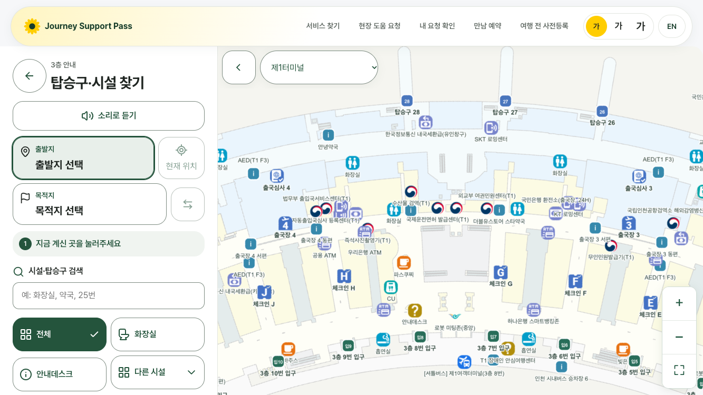
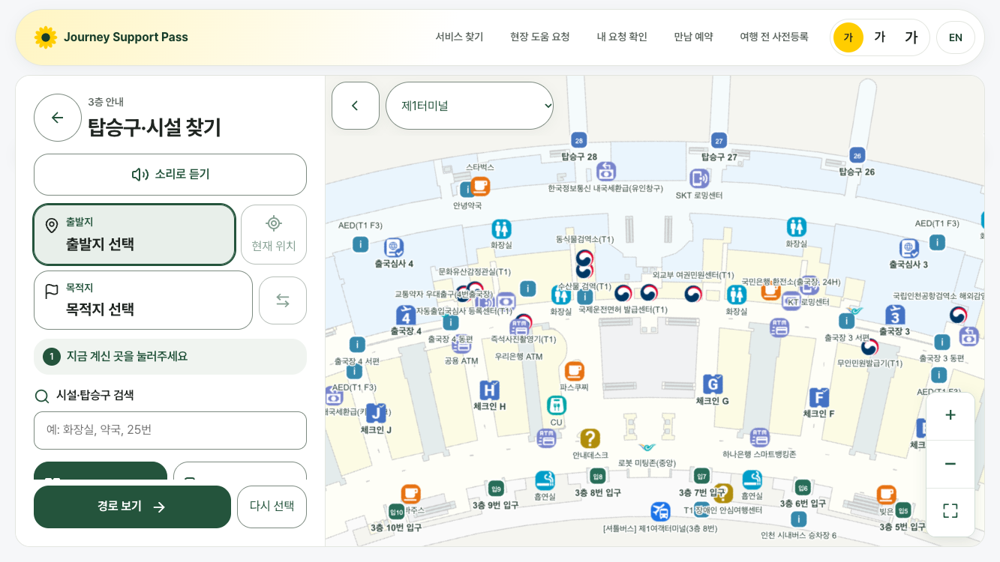
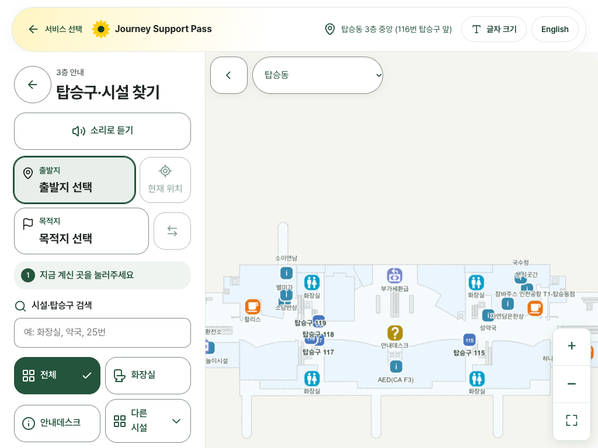
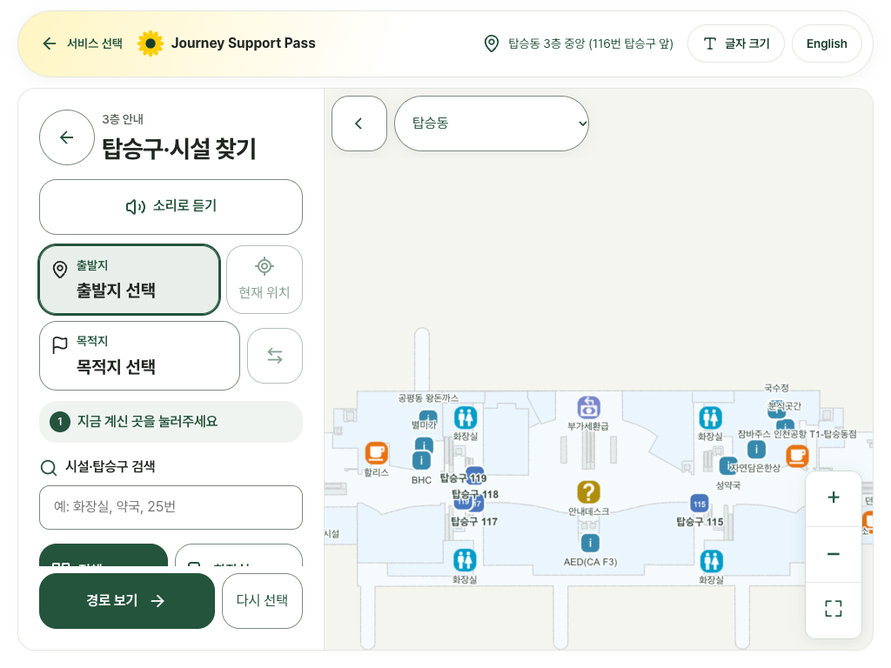
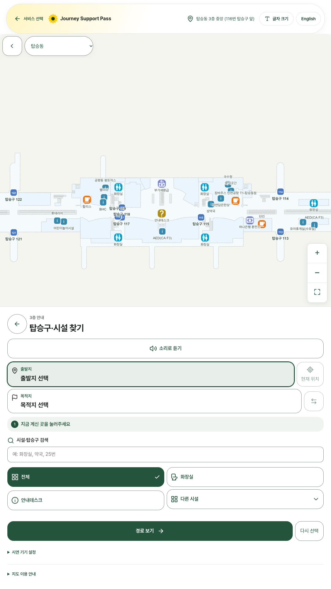
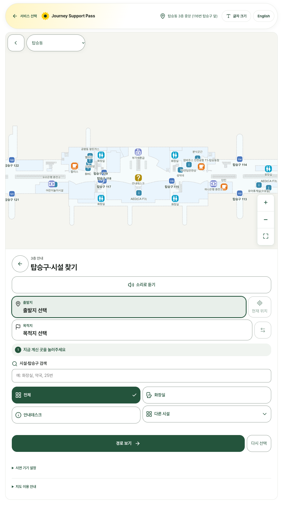

# 탑승구·시설 찾기(/navigate) 지도 화면 끝선·진행 버튼 정리

지도가 핵심인 화면이라 소개 박스는 넣지 않았습니다(지도 높이를 지키기 위해). 대신 첫 화면과 같은 끝선·둥근 카드 틀로 맞추고, 주요 버튼 「경로 보기」가 어느 크기에서도 보이게 했습니다.

## 바꾼 화면
- /navigate (같은 지도 부품을 쓰는 이동 지원 지도 화면도 함께 적용)
  - 전체 화면 지도(`facility-map.module.css` `.fullscreen`)를 화면 끝까지 차는 대신 위쪽 바와 같은 끝선, 바 아래 간격, 아래 여백(`--site-bar-gutter`)을 둔 1px 선의 둥근 카드로 바꿨습니다. 지도 그림과 옆 칸도 같은 둥근 모서리를 씁니다.
  - 「경로 보기 / 다시 선택」 줄(`navigation-map.module.css` `.actions`)을 옆 칸 아래에 붙였습니다(`position: sticky`). 옆 칸이 길어 칸 안에서 스크롤돼도 주요 버튼은 늘 보입니다. 휴대전화 아래 칸에서도 같습니다.
  - 「이용 기기 · 시연」 선택은 PR #91에서 이미 「시연 기기 설정」 접기 안으로 들어가 있어 그대로 두었습니다.
- 새 CSS 파일·`!important`·색 코드·고정 px 크기·`overflow: hidden/clip`은 더하지 않았습니다. 지도 모서리는 원래 있던 `overflow: auto` 칸의 `border-radius`로 둥글게 했습니다.

## 크기별 실측 (바꾸기 전 → 뒤)
px 단위. 지도 좌우는 전체 화면 지도 상자의 왼쪽·오른쪽 끝입니다. 키오스크는 공개 시연 설치 코드로 연 세션입니다.

| 크기 | 글자 | 세로 doc/vh | 옆 넘침 | 바 끝선 | 지도 좌우 (전 → 후) | 옆 칸 내용/높이 (전 → 후) | 「경로 보기」 화면 안 (전 → 후) |
|---|---|---|---|---|---|---|---|
| 390x844 | ×1 | 844/844 → 844/844 | 0 | [12, 378] | [0, 390] → [12, 378] | 966/455 → 974/455 | 보임 → 보임 |
| 390x844 | ×1.5 | 844/844 → 844/844 | 0 | [12, 378] | [0, 390] → [12, 378] | 1564/455 → 1649/455 | 보임 → 보임 |
| 1280x633 | ×1 | 633/633 → 633/633 | 0 | [20, 1260] | [0, 1280] → [20, 1260] | 905/545 → 937/511 | **안 보임** → 보임 |
| 1280x633 | ×1.5 | 633/633 → 633/633 | 0 | [20, 1260] | [0, 1280] → [20, 1260] | 1354/545 → 1402/505 | **안 보임** → 보임 |
| 1333x750 | ×1 | 750/750 → 750/750 | 0 | [20, 1313] | [0, 1333] → [20, 1313] | 905/662 → 937/628 | **안 보임** → 보임 |
| 1333x750 | ×1.5 | 750/750 → 750/750 | 0 | [20, 1313] | [0, 1333] → [20, 1313] | 1354/662 → 1402/622 | **안 보임** → 보임 |
| 1366x657 | ×1 | 657/657 → 657/657 | 0 | [20, 1346] | [0, 1366] → [20, 1346] | 905/569 → 937/535 | **안 보임** → 보임 |
| 1366x657 | ×1.5 | 657/657 → 657/657 | 0 | [20, 1346] | [0, 1366] → [20, 1346] | 1354/569 → 1402/529 | **안 보임** → 보임 |
| 1920x937 | ×1 | 937/937 → 937/937 | 0 | [288, 1632] | [0, 1920] → [288, 1632] | 905/831 → 937/797 | 보임 → 보임 |
| 1920x937 | ×1.5 | 937/937 → 937/937 | 0 | [288, 1632] | [0, 1920] → [288, 1632] | 1354/831 → 1402/791 | **안 보임** → 보임 |
| 키오스크 1920x1080 | ×1 | 1080/1080 → 1080/1080 | 0 | [288, 1632] | [0, 1920] → [288, 1632] | 970/970 → 952/936 | 보임 → 보임 |
| 키오스크 1920x1080 | ×1.5 | 1080/1080 → 1080/1080 | 0 | [288, 1632] | [0, 1920] → [288, 1632] | 1376/970 → 1424/930 | **안 보임** → 보임 |
| 키오스크 1024x768 | ×1 | 768/768 → 768/768 | 0 | [20, 1004] | [0, 1024] → [20, 1004] | 932/679 → 964/645 | **안 보임** → 보임 |
| 키오스크 1024x768 | ×1.5 | 768/768 → 768/768 | 0 | [20, 1004] | [0, 1024] → [20, 1004] | 1376/679 → 1424/639 | **안 보임** → 보임 |
| 키오스크 1080x1920 | ×1 | 1920/1920 → 1920/1920 | 0 | [20, 1060] | [0, 1080] → [20, 1060] | 920/920 → 952/952 | 보임 → 보임 |
| 키오스크 1080x1920 | ×1.5 | 1920/1920 → 1920/1920 | 0 | [20, 1060] | [0, 1080] → [20, 1060] | 1376/1036 → 1424/1036 | **안 보임** → 보임 |

## 점검
- tsc 통과, eslint src 오류 0(기존 경고 3), vitest 1010 통과·5 건너뜀.
- layout-check: 132개 화면 문제 0개. 첫 실행은 브라우저 화면 크기 설정 단계에서 점검 도구가 멈춰 결과 없이 끝났고, 다시 돌린 결과입니다.
- e2e: 289개 중 288개 통과, 1개 실패. 실패 항목은 「모의 체크인이 정확히 2건」 통계(`checkins === 2`)이며 6건으로 나왔습니다. 같은 날 같은 로컬 DB에서 세 번째로 점검을 돌려 기록이 쌓인 결과이고, PR #90 점검에서도 같은 이유로 실패했습니다. 화면 흐름 점검은 모두 통과했습니다.

## 화면 그림
| 크기 | 전 | 후 |
|---|---|---|
| 휴대전화 390 |  |  |
| 노트북 1333 |  |  |
| 키오스크 1024 |  |  |
| 세로 키오스크 1080 |  |  |

## 확인 못 한 것 / 남은 문제
- 옆 칸은 여전히 칸 안에서 스크롤됩니다(검색·필터 목록이 길어서). 주요 버튼은 늘 보이지만, 검색·필터를 아래로 내리거나 접는 정리는 하지 않았습니다.
- 여객 웹의 아래쪽 바(footer)는 고정된 지도 뒤에 가려집니다(바꾸기 전과 같음).
- 경로를 찾은 뒤 결과 칸과 저니봇 안내 단계는 화면 그림·실측을 따로 하지 않았습니다.
- 이동 지원(`/help?topic=mobility`)에서 지도가 열린 상태는 이번에 따로 재지 않았습니다(같은 지도 부품이라 같은 규칙이 적용됩니다).
