# 여객 패스(/p/[token], /p/[token]/help) 화면을 첫 화면 틀로 통일

## 바꾼 화면
- `/p/[token]` (내 등록)
  - 휴대전화처럼 가운데 좁은 한 줄이던 화면을 위쪽 바와 같은 끝선으로 넓혔습니다(`passenger-layout.css` `.ph-pass`, 바와 같은 `--w` 공식).
  - 「Journey Support Pass · 내 등록 · 고유 일련 번호」를 노란 그라데이션 소개 박스(`.ph-hero`)에 담았습니다.
  - 그 아래를 카드로 나눴습니다. 노트북(1101px 이상)은 세 칸(지금 할 일 / 준비 상황 / 고른 안내), 태블릿은 두 칸, 휴대전화는 한 줄입니다. 나란한 카드는 높이가 같습니다.
  - 카드 안의 「고른 안내」 줄은 상자 없이 선으로만 나눴습니다(상자 속 상자 없음).
  - 여러 줄 설명을 한 줄로 줄였습니다(`i18n.ts` 한국어·영어). 탑승권 연결 버튼 아래의 같은 뜻 설명 한 줄은 뺐습니다. 기능·버튼은 그대로입니다.
- `/p/[token]/help`
  - 소개 박스 위에 따로 있던 「내 등록으로 / English / 큰 글씨」 줄을 없앴습니다. 언어·글자 크기는 위쪽 바에 이미 있습니다.
  - 「내 등록으로」는 소개 박스의 「← 이전」 자리로 옮겼습니다(첫 단계에서 「이전」이 「내 등록으로」가 되고 내 등록 화면으로 갑니다).
  - 감싸던 `.public-request-layout.request-solo` 칸을 없애 `/help`와 같은 틀로 열립니다. 쓰이지 않게 된 `.request-solo` 규칙은 지웠습니다.
- 새 CSS 파일·`!important`·색 코드·고정 px 크기·`overflow: hidden/clip`은 더하지 않았습니다.

## 크기별 실측 (바꾸기 전 → 뒤)
px. 로컬 DB에 시연 패스(MK701, 체크인 전, 도움 요청 내역 없음)를 등록해 쟀습니다. 키오스크는 시연 설치 세션입니다.

| 화면 | 크기 | 글자 | 세로 doc/vh | 옆 넘침 | 바 끝선 | 본문 끝선 (뒤) |
|---|---|---|---|---|---|---|
| /p/[token] | 390x844 | ×1 | 1719 → 1527 / 844 | 0 | [12, 378] | [12, 378] |
| /p/[token] | 390x844 | ×1.5 | 3018 → 2685 / 844 | 0 | [12, 378] | [12, 378] |
| /p/[token] | 1280x633 | ×1 | 1556 → **633** / 633 | 0 | [20, 1260] | [20, 1260] |
| /p/[token] | 1280x633 | ×1.5 | 2285 → 985 / 633 | 0 | [20, 1260] | [20, 1260] |
| /p/[token] | 1333x750 | ×1 | 1556 → **750** / 750 | 0 | [20, 1313] | [20, 1313] |
| /p/[token] | 1333x750 | ×1.5 | 2285 → 1047 / 750 | 0 | [20, 1313] | [20, 1313] |
| /p/[token] | 1366x657 | ×1 | 1556 → **657** / 657 | 0 | [20, 1346] | [20, 1346] |
| /p/[token] | 1366x657 | ×1.5 | 2285 → 980 / 657 | 0 | [20, 1346] | [20, 1346] |
| /p/[token] | 1920x937 | ×1 | 1574 → **937** / 937 | 0 | [288, 1632] | [288, 1632] |
| /p/[token] | 1920x937 | ×1.5 | 2302 → 1065 / 937 | 0 | [288, 1632] | [288, 1632] |
| /p/[token] | 키오스크 1920x1080 | ×1 | 1578 → 1080 / 1080 | 0 | [288, 1632] | [288, 1632] |
| /p/[token] | 키오스크 1920x1080 | ×1.5 | 2307 → 1080 / 1080 | 0 | [288, 1632] | [288, 1632] |
| /p/[token] | 키오스크 1024x768 | ×1 | 1557 → 1065 / 768 | 0 | [20, 1004] | [20, 1004] |
| /p/[token] | 키오스크 1024x768 | ×1.5 | 2286 → 1680 / 768 | 0 | [20, 1004] | [20, 1004] |
| /p/[token] | 키오스크 1080x1920 | ×1 | 1920 → 1920 / 1920 | 0 | [20, 1060] | [20, 1060] |
| /p/[token] | 키오스크 1080x1920 | ×1.5 | 2307 → 1920 / 1920 | 0 | [20, 1060] | [20, 1060] |
| /p/[token]/help | 390x844 | ×1 | (재지 못함*) → 1232 / 844 | 0 | [12, 378] | [12, 378] |
| /p/[token]/help | 390x844 | ×1.5 | 2408 → 2357 / 844 | 0 | [12, 378] | [12, 378] |
| /p/[token]/help | 1280x633 | ×1 | 723 → **633** / 633 | 0 | [20, 1260] | [20, 1260] |
| /p/[token]/help | 1280x633 | ×1.5 | 1135 → 955 / 633 | 0 | [20, 1260] | [20, 1260] |
| /p/[token]/help | 1333x750 | ×1 | 837 → **750** / 750 | 0 | [20, 1313] | [20, 1313] |
| /p/[token]/help | 1333x750 | ×1.5 | 1306 → 1126 / 750 | 0 | [20, 1313] | [20, 1313] |
| /p/[token]/help | 1366x657 | ×1 | 723 → **657** / 657 | 0 | [20, 1346] | [20, 1346] |
| /p/[token]/help | 1366x657 | ×1.5 | 1135 → 955 / 657 | 0 | [20, 1346] | [20, 1346] |
| /p/[token]/help | 1920x937 | ×1 | 937 → 937 / 937 | 0 | [288, 1632] | [288, 1632] |
| /p/[token]/help | 1920x937 | ×1.5 | 1289 → 1109 / 937 | 0 | [288, 1632] | [288, 1632] |
| /p/[token]/help | 키오스크 1920x1080 | ×1 / ×1.5 | 1080 → 1080 / 1080 | 0 | [288, 1632] | [288, 1632] |
| /p/[token]/help | 키오스크 1024x768 | ×1 | 768 → 768 / 768 | 0 | [20, 1004] | [20, 1004] |
| /p/[token]/help | 키오스크 1024x768 | ×1.5 | 1031 → 1031 / 768 | 0 | [20, 1004] | [20, 1004] |
| /p/[token]/help | 키오스크 1080x1920 | ×1 / ×1.5 | 1920 → 1920 / 1920 | 0 | [20, 1060] | [20, 1060] |

\* 바꾸기 전 390x844 ×1 은 화면이 「접수 내역을 확인하고 있어요…」 상태일 때 찍혀 844 로 나왔습니다. 실제 값이 아니어서 비교하지 않습니다.

`/p/[token]` 은 휴대전화 화면이라 키오스크(`FlowShell kiosk={false}`)에서 쓰이지 않습니다. 키오스크 크기 값은 참고로만 적었습니다.

## 점검
- tsc 통과, eslint src 오류 0(기존 경고 3), vitest 1010 통과·5 건너뜀.
- layout-check: 132개 화면 문제 0개.
- e2e: 289개 중 289개 통과.

## 화면 그림
| 화면 | 크기 | 전 | 후 |
|---|---|---|---|
| /p/[token] | 390x844 | 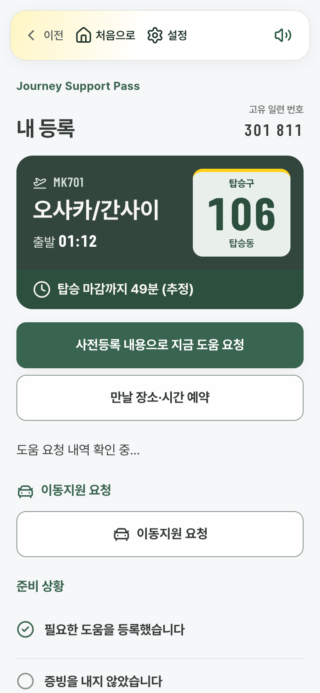 | 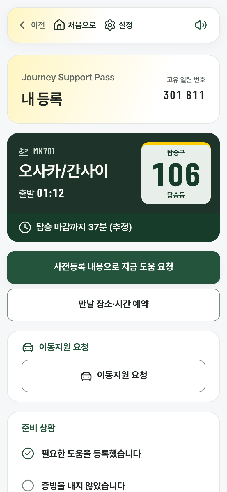 |
| /p/[token] | 1333x750 | 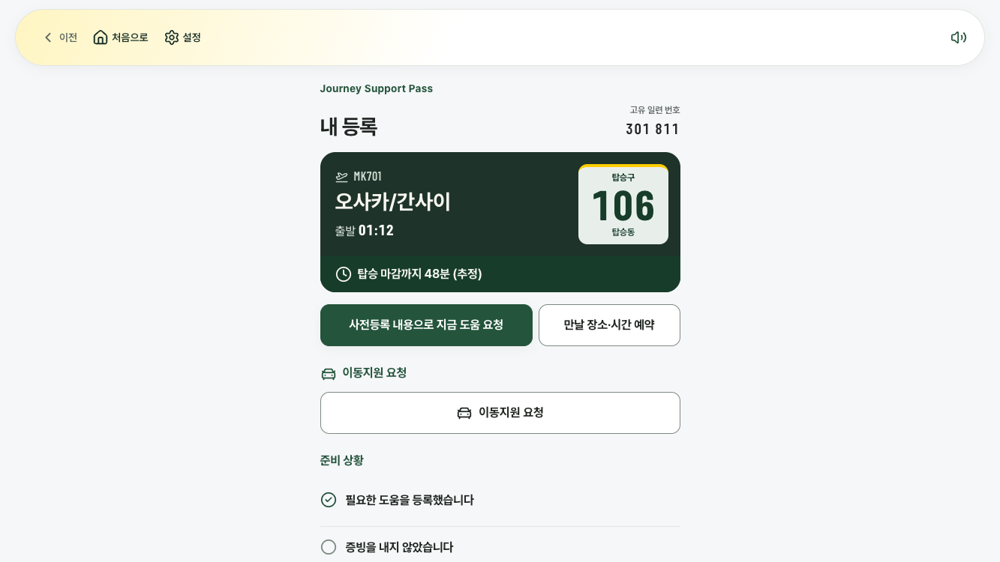 | 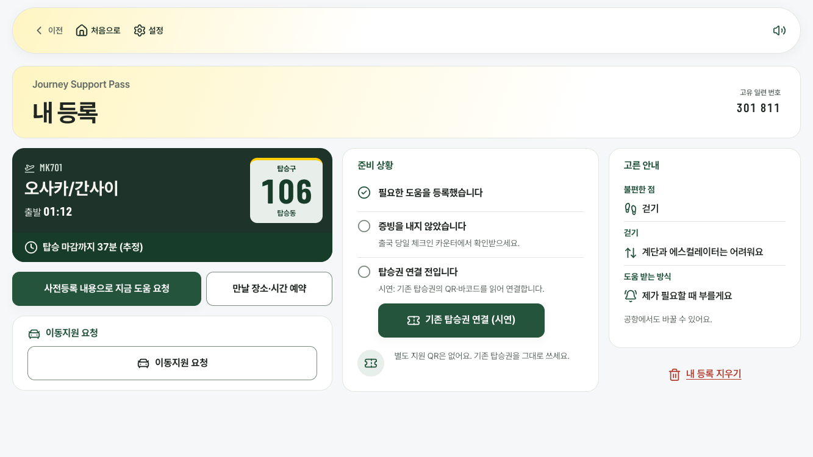 |
| /p/[token]/help | 390x844 | 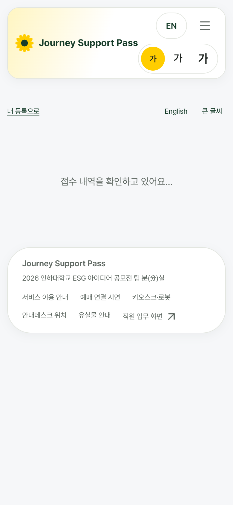 | 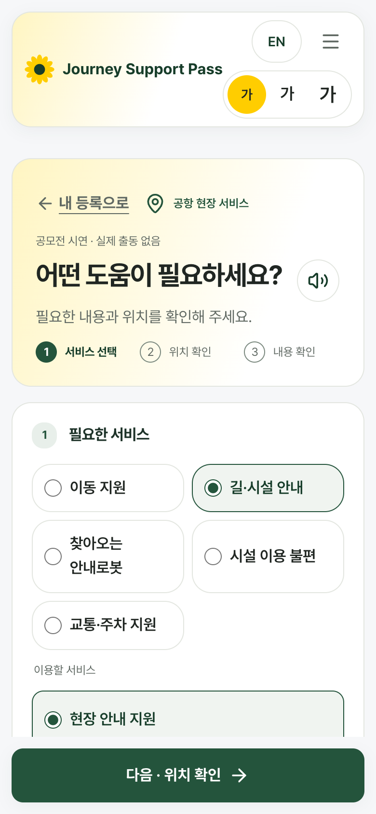 |
| /p/[token]/help | 1333x750 | 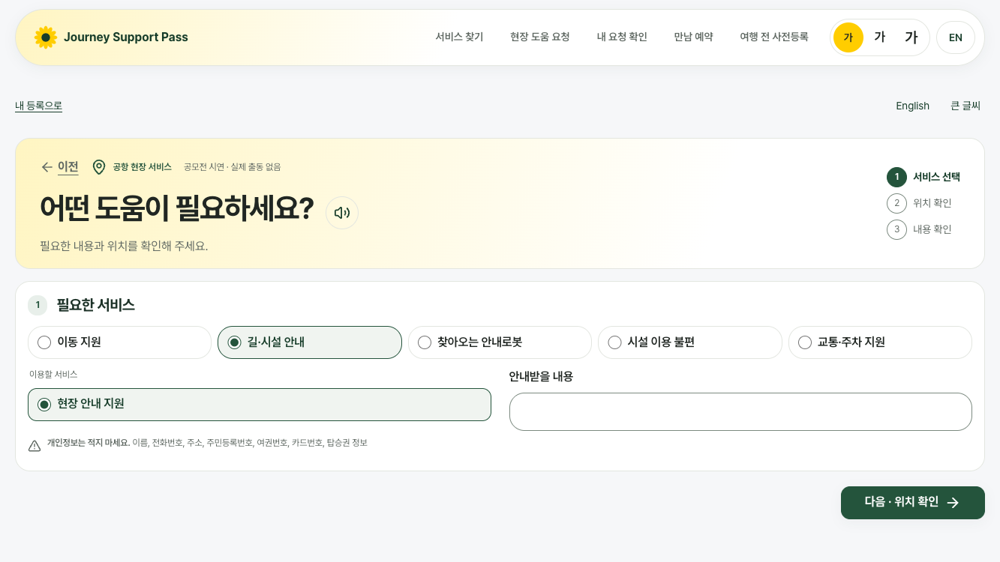 | 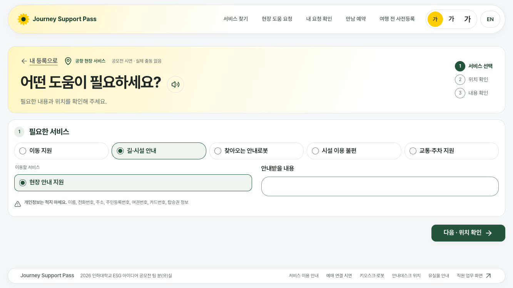 |
| /p/[token]/help | 키오스크 1920x1080 |  | 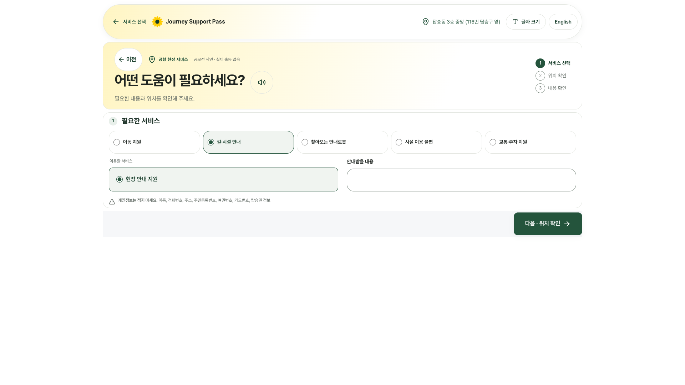 |
| /p/[token]/help | 키오스크 1024x768 |  | 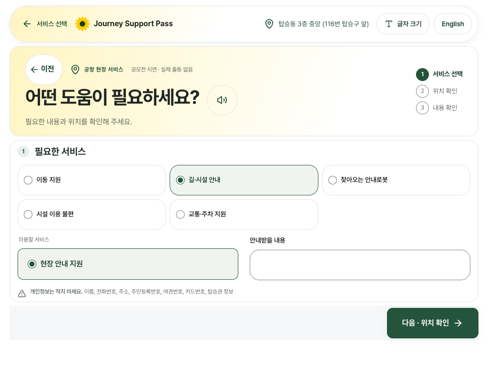 |
| /p/[token]/help | 키오스크 1080x1920 | 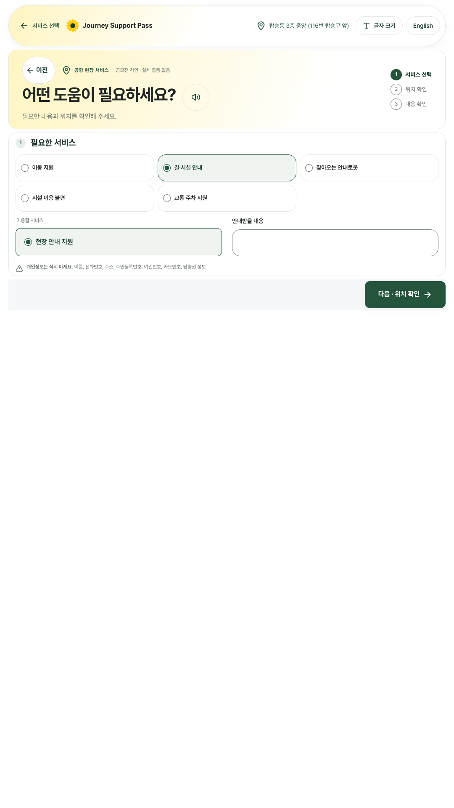 |  |

## 확인 못 한 것 / 남은 문제
- 체크인을 마친 패스(우대출구·키오스크 안내 줄이 보이는 상태)와 도움 요청 내역이 있는 패스는 크기별로 재지 않았습니다. e2e 의 해당 흐름(탑승권 연결, 영어 패스, 지운 패스)은 통과했습니다.
- 글자 1.5배에서는 노트북에서 `/p/[token]` 980~1065, `/p/[token]/help` 955~1126 으로 스크롤이 남습니다.
- `/p/[token]/help` 키오스크 1024x768 ×1.5 는 1031/768 로 스크롤이 남습니다(`/help` 와 같은, 원래 있던 문제).
- 「지웠습니다」 화면(`erased`)과 끝난·없는 패스 화면은 바꾸지 않았습니다.
