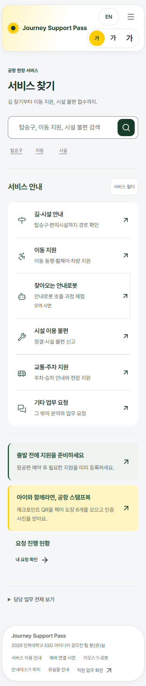
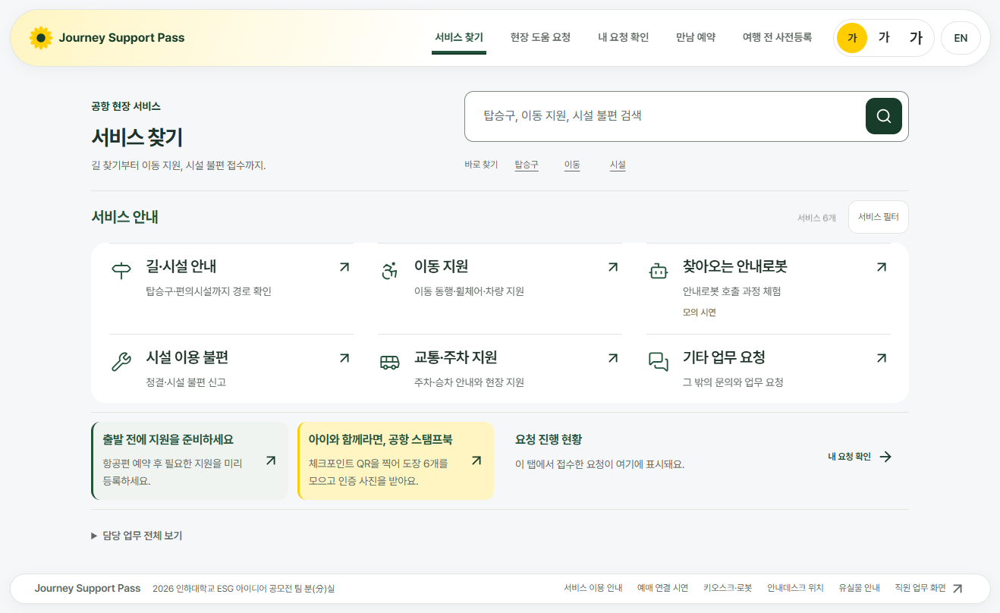
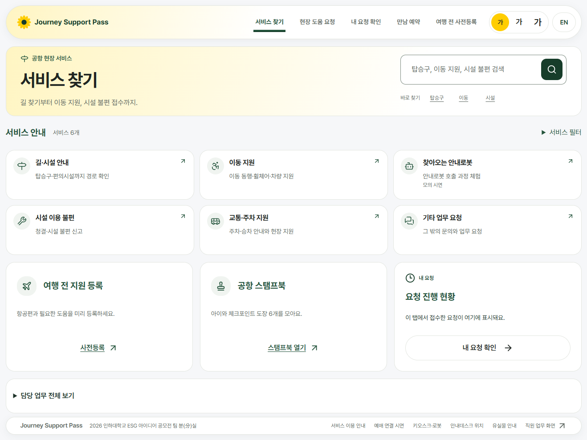
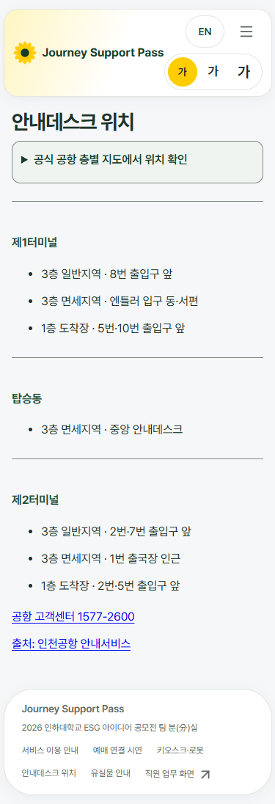
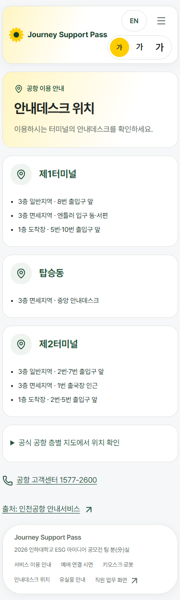
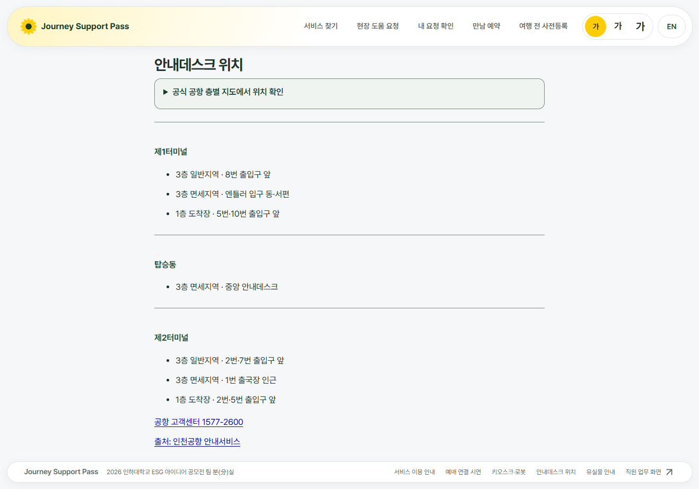
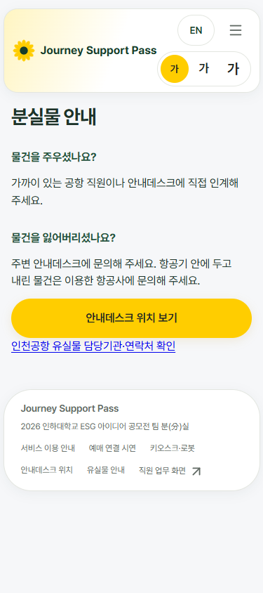
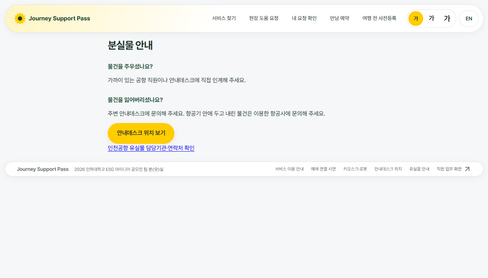
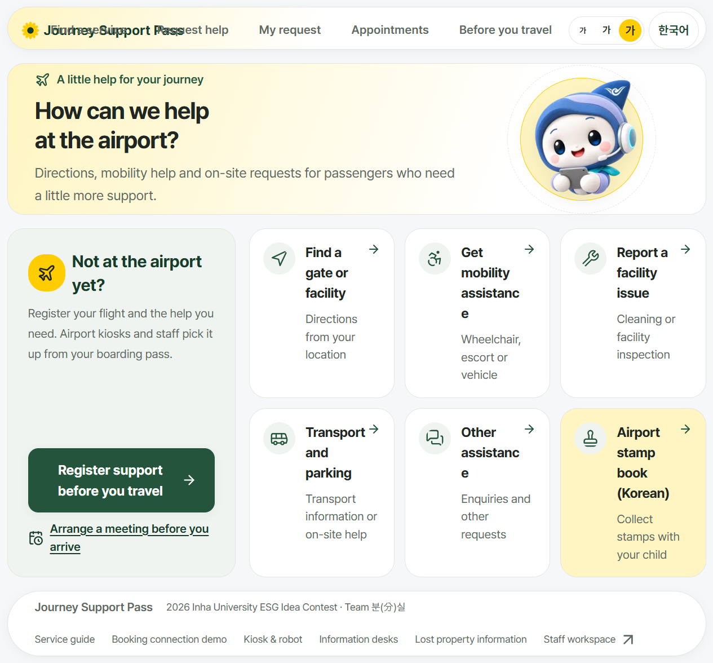
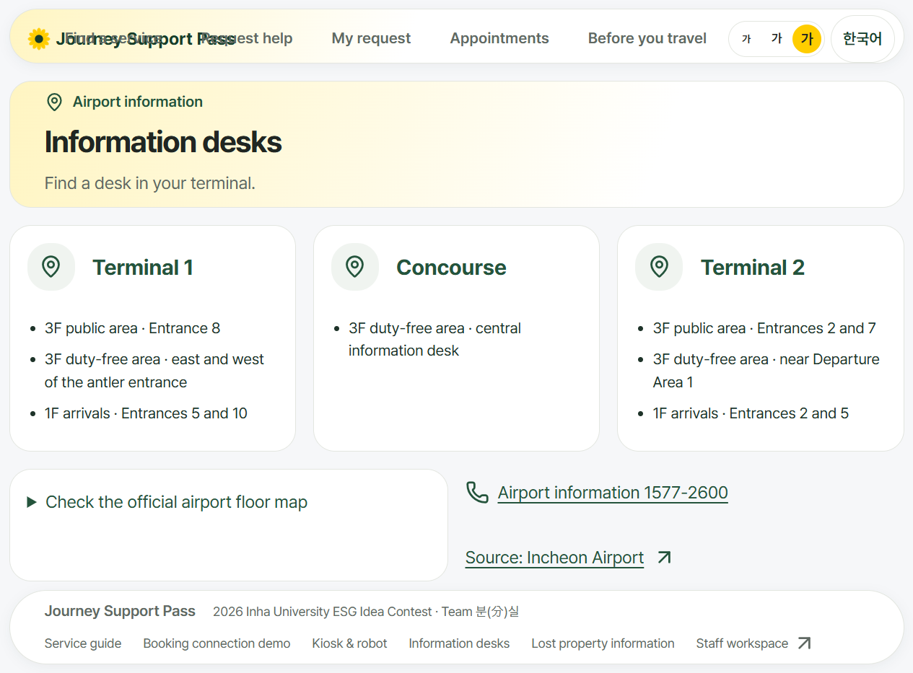

# 여객 서비스 화면 정리

기준 main: ad25d9d. 갈래: design/passenger-services. 대상은 /services, /services/desks, /services/lost-property 세 곳입니다.

## 바꾼 화면

- /services: 첫 화면의 ph-hero·ph-list·아이콘 칩을 재사용했습니다. 검색·필터·요청 확인·사전등록·스탬프북·담당 업무 펼치기를 유지했습니다.
- /services/desks: 소개 박스와 터미널별 흰 카드로 정리했습니다. 공식 지도 펼치기, 큰 창 링크, 전화·출처 링크를 유지했습니다. 낮은 노트북에서는 지도와 연락처를 나란히 둡니다.
- /services/lost-property: 소개 박스와 주운 물건·잃어버린 물건 카드의 높이를 맞췄습니다. 안내데스크 연결과 유실물 연락처를 유지했습니다.
- desk-locations 검색 결과: src/app/staff/** 0건. staff.css의 여객 전용 규칙 두 개를 제거하고 passenger.css로 옮겼습니다.
- 새 CSS 파일·import·색 코드·고정 px 크기·내용을 숨기는 overflow·!important를 추가하지 않았습니다. 상단 바·manifest 두 파일은 변경하지 않았습니다.

## 크기별 실측 (바꾸기 전 → 뒤)

단위 px. 끝선은 [왼쪽,오른쪽]이며 바 / 첫 본문 덩어리 순서입니다. sw는 가이드의 scrollWidth - clientWidth 원값으로, -15는 옆 넘침 없음입니다.

| 화면 | 크기 | 세로(doc/vh) | 옆 넘침(sw) | 바와 끝선 (바 / 본문) |
|---|---|---|---|---|
| /services | 390×844 | 1759/844 → 1967/844 | -15 → -15 | [5,371] / [20,355] → [5,371] / [5,371] |
| /services | 1333×750 | 808/750 → 989/750 | -15 → -15 | [13,1306] / [120,1198] → [13,1306] / [13,1306] |
| /services | 1920×937 | 937/937 → 1007/937 | -15 → -15 | [281,1625] / [425,1481] → [281,1625] / [281,1625] |
| /services/desks | 390×844 | 1096/844 → 1242/844 | -15 → -15 | [5,371] / [16,359] → [5,371] / [5,371] |
| /services/desks | 1333×750 | 923/750 → 750/750 | -15 → -15 | [13,1306] / [291,1027] → [13,1306] / [13,1306] |
| /services/desks | 1920×937 | 941/937 → 937/937 | -15 → -15 | [281,1625] / [585,1321] → [281,1625] / [281,1625] |
| /services/lost-property | 390×844 | 844/844 → 909/844 | -15 → -15 | [5,371] / [16,359] → [5,371] / [5,371] |
| /services/lost-property | 1333×750 | 750/750 → 750/750 | -15 → -15 | [13,1306] / [291,1027] → [13,1306] / [13,1306] |
| /services/lost-property | 1920×937 | 937/937 → 937/937 | -15 → -15 | [281,1625] / [585,1321] → [281,1625] / [281,1625] |
| /staff/login | 390×844 | 844/844 → 844/844 | -15 → -15 | [0,375] / [16,359] → [0,375] / [16,359] |
| /staff/login | 1333×750 | 750/750 → 750/750 | -15 → -15 | [0,1318] / [435,883] → [0,1318] / [435,883] |
| /staff/login | 1920×937 | 937/937 → 937/937 | -15 → -15 | [0,1905] / [729,1177] → [0,1905] / [729,1177] |
| /staff/desk | 390×844 | 1197/844 → 1197/844 | -15 → -15 | [0,375] / [32,343] → [0,375] / [32,343] |
| /staff/desk | 1333×750 | 1158/750 → 1158/750 | -15 → -15 | [240,1318] / [264,1294] → [240,1318] / [264,1294] |
| /staff/desk | 1920×937 | 1158/937 → 1158/937 | -15 → -15 | [240,1905] / [264,1881] → [240,1905] / [264,1881] |

- 여객 세 화면의 모든 최상위 덩어리가 변경 후 상단 바와 같은 끝선입니다.
- 직원 두 화면 × 세 크기는 doc/vh·옆 넘침·바/본문 끝선·각 본문 덩어리 높이까지 전후 동일합니다. 직원 안내데스크의 기존 세로 스크롤은 그대로입니다.
- /services는 긴 목록 예외를 적용했습니다. 전체 높이는 늘었지만 소개 박스와 첫 줄 카드는 화면 안에 보입니다: 390에서 609 → 610px, 1333에서 440 → 449px, 1920에서 458 → 467px.
- 나란한 본문 카드 높이: 1333에서 서비스 6개 각각 112px, 터미널 3개 각각 205px, 분실물 2개 각각 207px. 휴대전화의 세로로 쌓인 카드는 내용에 맞춰 높이를 사용합니다.

### 작은 검색 단추

| 크기 | 탑승구 | 이동 | 시설 | 기준 |
|---|---|---|---|---|
| 390×844 | 44×44 → 44×44 | 44×44 → 44×44 | 44×44 → 44×44 | 휴대전화 44·최소 24 충족 |
| 1333×750 | 44×44 → 44×44 | 44×44 → 44×44 | 44×44 → 44×44 | 최소 24 충족 |
| 1920×937 | 44×44 → 44×44 | 44×44 → 44×44 | 44×44 → 44×44 | 최소 24 충족 |

### 추가 크기 확인

한국어·영어, 320×640·768×1024·1280×633·1366×657, 글자 1배·1.5배 총 48개 조합을 확인했습니다. 모두 본문 옆 넘침 0, 바와 본문 끝선 일치입니다. 1.5배에서는 내용을 숨기지 않고 세로 스크롤을 허용합니다.

| 화면 | 언어 | 크기 | 세로(doc/vh) | 옆 넘침 | 서비스 첫 줄 아래끝 |
|---|---|---|---|---|---|

## 점검

- tsc: 통과.
- eslint src: 오류 0, 기존 경고 3 (RegisterFlow의 effect 의존성 1, StampBook의 img 2). 이번 변경 파일의 경고 없음.
- vitest: 1006 통과, 5 건너뜀. 테스트 파일 63 통과, 1 건너뜀.
- layout-check: 132개 화면, 문제 0개 (새로 탐지 0 / 기존 탐지 0). 아래 상단 바 겹침은 이 자동 검사에 포함되지 않아 별도로 기록합니다.
- e2e: 289 / 289 통과, 실패 0. 실행 중 파일을 수정하지 않았습니다.
- 대상 화면 추가 검사: 117개 통과. 검색·빠른 검색·결과 없음/초기화·모의 체험 필터·공식 지도 열기/닫기·영어 안내데스크 링크 이동 포함.
- 확인 서버: localhost:3100. 다른 개발 서버와 충돌하지 않도록 빌드 캐시와 로컬 시험 DB를 분리했습니다.

## 화면 그림

| 화면·크기 | 전 | 후 |
|---|---|---|
| services · 390 |  |  |
| services · 1333 |  |  |
| services-desks · 390 |  |  |
| services-desks · 1333 |  |  |
| services-lost-property · 390 |  |  |
| services-lost-property · 1333 |  |  |

## 확인 못 한 것 / 남은 문제

- **기존 공통 상단 바 겹침**: 1280×633, 영어, 글자 1.5배에서 로고와 Find a service / Request help 메뉴가 겹칩니다. 수정하지 않은 첫 화면 /에서도 같은 겹침을 직접 재현했습니다. 상단 바는 이번 세 화면의 변경 범위 밖이므로 그대로 두었습니다. 이 때문에 1.5배 전체 UI가 완전하다고 보고하지 않습니다.
- 수정하지 않은 첫 화면: 
- 대상 안내데스크: 
- 공식 외부 지도 서비스의 현장 데이터 정확도·외부 서버 장애 상황: 재지 않음. 지도 iframe 및 큰 창 링크가 열리는 것만 확인했습니다.
- 실제 휴대전화·실물 키오스크: 재지 않음. 이번 세 주소는 여객 웹이며 브라우저 뷰포트로 확인했습니다.
- /services 전체 목록 및 휴대전화 세로 스크롤은 허용 상태입니다. 내용을 자르거나 기능을 제거하지 않았습니다.
- 배포·병합은 하지 않습니다.
