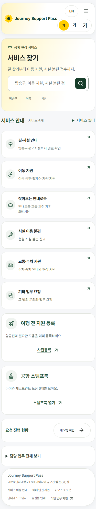
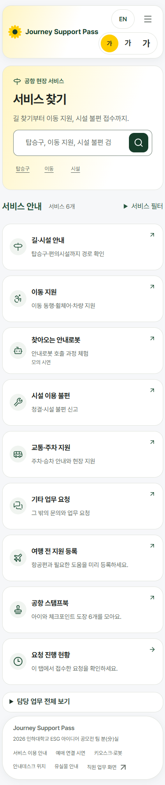
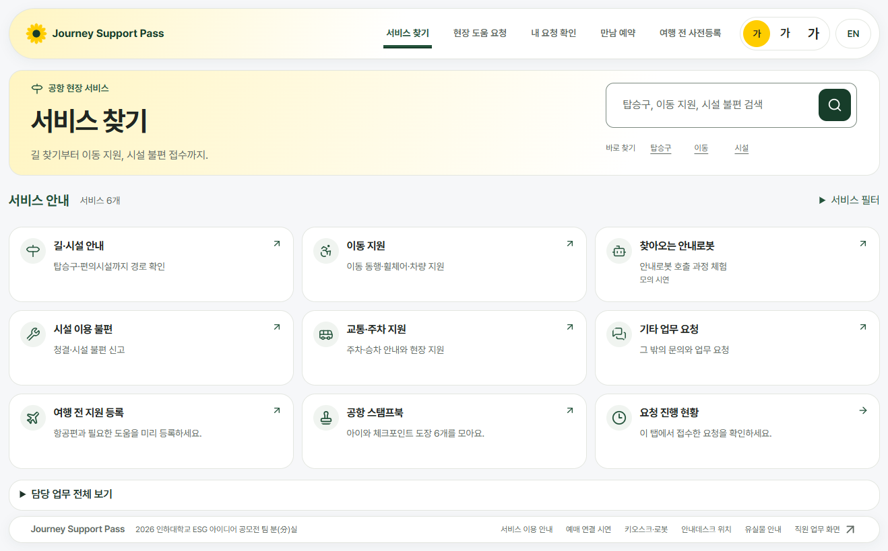
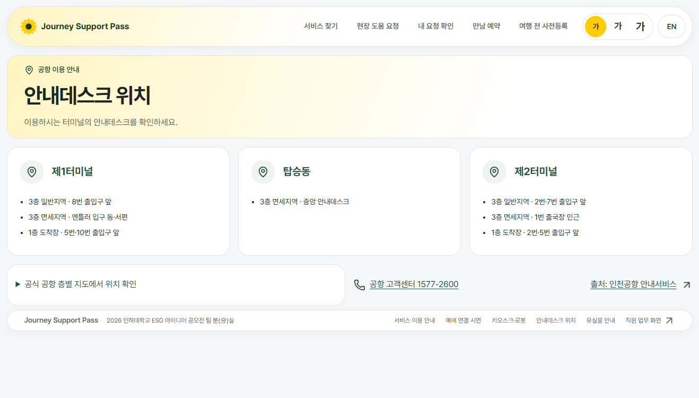
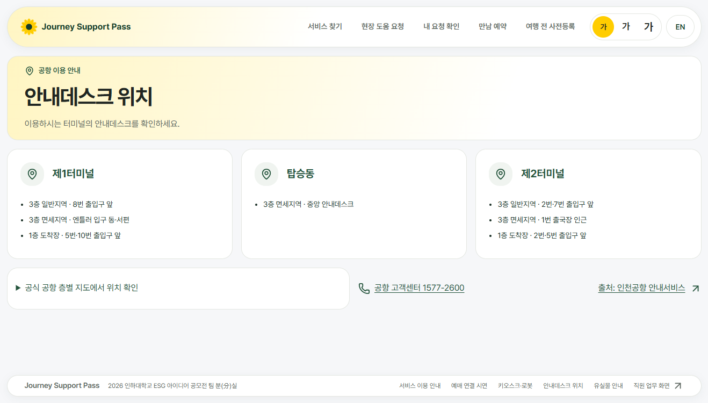
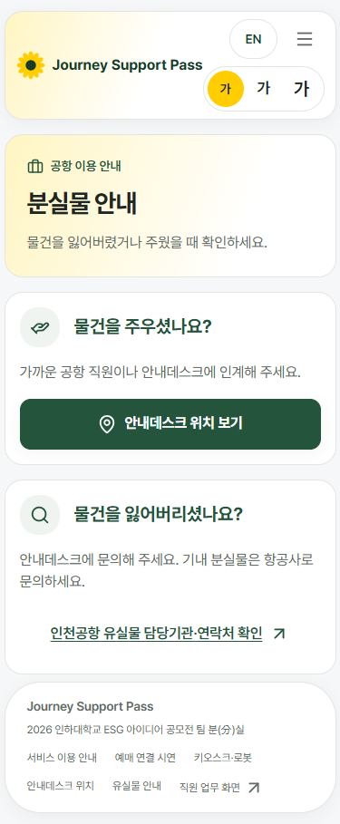
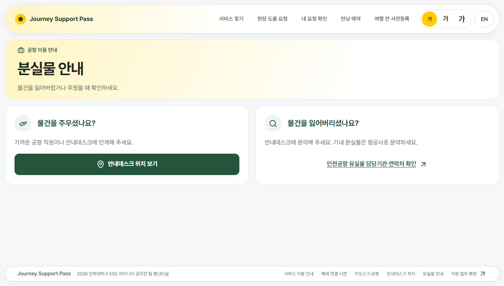

# 서비스 카드 격자와 짧은 화면 하단 바 정리

서비스별 본문 끝선과 카드 모양을 첫 화면의 공통 부품으로 맞췄습니다. 서비스 목록은 보조 카드 세 개까지 같은 격자에 넣어 스크롤을 줄였고, 안내데스크·분실물은 내용이 짧을 때 하단 바가 화면 아래에 놓입니다.

## 바꾼 화면

- /services: 서비스 카드 6개와 여행 전 지원 등록·공항 스탬프북·요청 진행 현황 3개를 하나의 ph-list 격자로 합쳤습니다. 노트북에서 3열×3줄, 카드 9개 모두 112px입니다. 별도 보조 카드 격자와 빈 여백을 제거했습니다.
- 요청 진행 현황은 기존 조회·갱신을 유지하는 작은 카드 형태를 추가했습니다. 실제 상태 표시와 /requests 연결을 유지하며, 다른 곳에서 쓰는 기본 패널은 그대로입니다.
- 검색·빠른 검색·필터·검색 결과 없음/초기화·담당 업무 전체 보기 기능을 유지했습니다. 필터를 적용해도 보조 카드 세 개는 남습니다.
- /services/desks, /services/lost-property: passenger-layout.css의 기존 .public-site:has(.ph-home) 두 규칙을 확장했습니다. 부모는 최소 화면 높이의 세로 flex, main은 남는 공간을 차지하고 내용은 위에 정렬합니다. footer는 화면에 고정하지 않아 긴 내용이나 지도 펼치기를 가리지 않습니다.
- 새 CSS 파일·!important·고정 px 크기·내용 숨김은 추가하지 않았습니다. manifest·상단 바·직원 CSS는 이번 추가 수정에서 건드리지 않았습니다.

## 크기별 실측 (바꾸기 전 → 뒤)

이번 전후 비교의 전은 PR #88 첫 커밋 d89b2c7입니다. px 단위이며, 세로는 doc/vh입니다. sw는 가이드의 scrollWidth - clientWidth 원값(-15는 넘침 없음)입니다.

| 화면 | 크기 | 세로(doc/vh) | 옆 넘침(sw) | 바와 끝선 | 수정 후 하단 바 아래끝 |
|---|---|---|---|---|---|
| /services | 390×844 | 1967/844 → 1772/844 | -15 (넘침 없음) | 일치 유지 | 1760px |
| /services | 1333×750 | 989/750 → 819/750 | -15 (넘침 없음) | 일치 유지 | 807px |
| /services | 1920×937 | 1007/937 → 937/937 | -15 (넘침 없음) | 일치 유지 | 825px |
| /services/desks | 390×844 | 1242/844 → 1242/844 | -15 (넘침 없음) | 일치 유지 | 1230px |
| /services/desks | 1333×750 | 750/750 → 750/750 | -15 (넘침 없음) | 일치 유지 | 738px |
| /services/desks | 1920×937 | 937/937 → 937/937 | -15 (넘침 없음) | 일치 유지 | 925px |
| /services/lost-property | 390×844 | 909/844 → 909/844 | -15 (넘침 없음) | 일치 유지 | 897px |
| /services/lost-property | 1333×750 | 750/750 → 750/750 | -15 (넘침 없음) | 일치 유지 | 738px |
| /services/lost-property | 1920×937 | 937/937 → 937/937 | -15 (넘침 없음) | 일치 유지 | 925px |

- /services 1333×750: **989 → 819px**, 170px 감소. 목표 800px보다 19px 큽니다. 구성은 상단 바와 본문 시작까지 104 + 소개 박스 157 + 필터 줄 44 + 카드 격자 360 + 덩어리 사이 간격 48 + 담당 업무 줄 46 + 하단 바와 여백 60 = **819px**입니다. 단추·글자를 억지로 줄이거나 내용을 숨기지 않았습니다.
- /services 390×844: **1967 → 1772px**, 195px 감소. 원래 main 기준 기록인 1759px보다 13px 큽니다. 원래 main의 1333 높이 808px와 비교하면 현재는 11px 큽니다.
- /services 1920×937: **1007 → 937px**, 세로 스크롤 없음.
- 짧은 두 화면은 노트북에서 하단 바 아래끝이 738/750, 큰 화면에서 925/937로 기존 아래 여백 **12px**만 남습니다. 휴대전화에서는 긴 본문을 따라 내려가며 하단 바가 내용을 가리지 않습니다.
- 하단 바의 수정 전 DOM 아래끝 좌표는 재지 않음. 전후 화면 그림과 수정 후 좌표를 제공합니다.
- 작은 검색 단추 3개는 세 크기에서 각각 **44×44px 유지**. 카드 전체도 링크로 누를 수 있습니다.

## 점검

- tsc: 통과.
- eslint src: 오류 0, 기존 경고 3 (RegisterFlow 의존성 1, StampBook img 2).
- vitest: **1006 통과, 5 건너뜀**.
- layout-check: **132개 화면, 문제 0개** (새로 탐지 0 / 기존 탐지 0).
- e2e: **289/289 통과, 실패 0**. 실행 중 제품 코드를 수정하지 않았습니다.
- 대상 화면 추가 검사 **34개 통과**: 끝선·옆 넘침·9개 카드 동일 높이·3열×3줄·44px 단추·하단 바 위치·검색·필터·담당 업무 펼치기·요청 상태 표시.
- 한국어/영어 × 세 크기 × 글자 1.5배 **18개 조합**, 본문 가로 넘침 없음.
- 검증 서버는 localhost:3110의 별도 실행 폴더입니다. 검사 시작 전 변경 파일과 원본 src의 파일 해시 불일치 0건을 확인했습니다. 빌드 캐시와 시험 DB를 분리해 이전 점검의 브라우저 프레임 오류와 누적 통계 영향을 피했습니다. 중단된 앞선 실행은 통과 결과에 포함하지 않았습니다.

## 화면 그림

| 화면·크기 | 전 | 후 |
|---|---|---|
| services · 390 |  |  |
| services · 1333 |  |  |
| services-desks · 390 |  |  |
| services-desks · 1333 |  |  |
| services-lost-property · 390 |  |  |
| services-lost-property · 1333 |  |  |

## 확인 못 한 것 / 남은 문제

- 기존 영어·글자 1.5배 공통 상단 바의 로고/메뉴 겹침은 남아 있습니다. 수정하지 않은 첫 화면에서도 확인된 공통 바 문제이며 이번 범위에서 고치지 않았습니다. layout-check의 문제 0은 이 겹침까지 없다는 뜻이 아닙니다.
- 실제 휴대전화·실물 키오스크: 재지 않음. 브라우저 뷰포트로 검사했습니다.
- 외부 지도 데이터 정확도와 외부 서버 장애 상황: 재지 않음.
- 초기 main과의 첫 비교 기록은 [d89b2c7의 보고서](https://github.com/rkdals0121/journey-support-pass/blob/d89b2c7ed18d5a246a5a119bc6a4080f5d6e1576/docs/design-before-after/passenger-services/README.md)에 남아 있습니다.
- 병합·운영 배포하지 않습니다.
