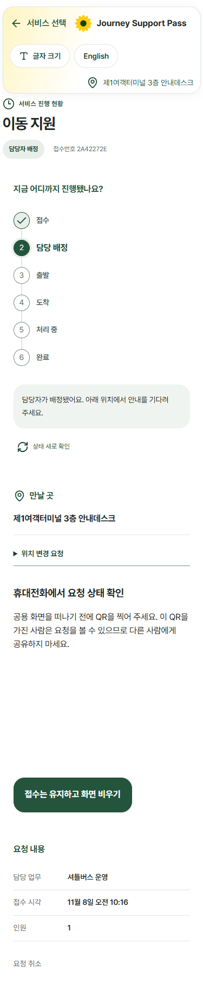
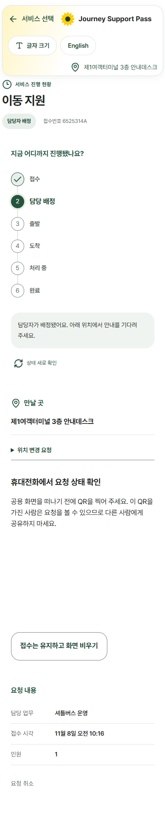
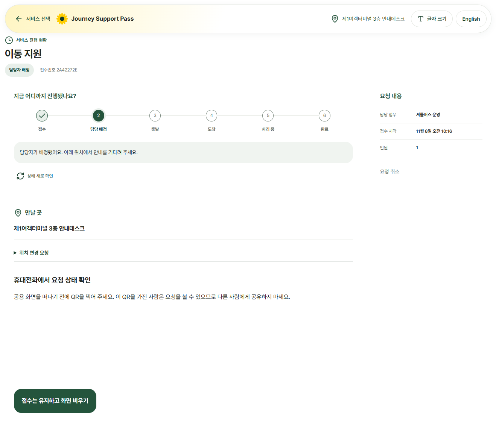
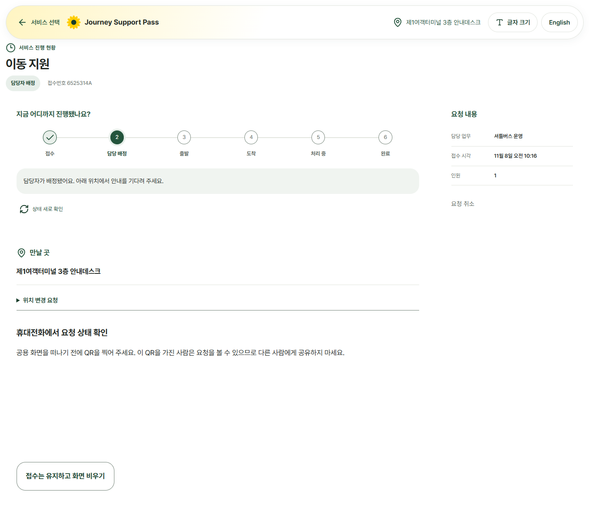
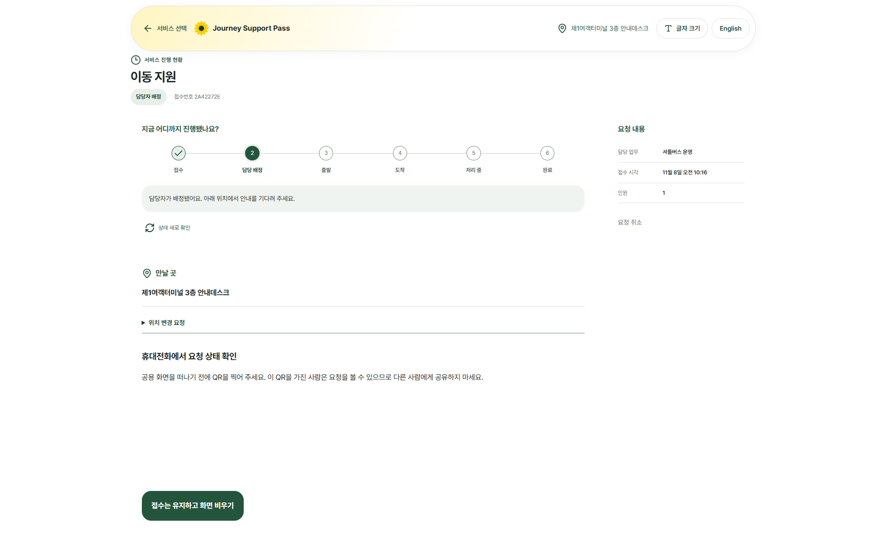
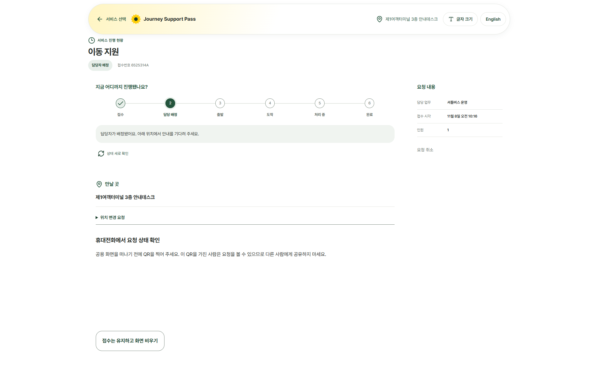
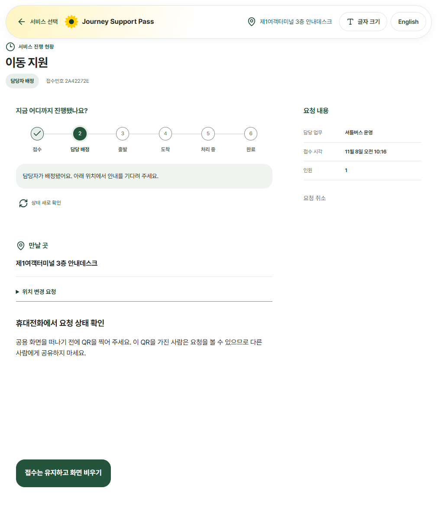
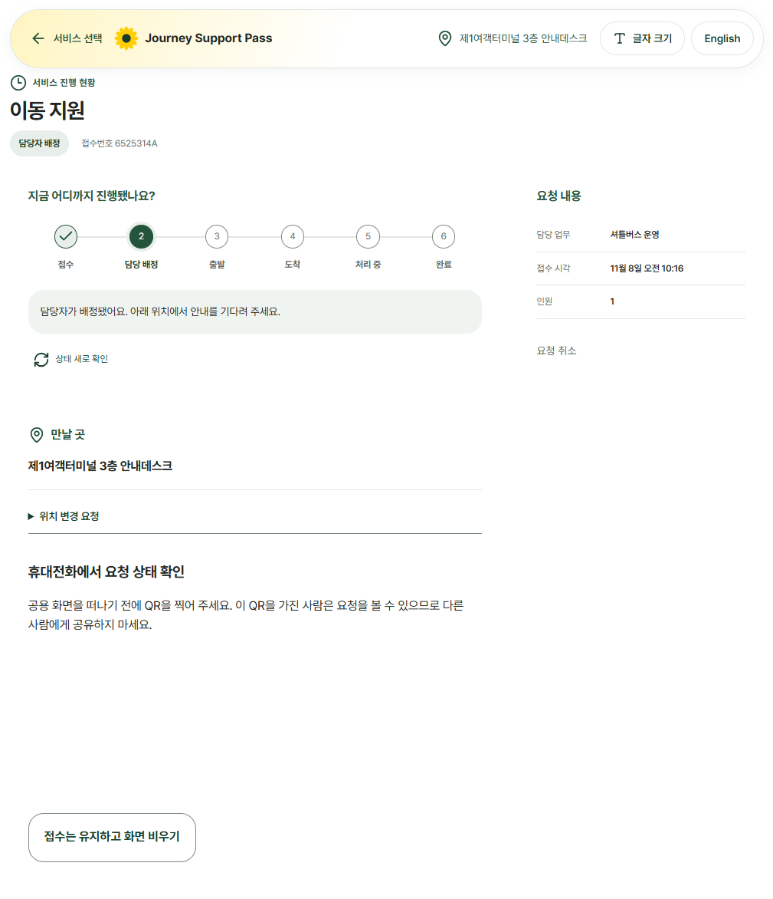
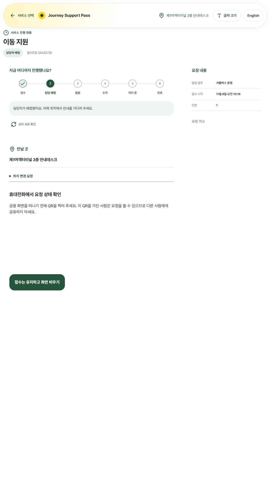
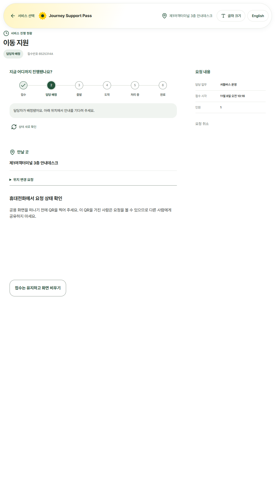

# 요청 진행 화면의 보조 버튼 대비

## 원인과 수정

- 대상은 `.public-button.public-button-secondary`의 「접수는 유지하고 화면 비우기」다. `.status-cancel`은 수정하지 않았다.
- 기존 `passenger.css`에서 보조 버튼 규칙 뒤에 기본 버튼 규칙이 있어, 기본 상태가 초록 바탕·흰 글자로 덮였다. PR #111의 공용 120ms 색 전환과 결합해 마우스를 올린 중간 시점의 대비가 2.38:1이 됐다.
- 기존 기본 버튼 규칙 바로 뒤에 hover·보조 버튼 규칙 세 줄을 옮겼다. 선택자·색 토큰·전환 시간·배치는 그대로다.
- 수정 후 기본 상태 12.09:1, hover 상태 10.34:1. 40ms에서 멈춘 전환과 움직임 줄이기 설정 모두 axe 대비 위반 0개.

## 크기별 실측

동일한 공유 기기의 이동지원 배정 후 화면이다. 변경 전 이미지는 브라우저 CSSOM에서 원본 선언 순서를 복원해 촬영했다. 요청 조회용 QR은 이미지 촬영 시에만 비공개 처리했고 제품 코드는 바꾸지 않았다.

| 크기 | 세로 doc/vh 전 → 후 | 가로 넘침 | 전 | 후 |
|---|---|---|---|---|
| 390×844 | 1839/844 → 1839/844 | 0 → 0 |  |  |
| 1333×750 | 1146/750 → 1146/750 | 0 → 0 |  |  |
| 1920×1080 | 1168/1080 → 1168/1080 | 0 → 0 |  |  |
| 1024×768 | 1172/768 → 1172/768 | 0 → 0 |  |  |
| 1080×1920 | 1920/1920 → 1920/1920 | 0 → 0 |  |  |

## 확인

- TypeScript 오류 0개. ESLint 오류 0개·기존 경고 3개.
- Vitest: 64개 파일 통과·1개 건너뜀, 1,015개 검사 통과·5개 건너뜀.
- 배치 점검: 216개 화면, 문제 0개.
- 전체 E2E: 초기 main은 288/289, 수정 후 새 시드 DB에서 289/289 통과. 실제 입구로봇 이동지원 접수 → 직원 배정 → 진행 현황의 대비 검사 통과.
- 임시 진단·화면 촬영 스크립트는 저장소 밖에 두었고 커밋하지 않았다.

## 남은 점

- 이 PR은 대비 수정이다. 공유 진행 화면의 기존 세로 넘침(가로 기기 3개 크기 포함)은 그대로이며 숨기지 않았다.
- 실물 키오스크 터치·조명과 화면 읽기 프로그램은 확인하지 않았다.
