# 직원 `/staff/login`, `/staff`, `/staff/requests` 정리

기준은 `docs/ui-guide.md`다. 7절에 따라 직원 화면은 **직원 틀(왼쪽 업무 메뉴 + 작업 면)을 그대로 두고**, 그 안의 부품만 웹 첫 화면(`/`)과 맞췄다. `/staff`는 `/staff/requests`로 넘어가는 주소라 따로 바꾼 것이 없다.

## 바꾼 것
- `/staff/login`
  - 위쪽 머리를 납작한 흰 띠에서 공용 둥근 바로 바꿨다. `site-bar.css`의 둥근 바 선택자 목록에 `.staff-login-brand`를 더했다.
  - 로그인 카드를 기준 카드(1px 선, 중간 모서리)로 바꿨다. 위쪽 굵은 초록 선은 뺐다.
  - 제목 옆에 아이콘 칩(방패)을 두고, 「지원 운영」 작은 머리글은 뺐다(제목 + 한 줄).
  - 카드 위 여백을 줄여 노트북에서 스크롤이 없다.
- `/staff/requests`
  - 요약 카드(근무 구역·오늘 접수·완료·확인 지연)를 한 줄 전체 폭으로 바꿨다. 태블릿에서도 네 칸이 한 줄이다(전에는 3+1).
  - 따로 크게 서 있던 「새로고침」은 범위 탭 줄 오른쪽에 「알림·설정」과 나란히 둔다. 휴대전화에서는 범위 고르기 칸 옆이다.
  - 도구 단추(새로고침·알림·설정·검색·상세 필터)와 검색칸을 한 모양으로 맞췄다: 1px 선, 카드와 같은 모서리, 같은 글자 크기. 전에는 단추마다 선 색·모서리·글자 크기가 달랐다.
  - 모든 줄(머리, 요약, 탭·도구, 검색, 목록)의 좌우 끝이 같다.
- CSS
  - 원래 규칙이 있는 `staff.css`·`staff-layout.css`에서 고쳤다.
  - 쓰이지 않게 된 규칙은 지웠다: `.staff-login-eyebrow`, 로그인 머리 띠, `.sx-summary`의 flex, 휴대전화의 `padding-right: 5.5rem`(옛 「알림·설정」 절대 위치용).
  - 새 CSS 파일, `!important`, 색 코드, 고정 px, `overflow: hidden` 은 더하지 않았다.

## 크기별 실측 (글자 1배, 바꾸기 전 → 뒤)
「바와 끝선」 칸은 직원 틀에 둥근 위쪽 바가 없으므로, 본문 덩어리들의 좌우 끝이 서로 같은지를 적었다(로그인은 카드와 아래 링크).

| 화면 | 크기 | 세로(doc/vh) | 옆 넘침 | 끝선 |
|---|---|---|---|---|
| `/staff/login` | 390×844 | 844/844 → 844/844 | 0 → 0 | 같음 → 같음 |
| `/staff/requests` (안내데스크) | 390×844 | 1168/844 → 1007/844 | 0 → 0 | 같음 → 같음 |
| `/staff/requests` (현장 직원) | 390×844 | 1105/844 → 945/844 | 0 → 0 | 같음 → 같음 |
| `/staff/login` | 1280×633 | 673/633 → 633/633 | 0 → 0 | 같음 → 같음 |
| `/staff/requests` (안내데스크) | 1280×633 | 640/633 → 633/633 | 0 → 0 | 같음 → 같음 |
| `/staff/requests` (현장 직원) | 1280×633 | 633/633 → 633/633 | 0 → 0 | 같음 → 같음 |
| `/staff/login` | 1333×750 | 750/750 → 750/750 | 0 → 0 | 같음 → 같음 |
| `/staff/requests` (안내데스크) | 1333×750 | 750/750 → 750/750 | 0 → 0 | 같음 → 같음 |
| `/staff/requests` (현장 직원) | 1333×750 | 750/750 → 750/750 | 0 → 0 | 같음 → 같음 |
| `/staff/login` | 1366×657 | 675/657 → 657/657 | 0 → 0 | 같음 → 같음 |
| `/staff/requests` (안내데스크) | 1366×657 | 657/657 → 657/657 | 0 → 0 | 같음 → 같음 |
| `/staff/requests` (현장 직원) | 1366×657 | 657/657 → 657/657 | 0 → 0 | 같음 → 같음 |
| `/staff/login` | 1920×937 | 937/937 → 937/937 | 0 → 0 | 같음 → 같음 |
| `/staff/requests` (안내데스크) | 1920×937 | 937/937 → 937/937 | 0 → 0 | 같음 → 같음 |
| `/staff/requests` (현장 직원) | 1920×937 | 937/937 → 937/937 | 0 → 0 | 같음 → 같음 |
| `/staff/login` | 768×1024 | 1024/1024 → 1024/1024 | 0 → 0 | 같음 → 같음 |
| `/staff/requests` (안내데스크) | 768×1024 | 1024/1024 → 1024/1024 | 0 → 0 | 같음 → 같음 |
| `/staff/requests` (현장 직원) | 768×1024 | 1024/1024 → 1024/1024 | 0 → 0 | 같음 → 같음 |

- 요청이 있을 때(「전체·완료」 5건, 안내데스크): 1280×633은 1068 → 1051, 1333×750은 1108 → 1091이다. 긴 목록이라 페이지가 내려간다(ui-guide 「긴 목록만 예외」).
- 글자 1.5배: 직원 화면에는 글자 크기 설정이 없다. 여객 화면과 같은 방법으로 1.5배를 넣어 재도 값이 1배와 같았다.
- 키오스크 크기: 해당 없음(직원 화면은 키오스크에서 쓰지 않는다).
- 원자료: `before.json`, `after.json`.

## 그림
| 화면 | 바꾸기 전 | 바꾼 뒤 |
|---|---|---|
| 로그인 390×844 | 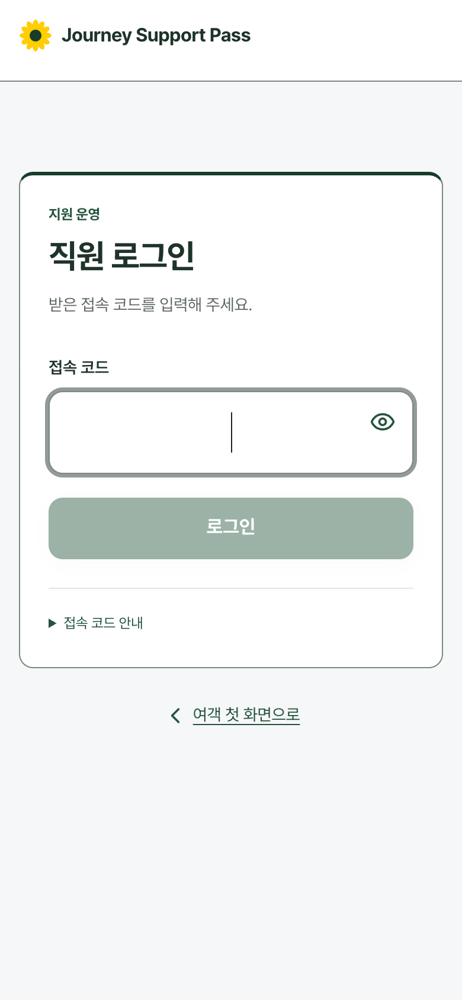 | 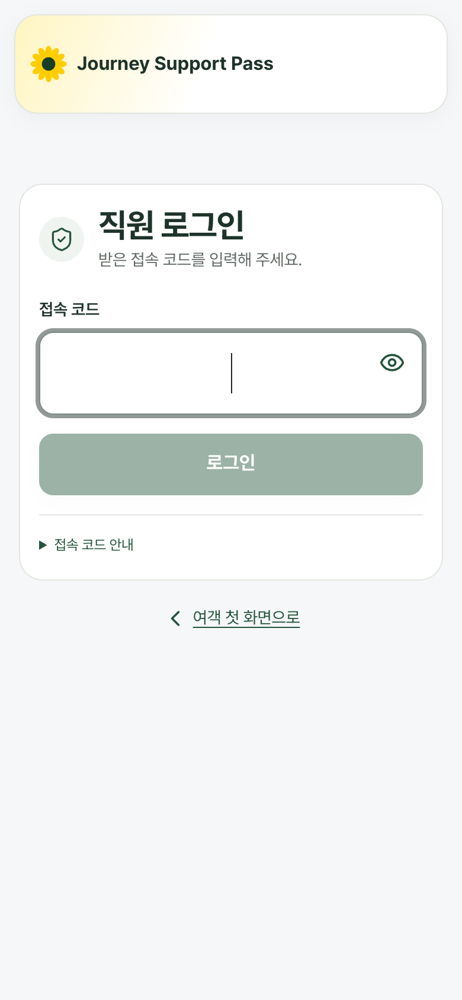 |
| 로그인 1333×750 | 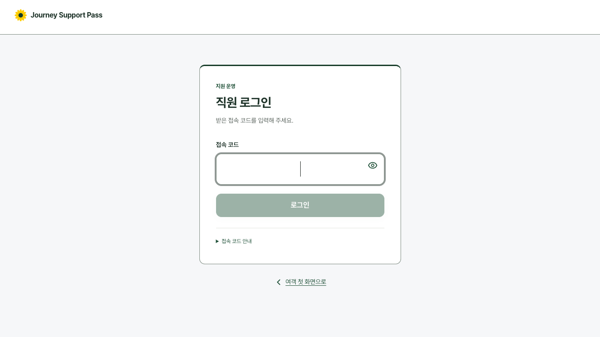 | 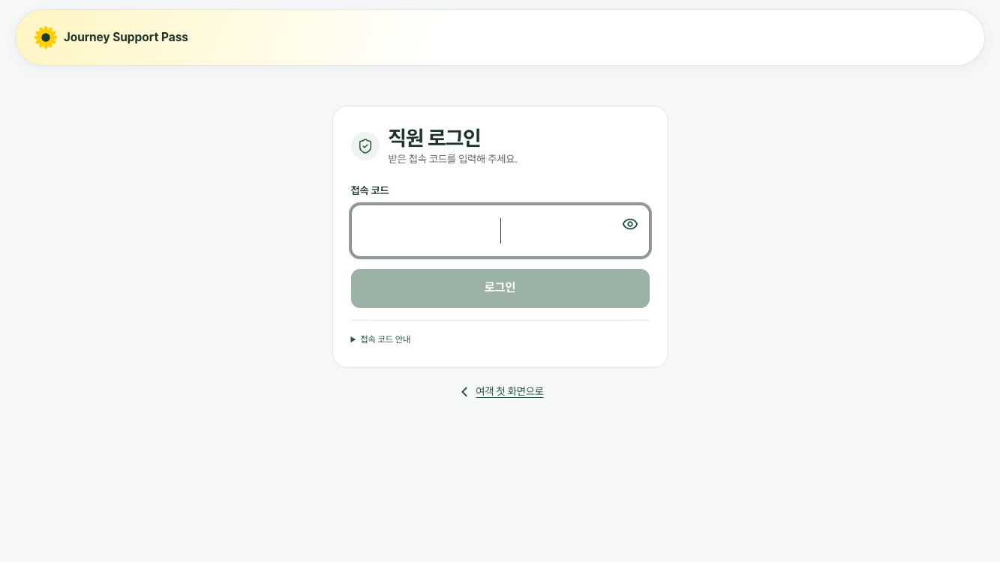 |
| 로그인 1280×633 | 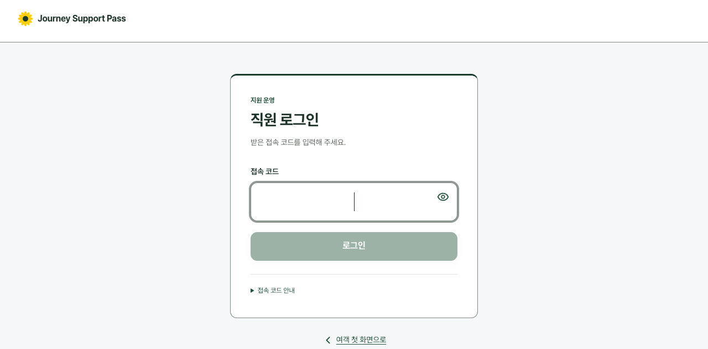 | 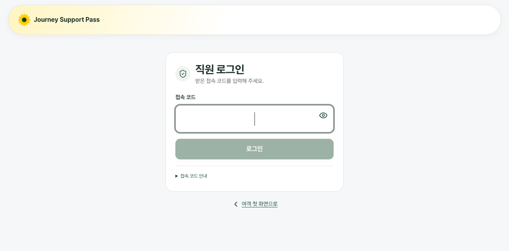 |
| 접수·배정(안내데스크) 390×844 | 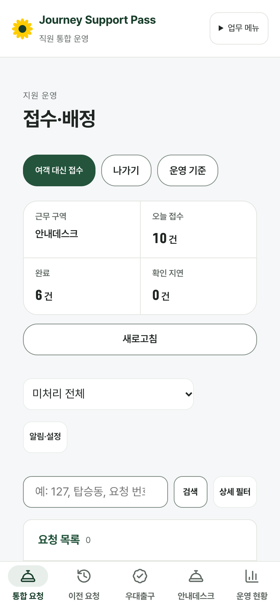 | 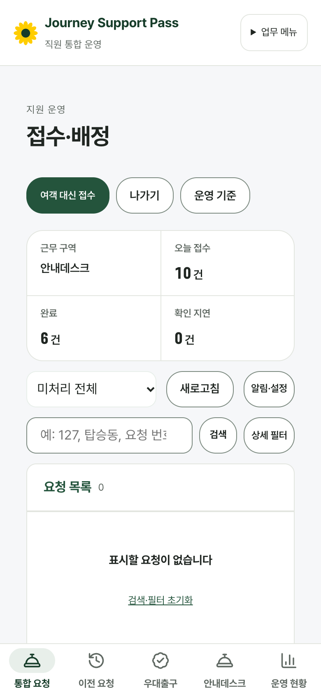 |
| 접수·배정(안내데스크) 1333×750 | 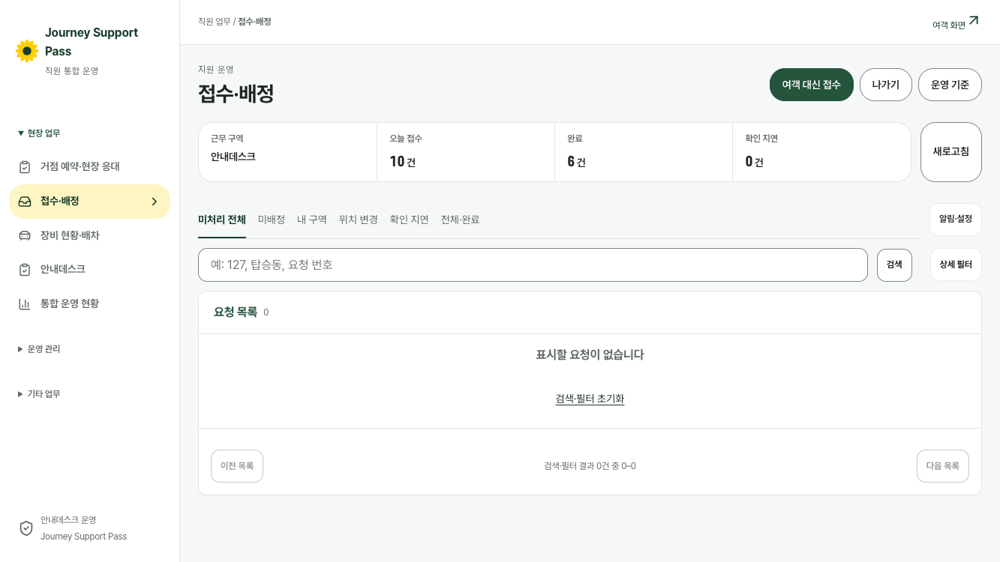 | 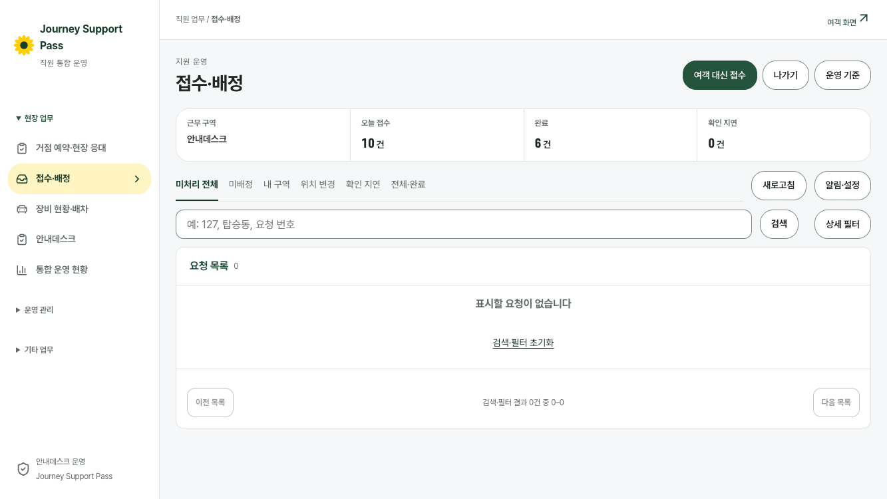 |
| 접수·배정(안내데스크) 1280×633 | 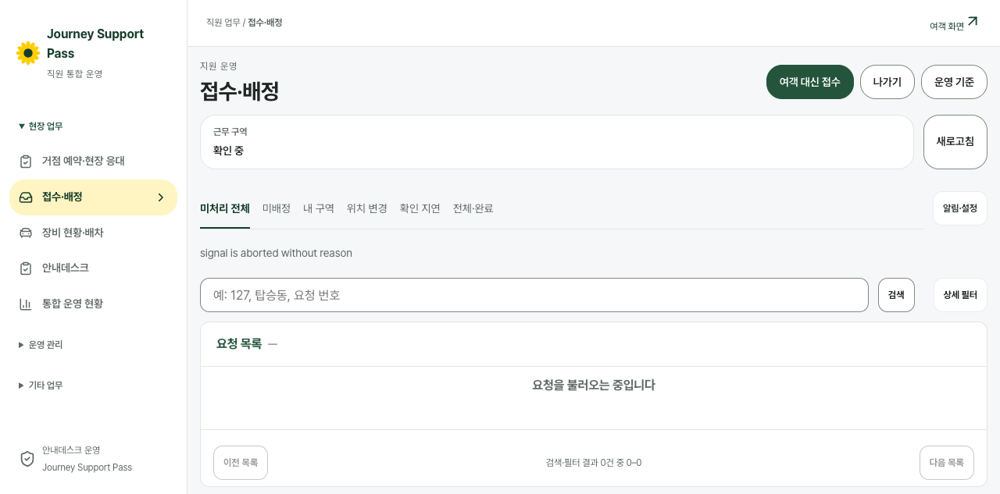 | 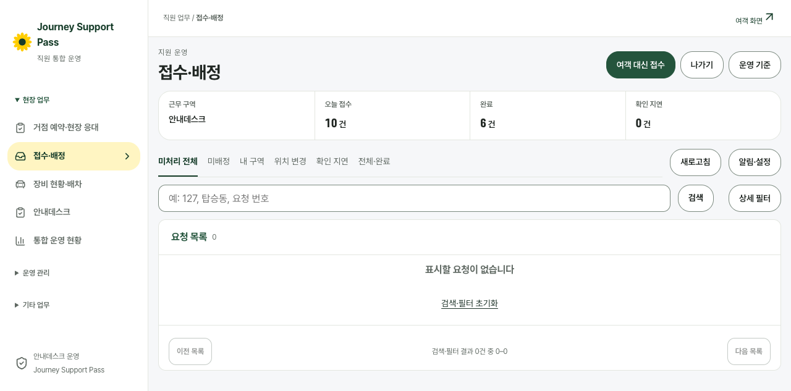 |
| 접수·배정(현장 직원) 390×844 | 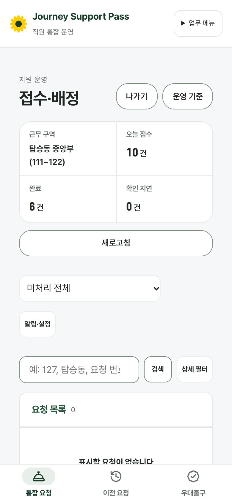 | 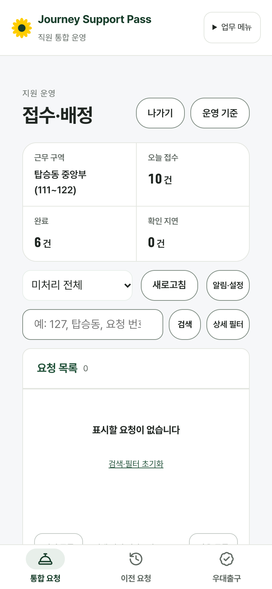 |
| 접수·배정(현장 직원) 1333×750 | 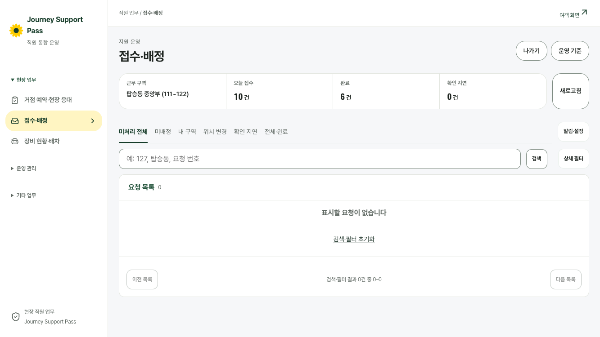 | 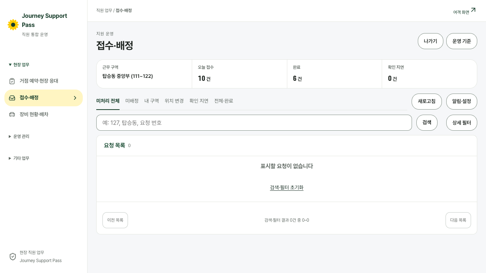 |
| 접수·배정(현장 직원) 1280×633 | 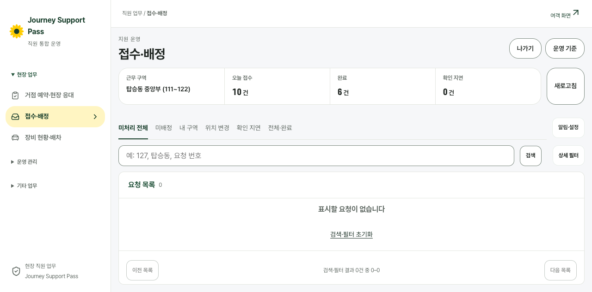 | 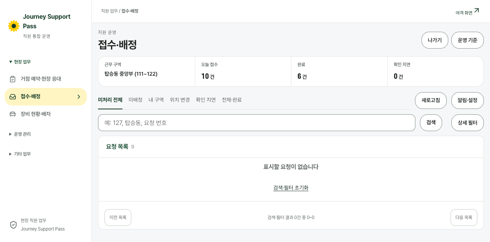 |

## 남은 문제
- 왼쪽 업무 메뉴는 흰 바탕이다. `docs/design-system.md`에는 「딥그린 메뉴」라고 되어 있다. 메뉴(`StaffFrame`)는 모든 직원 화면이 함께 쓰는 부품이라 이 PR 범위 밖으로 두었다.
- 휴대전화의 접수·배정 화면은 머리 위 여백이 크다. 업무 메뉴 띠 아래 공통 여백이라 이번에는 그대로 뒀다.
- 태블릿 768에서는 범위 탭 줄이 좁아 「확인 지연」「전체·완료」가 탭 줄 안에서 옆으로 스크롤된다(전과 같음).
