# 글자 크기 선택 상태의 색

- 기존 site-bar.css의 선택 상태 두 규칙만 수정했다. 위쪽 바 크기·배치와 #114의 모바일 작업은 변경하지 않았다.
- 선택 상태는 --color-primary 바탕 + --color-surface 글자로 통일했다. 공유 기기 버튼의 테두리도 --color-primary를 쓴다.
- 계산된 색은 흰 글자·딥그린 배경이며 대비는 8.72:1이다. 새 색은 추가하지 않았다.

## 검사

- tsc 오류 0개, eslint 오류 0개·기존 경고 3개.
- Vitest 1,015개 통과·5개 건너뜀(파일 64개 통과·1개 건너뜀).
- layout-check: 216개 화면, 문제 0개.
- e2e: 289/289 통과.
- 색 대비 원본 검사 15개 조합 모두 통과.

## 실제 화면

| 화면 | 크기 | 전 | 후 |
|---|---|---|---|
| home | 390×844 | 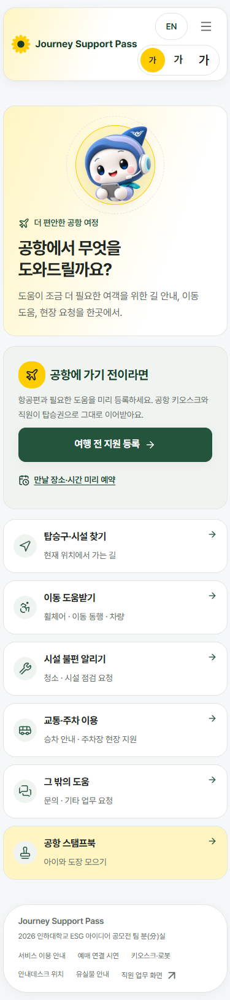 | 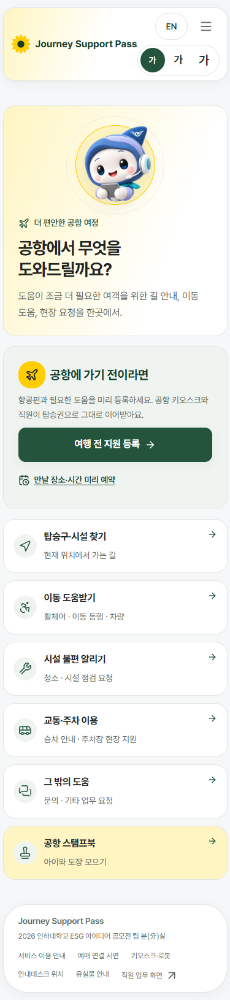 |
| prepare | 390×844 | 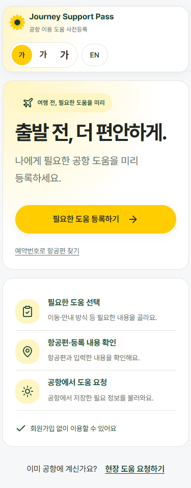 | 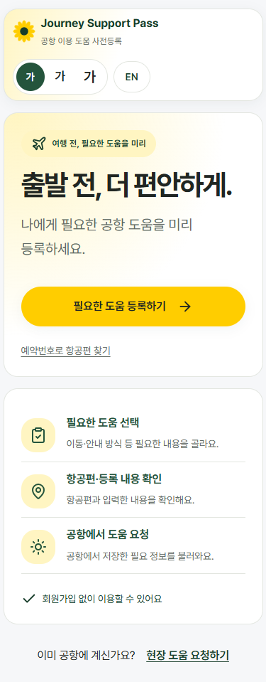 |
| booking | 390×844 | 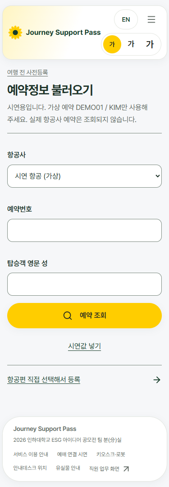 | 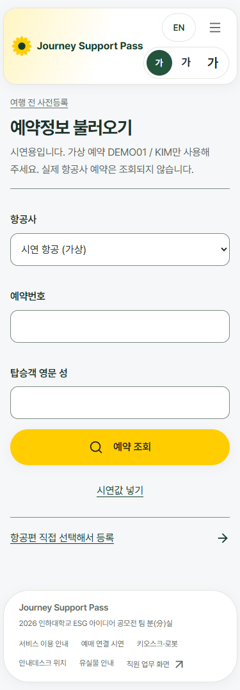 |
| home | 1333×750 | 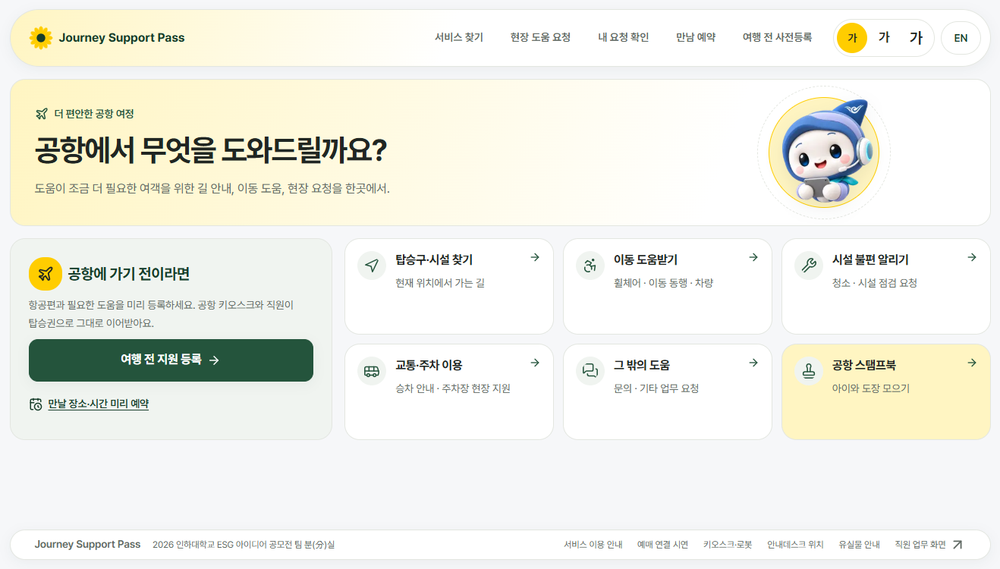 | 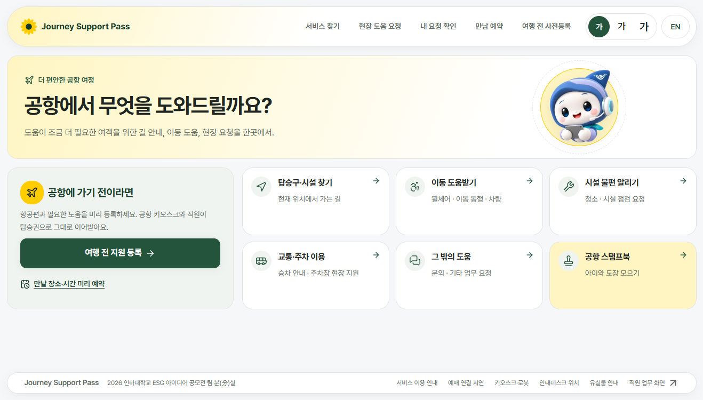 |
| prepare | 1333×750 | 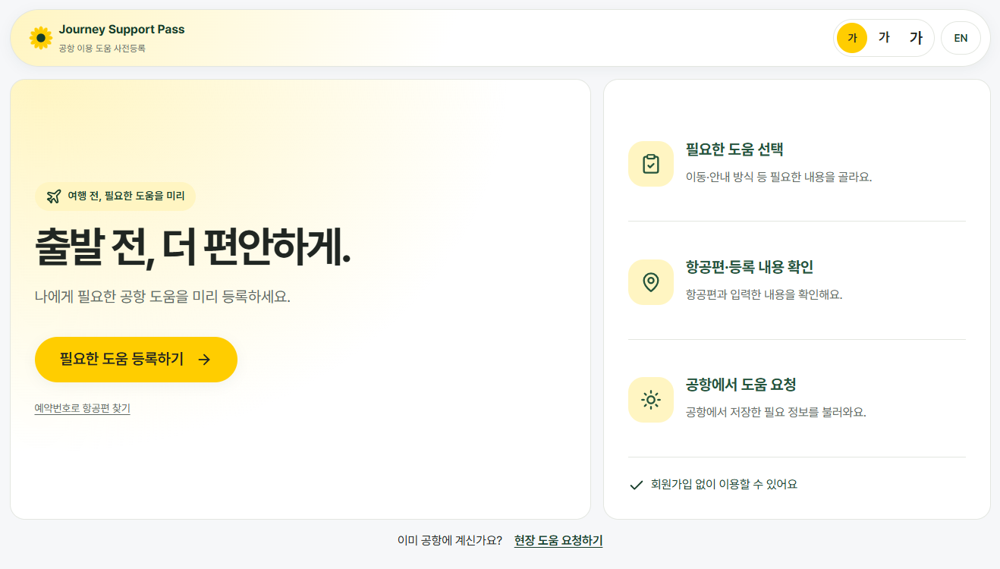 | 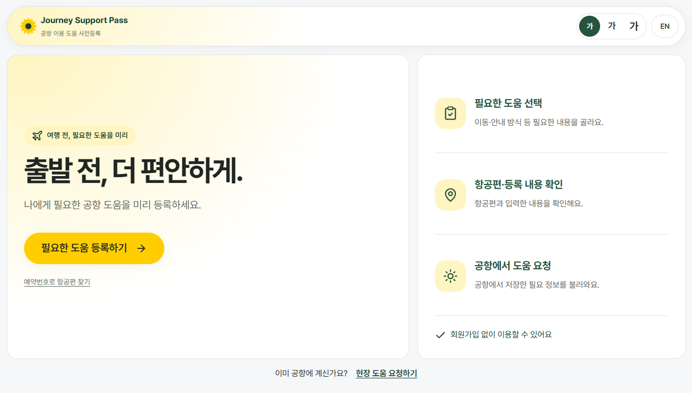 |
| booking | 1333×750 | 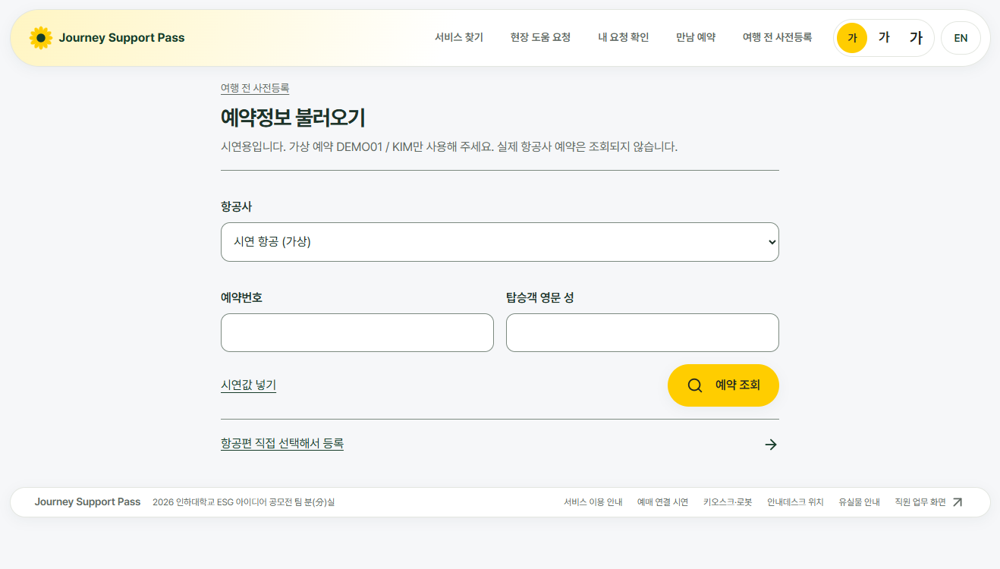 | 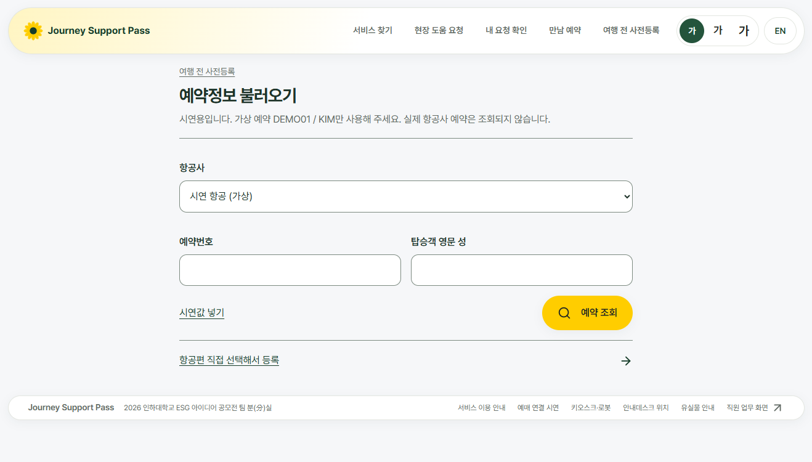 |
| 공유 기기의 글자 크게 선택 | 1920×1080 | 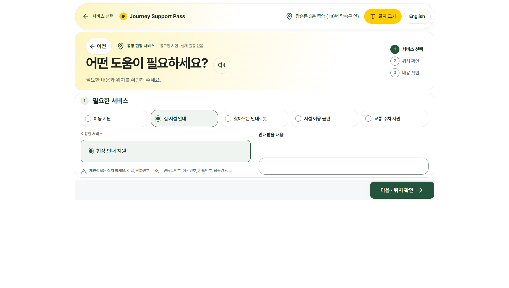 | 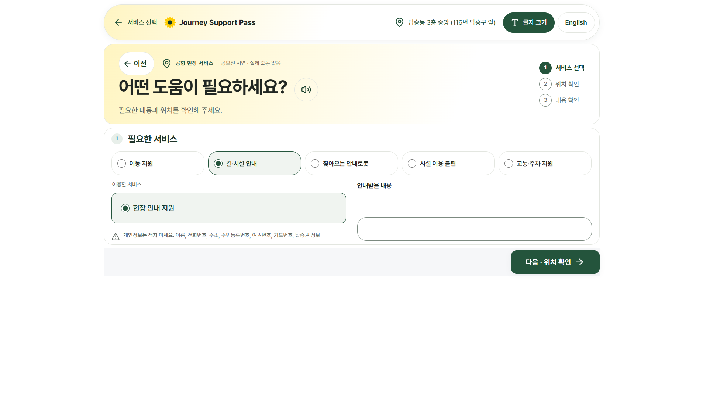 |

공유 기기의 변경 전 이미지는 같은 브라우저에서 원본 색상 선언을 CSSOM에 복원해 촬영했다. 임시 측정 스크립트는 저장소 밖에 두었다.

## 남은 점

- 실물 터치 기기·화면 읽기 프로그램은 확인하지 않았다.
- #114의 모바일 바 높이·배치와 지도 문제는 이번 색상 수정의 범위가 아니다.
