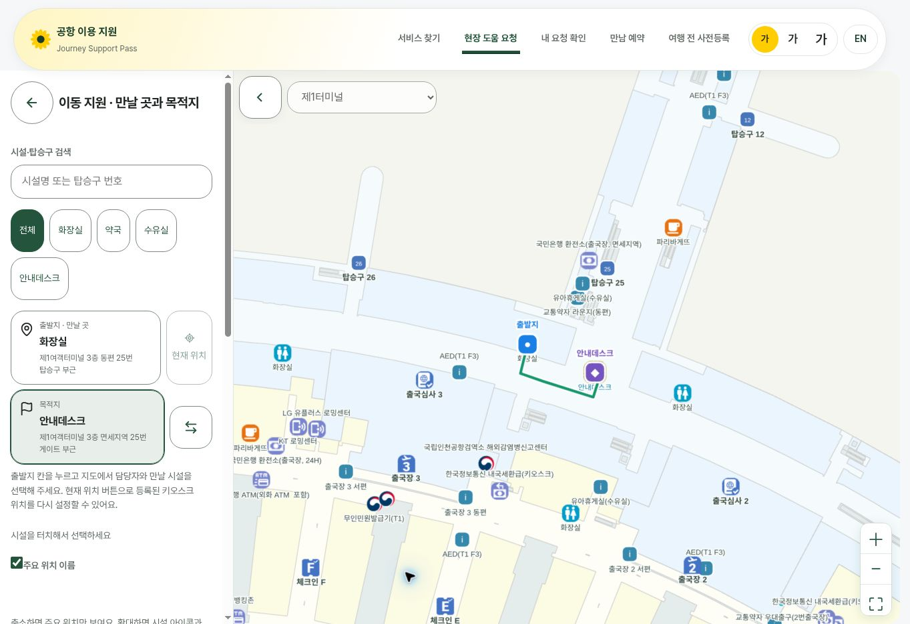
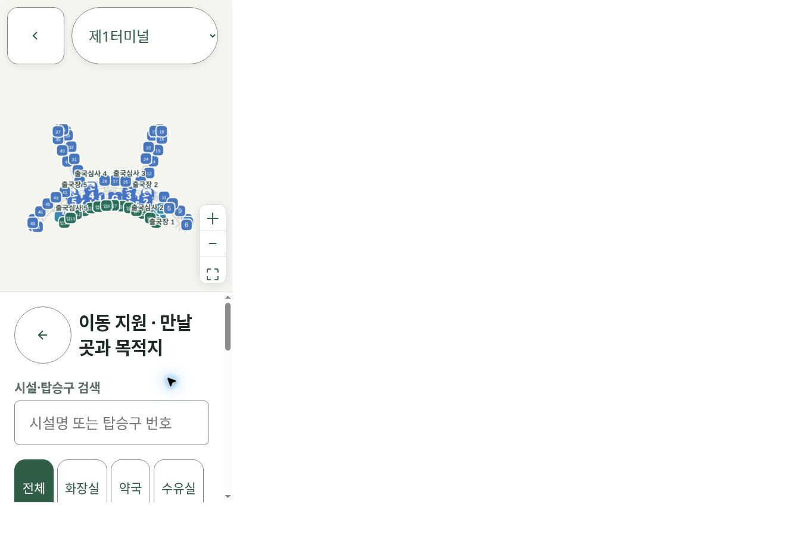
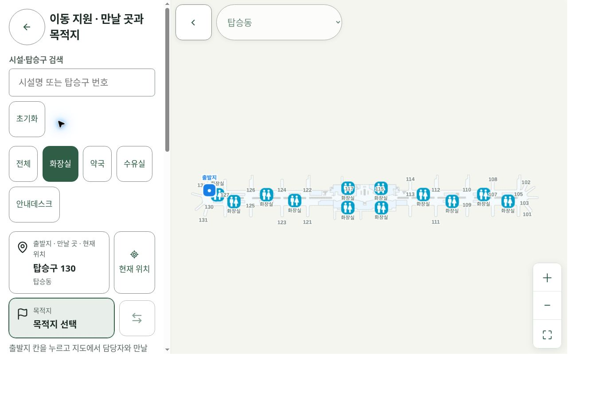

# 공통 지도와 이동지원 시설 출발지 PR

## 결과

시설 검색·터치 선택·출발지/목적지·현재 위치·가까운 시설·경로 계산을 공통 코드로 통합했다. 이동지원은 지도 시설을 만날 곳으로 선택하고 직원에게 요청한다. 탑승구 전용 출발지 제한을 제거했다. 지도 확대에 따른 네 단계 시설 표시, 검색 결과 표시, 주요 위치 이름과 이름 겹침 처리를 포함한다. 탑승구·시설 찾기의 키오스크/저니봇 시연 마무리를 유지하고, 이동지원에는 저니봇 안내 절차를 넣지 않는다.

## 검사

- TypeScript 통과.
- 전체 src ESLint: 오류 0, 기존 경고 3 (RegisterFlow 의존성, StampBook 이미지).
- 전체 Vitest: 1,006개 통과, 5개 건너뜀 (63개 파일 통과, 1개 파일 건너뜀).
- Next.js 전체 빌드 통과. 최신 main 반영 후 빌드 결과 확인.
- 실제 Next 화면: 출발지 미선택 시설 표시, 탑승구25→화장실92m, 화장실→안내데스크49m, 요청 확인에 시설명 유지, 시설 간 출발지/목적지 교환 확인. 운영 접수 제출은 하지 않음.
- API 자동 테스트: 키오스크·모바일 시설 출발지 저장·조회, 직원 목록 표시, 모르는 ID 거절 확인.
- `scripts/layout-check.ts`, `scripts/e2e.ts`: 미실행. 관리형 브라우저는 CUA 경로를 사용하므로 로컬 Chromium을 실행하는 기존 Puppeteer 점검은 실행하지 않음. 아래 화면 확인이 해당 스크립트 통과를 대신하지 않음.
- 모든 기기·글자 크기 조합, 실제 하드웨어, Vercel 미리보기 검증은 남아 있음. 검토용 Draft PR로 준비.

## 화면

실제 Next 앱의 이동지원 시설 출발지와 경로:

휴대전화·키오스크 확인 자료는 공통 React 컴포넌트를 불러온 로컬 확인 화면이며, 로그인·접수까지 포함한 전체 기기 검증은 아니다.

## 범위와 출처

DB 스키마 변경 없음. `layout.tsx`에 CSS 덮어쓰기 파일을 추가하지 않고 공통 상단 바를 유지했다. 실제 로봇 이동 제어는 없다.

기존 지도 자료의 출처·이용 조건과 공개 재배포 허가 미확인 상태: [지도 자료 권리 기록](../public/airport-map/THIRD_PARTY_NOTICES.md).

main 병합과 운영 배포는 별도이다.

