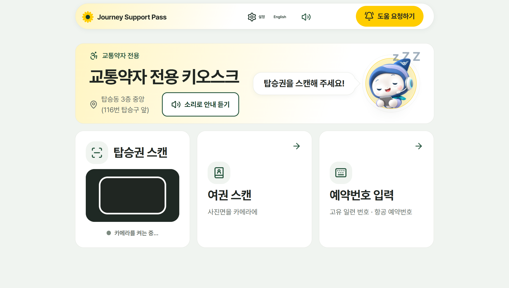
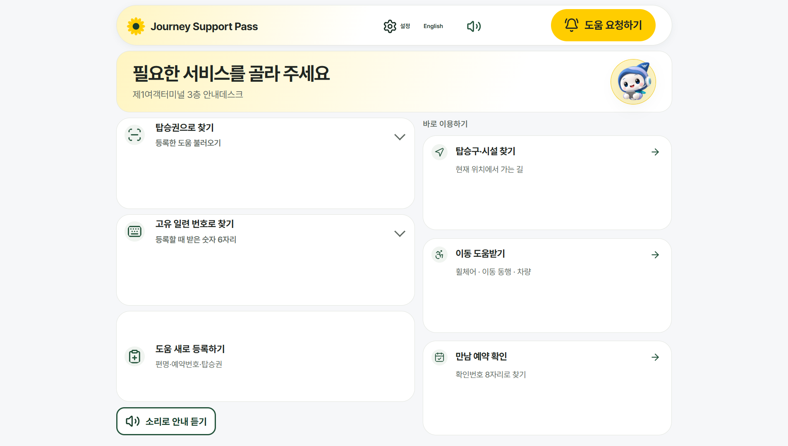
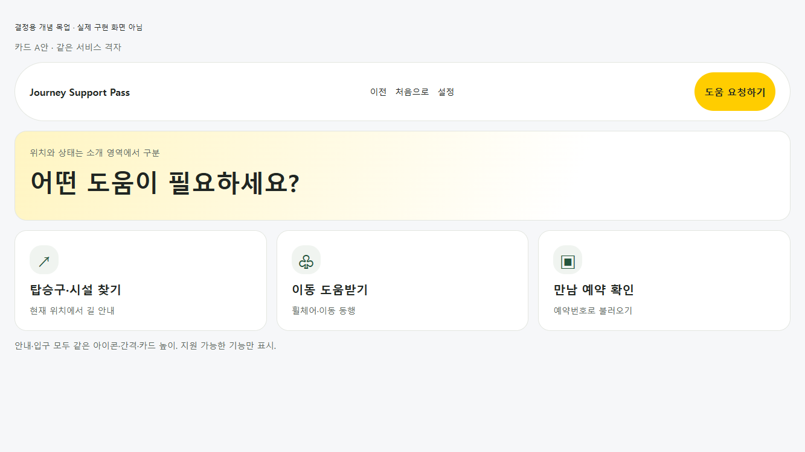
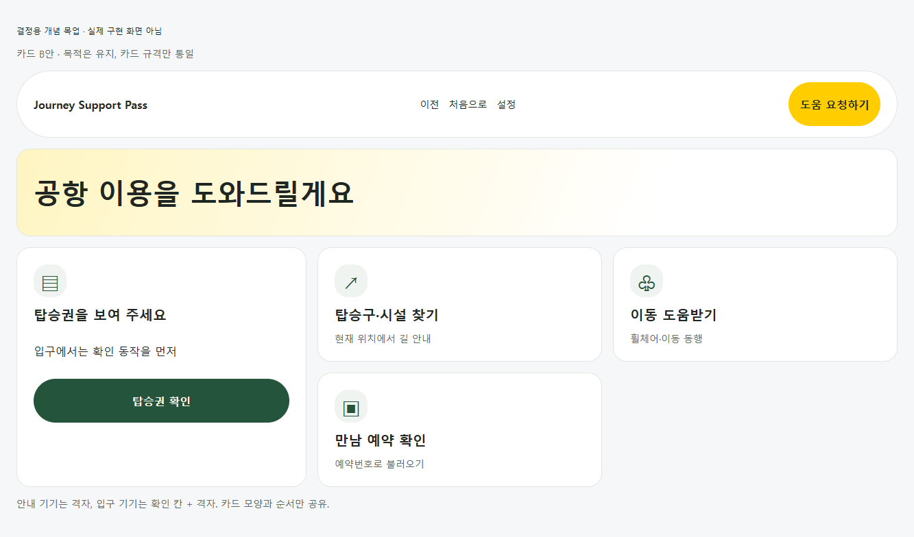
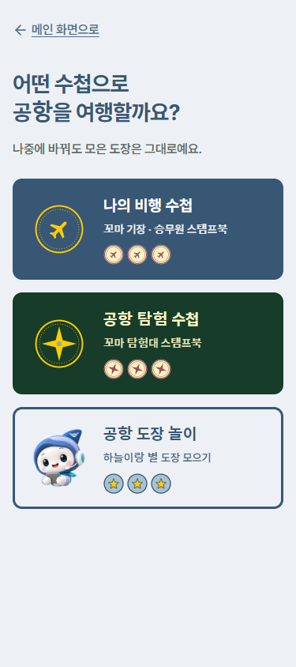
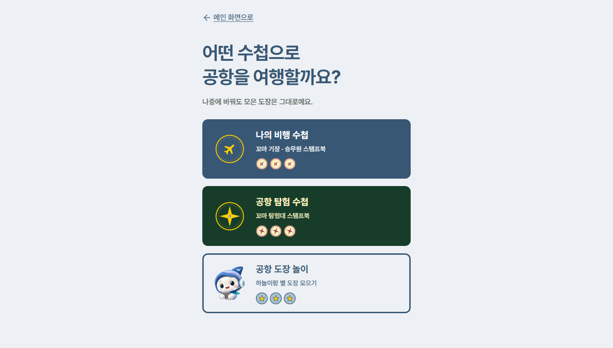
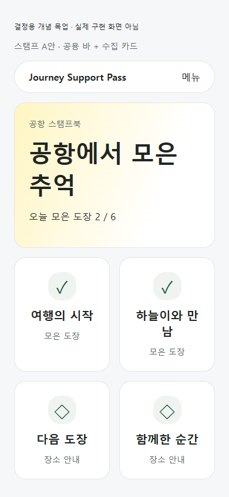
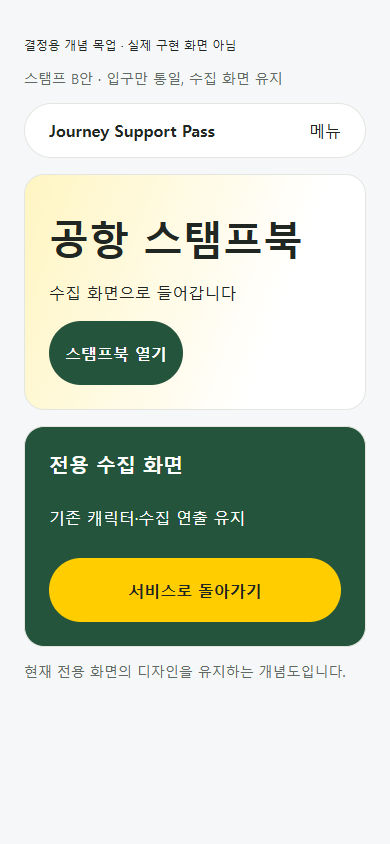

# 키오스크 카드·스탬프 화면 정리 방안 — 결정 필요

코드 변경 없이 비교하는 제안입니다. 기준은 main `48a2e72`(#116·#119 포함)이며, 아래 현재 화면은 로컬 main을 실제 Chrome에서 열어 찍었습니다. 목업은 **개념도**이며 구현·반응형 검증을 마친 화면이 아닙니다. 목업의 수집 수치·문구는 예시이고 새 기능을 제안하는 뜻이 아닙니다. 최종 결정 전 CSS·컴포넌트는 바꾸지 않습니다.

## 1. 안내·입구 기기의 카드 배치

### 현재

안내 기기는 하늘이 소개와 탑승권·번호 입력 동작이 중심이고, 입구 기기는 확인 동작과 서비스 카드가 좌우로 나뉩니다. 둥근 바·색 토큰은 공유하지만 카드가 시작하는 위치와 격자 구조가 다릅니다. 두 접점의 역할도 달라, 모양 통일과 역할 통일을 구분해야 합니다.

| 실제 화면 | 1920×1080 |
|---|---|
| 안내 기기 첫 화면 |  |
| 입구 기기 첫 화면 |  |

### A안: 서비스 격자 전체 통일

- 두 화면 모두 소개 영역 아래 같은 카드 격자·순서·높이를 사용합니다. 위치·현재 단계는 소개 영역에서 구분합니다. 지원하지 않는 서비스는 새로 추가하지 않습니다.
- 장점: 다른 기기로 이동해도 같은 위치에서 같은 서비스를 찾습니다. 공용 부품과 실측 기준이 단순해집니다.
- 단점: 입구의 탑승권 확인 동작이 서비스 격자에 묻힐 수 있습니다. 첫 화면과 확인 후 화면의 역할까지 다시 설계해야 합니다.
- 예상 규모: 중간~큼. 두 기기 첫 화면·서비스 상태 분기, 소리 안내 순서, 전체 e2e와 기기 3크기·큰 글자 검증이 필요합니다.

### B안: 역할별 배치 유지 + 카드 규격 통일 — 추천

- 안내는 안내 중심 격자, 입구는 탑승권 확인 칸 + 서비스 격자를 유지합니다. 같은 서비스의 아이콘 칩·카드 높이·안쪽 여백·제목 위치·순서만 공유합니다. 세로 화면에서는 같은 순서로 아래에 쌓습니다.
- 장점: 기기별 핵심 행동과 기존 흐름을 보존하면서 시각적 단절을 줄입니다. 변경 범위와 회귀 위험이 더 작습니다.
- 단점: 격자 전체 모양은 계속 다릅니다. 공통 카드와 기기별 바깥 배치의 경계를 문서화해야 합니다.
- 예상 규모: 중간. 기존 카드 부품·원래 기기 CSS의 정리와 상태별 실측이 필요합니다. API·저장 구조 변경은 예상하지 않습니다.

**결정 요청:** 카드 규격만 먼저 맞추는 B안으로 진행할지, 화면 구조까지 맞추는 A안으로 진행할지 선택이 필요합니다.

## 2. 스탬프북의 독립 디자인과 공용 바

### 현재

`/stamp` 입구는 공용 둥근 바 대신 「메인 화면으로」 링크를 쓰며, 파랑·딥그린의 큰 수첩 선택 카드 3개를 보여 줍니다. 일반 서비스 화면에서 들어오면 다른 서비스처럼 느껴집니다. 수첩 종류와 수집 화면의 개성은 보존할 가치가 있습니다.

| 크기 | 문서 높이 / 화면 높이 | 옆 넘침 | 실제 화면 |
|---|---|---|---|
| 390×844 | 844 / 844 | 0 |  |
| 1333×750 | 750 / 750 | 0 |  |

### A안: 공용 바와 카드 틀을 스탬프 화면에도 적용 — 추천

- 공용 바·소개 영역·흰 카드와 아이콘 칩을 사용합니다. 수첩 선택·도장 상태·캐릭터는 콘텐츠로 유지합니다. 입구 3종 선택이나 저장된 수집 상태를 없애지 않습니다.
- 장점: 서비스 이동·설정 위치가 일정해집니다. 공용 접근성·반응형 기준을 재사용합니다.
- 단점: 바가 차지하는 높이만큼 카드 배치를 조정해야 합니다. 기존 수집 화면의 고유한 분위기가 줄어듭니다.
- 예상 규모: 중간~큼. 입구뿐 아니라 각 수첩·도장·완료·복귀 상태를 목록화한 뒤 단계별로 적용해야 합니다. 수집 저장 규칙은 유지합니다.

### B안: 공용 입구만 만들고 전용 수집 화면 유지

- 서비스에서 들어오는 입구는 공용 틀을 사용하고, 수집 화면은 기존 연출을 유지합니다. 전용 화면에도 서비스 복귀 동작과 접근 가능한 이름은 유지합니다.
- 장점: 기존 게임 분위기를 지키며 작은 변경으로 서비스와 연결합니다.
- 단점: 입구와 수집 화면 사이의 디자인 차이는 남습니다. 한 번 더 누르는 입구를 새로 만들 경우 불필요한 단계가 늘 수 있습니다.
- 예상 규모: 작음~중간. 입구·복귀 연결이 중심입니다. 별도 입구 클릭을 추가하지 않는 방식부터 검토해야 합니다.

**추천:** 장기 목표는 A안입니다. 우선 입구 3종 선택의 의미를 그대로 유지해 공용 틀에 넣고, 각 수집 화면은 별도 상태 점검 후 옮기는 방식이 안전합니다. 이번 문서에는 구현을 포함하지 않습니다.

## 결정 후 검증 범위

- 카드: 안내·입구의 첫 화면과 확인 후 서비스 화면, 1920×1080·1024×768·1080×1920, 글자 1·1.5배. 공용 도움 버튼 크기·위치·가림도 재확인합니다.
- 스탬프: 320·390 휴대전화와 1333×750 노트북, 수첩 종류별 입장·수집·완료·복귀. 저장된 상태가 유지되는지 확인합니다.
- 목업의 누르는 크기·가림·모든 상태는 아직 재지 않았습니다. 구현 PR에서 실제 UI로 다시 측정해야 합니다.
- 운영 실측은 접속 코드 문제로 건너뜀. 관리자가 운영 화면을 직접 확인하며, 이번 실제 캡처는 로컬 main 기준입니다.
- 문서 전용 변경입니다. 자동 검사 기준선은 같은 main의 tsc 오류 0, eslint 오류 0·기존 경고 3개, vitest 1015 통과·5 건너뜀, 배치 216개·문제 0개, 전체 e2e 295/295입니다. 이 제안의 구현이 검증됐다는 뜻은 아닙니다.
